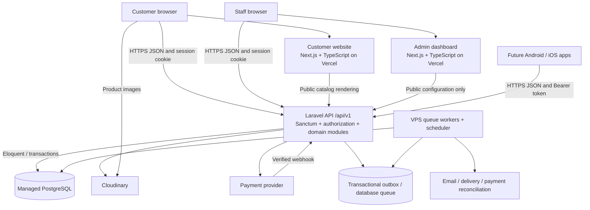
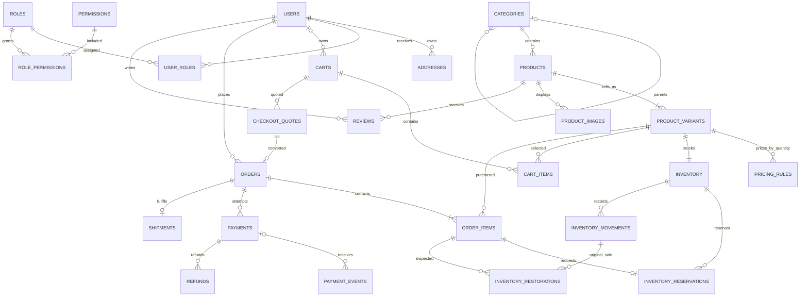

# FatihaAllOver E-Commerce Platform — Architecture Blueprint

Version: 1.1  
Date: 10 October 2026  
Status: Architecture review corrections applied; ready for phased implementation subject to section 10.3 business decisions  
Audience: Product owner, backend/frontend/mobile developers, QA, and operations

This document defines the system boundaries, initial relational schema, API contract, transaction rules, and delivery sequence. It contains no application implementation or scaffolding. Requirements supplied by the owner are treated as fixed; additional business choices are explicitly identified as proposed defaults.

## Architecture decisions at a glance

| Area | Decision |
|---|---|
| Backend | One Laravel API organized as a modular monolith |
| Clients | Separate Next.js + TypeScript customer and admin applications; future Android/iOS clients |
| Data | Managed PostgreSQL, accessed exclusively by Laravel through Eloquent and transactional database operations |
| Identity | One customer identity for both retail and bulk purchases; staff permissions are separate from customer pricing |
| Authentication | Sanctum sessions for first-party websites; Sanctum device tokens for future mobile clients |
| Pricing | Backend-owned quantity pricing per purchasable variant/SKU; immutable order price snapshots |
| Inventory | Reservation at checkout; stock deduction on order confirmation; audited compensating adjustments |
| Payment | Pending order before gateway interaction; verified callbacks and reconciliation determine payment outcome |
| Media | Cloudinary assets; database stores asset references and metadata |
| Hosting | Two Vercel frontend projects, Laravel API/workers/scheduler on VPS, managed PostgreSQL |

Proposed MVP defaults: Bangladesh delivery, BDT currency, whole-number quantities, one stock location, one primary category per product, guest browsing/cart with login required at checkout, one online payment gateway plus cash on delivery (COD) where enabled, and no backorders. These are scope assumptions, not additional requirements from the owner. Tax treatment, payment provider, delivery coverage/fees, and refund policy must be settled before their implementation and launch validation.

## 1. System architecture

### 1.1 Logical architecture

Both websites and future mobile apps consume the same business API. `/api/v1/admin` is a permission-protected route group inside that API, not a separate backend. No frontend connects directly to PostgreSQL or decides trusted prices, stock, roles, payment results, or order transitions.

The customer website renders public catalog pages on the server for discoverability and speed. Its browser performs authenticated account/cart/checkout requests directly to Laravel. The admin application is a protected client interface; every data request is independently authorized by Laravel. Authenticated server rendering may be added through an explicitly designed cookie-forwarding layer, but is unnecessary for the MVP.

Keep secrets and privileged data inside server-only boundaries. Never place database credentials, gateway secrets, Cloudinary API secrets, or privileged access tokens into frontend public environment variables or client bundles. This follows the separation described in [Next.js data security guidance](https://nextjs.org/docs/app/guides/data-security).

### 1.2 Backend responsibilities and module boundaries

Use one deployable Laravel application and one relational database initially. This provides atomic orders, pricing, and inventory transactions without distributed transaction infrastructure. Modules own their business rules and write operations; modules may share a transaction through an application service.

Request path: route and middleware → validated request → authorization policy → application/domain service → Eloquent/database transaction → API resource response. Controllers stay small. Cross-module workflows such as checkout call explicit services; they do not duplicate rules in controllers, jobs, or frontend components.

Eloquent handles relationships and routine persistence. Database constraints, row locking, and explicit transactions enforce invariants under concurrent requests. Avoid a generic repository abstraction over every Eloquent model; introduce interfaces at external boundaries such as payments, delivery, and media.

Use durable outbox events for side effects after committed business changes. A dispatcher submits work to the queue and consumers tolerate duplicate delivery. Laravel supports database-backed queues and post-commit dispatch; the outbox additionally closes the crash gap between committing a transaction and publishing a job. [Laravel queue documentation](https://laravel.com/docs/13.x/queues)

### 1.3 Deployment and scaling

Illustrative production hostnames, subject to domain ownership:

| Host | Deployment | Responsibility |
|---|---|---|
| `www.fatihaallover.com` | Vercel customer project | Storefront |
| `admin.fatihaallover.com` | Vercel admin project | Staff interface |
| `api.fatihaallover.com` | VPS reverse proxy + PHP runtime | Laravel HTTPS API |
| Private database endpoint | Managed PostgreSQL | Business records, initial sessions/queue/cache |

Use HTTPS everywhere, a process supervisor for workers, and a scheduler for reservation expiry, reconciliation, and outbox dispatch. Keep PostgreSQL access limited to backend hosts through private networking where available, or firewall allowlisting with TLS. Frontends, mobile apps, and browsers receive no database credentials.

Start with PostgreSQL-backed queue, cache, and sessions to avoid adding an unrequested mandatory infrastructure service. Redis is an optional scaling step when queue/cache/session load justifies it. Stock correctness always remains in PostgreSQL.

Cache only public catalog/CMS responses, with invalidation after admin changes and a bounded fallback TTL. Quotes, checkout, payment status, addresses, and account responses are private and uncached. Browser-visible stock is advisory; checkout always reads authoritative inventory. Catalog caches never authorize a sale.

Scale through query/index tuning, media CDN delivery, additional queue workers, and then multiple API instances behind a load balancer. Shared sessions, queues, and database locks allow this progression. Read replicas and a dedicated search service are later options; checkout and immediately consistent reads use the primary database.

### 1.4 Repository responsibilities

| Existing directory | Planned responsibility |
|---|---|
| `backend/` | Laravel API, domain modules, migrations, tests, provider adapters |
| `fatihaallover-web/` | Customer Next.js application |
| `admin-panel/` | Admin Next.js application |
| `mobile-app/` | Future mobile clients; framework choice deferred |
| `documentation/` | Architecture, API specification, decisions, operational runbooks |

Publish a single OpenAPI contract from the backend boundary. Later generate TypeScript API types for both websites and client types suitable for mobile. Shared contracts do not mean shared frontend access to backend secrets or database models.

## 2. Backend module design

Modules are logical ownership boundaries within Laravel, not separate packages or services required at launch.

| Module | Purpose and main responsibilities | Important entities |
|---|---|---|
| Authentication | Register/login/logout, password reset, email verification, session/device revocation, staff MFA challenge | User, Session, PersonalAccessToken, AdminSecurity |
| Users | Customer profile, addresses, account status, staff roles/permissions, privacy workflows | User, Address, Role, Permission |
| Categories | Dynamic hierarchy, ordering, slugs, activation, reassignment and safe deletion | Category |
| Products | Product content, publication, category assignment, discoverability, media attachment | Product, ProductImage |
| Product Variants | Sellable SKU, option values, base price, availability, package/weight metadata | ProductVariant, ProductOption, ProductOptionValue, VariantOptionValue |
| Inventory | Available stock, reservations, adjustments, deduction, inspected restoration, low-stock alerts | Inventory, InventoryReservation, InventoryMovement, InventoryRestoration |
| Pricing Engine | Validate quantity tiers, calculate exact unit/line totals, version prices, produce checkout quotes | PricingRule, ProductVariant, CheckoutQuote |
| Cart | Guest and customer carts, quantity validation, cart merge, repricing, cart revisions | Cart, CartItem |
| Orders | Transactional checkout, immutable sale snapshots, controlled state transitions, cancellation/history | Order, OrderItem, OrderStatusHistory |
| Payments | Provider adapter, attempts, callback verification, reconciliation, COD collection, refunds | Payment, PaymentEvent, Refund |
| Delivery | Serviceability, delivery fee, shipment/tracking, fulfillment updates | DeliveryZone, DeliveryRate, Shipment |
| Reviews | Verified-purchase eligibility, rating, moderation, public aggregates | Review, OrderItem |
| CMS | Informational pages, banners, navigation blocks, publication workflow, media references | CmsContent, ProductImage where used for product media only |
| Notifications | Transactional order/payment messages, delivery attempts, retries and deduplication | NotificationDelivery, OutboxEvent |
| Settings | Public shop settings, validated operational configuration, revision tracking | Setting |

Cross-cutting facilities: authorization policies, audit records, request validation, idempotency records, API resources, rate limiting, structured logs, and correlation IDs. Secrets belong in deployment secret storage, not editable settings.

Admin dashboard statistics are queries/read models across orders, payments, inventory, and users. MVP aggregates distinguish confirmed sales, received funds, outstanding COD, refunds, and cancelled orders. Staff see only metrics their permissions allow.

## 3. Initial database design

### 3.1 Schema conventions

This is a logical schema suitable for translating into reviewed migrations later; it is not executable SQL.

- Unless otherwise stated, each table has `id BIGINT GENERATED BY DEFAULT AS IDENTITY PRIMARY KEY`, `created_at TIMESTAMPTZ NOT NULL`, and `updated_at TIMESTAMPTZ NOT NULL`. These common columns apply to every domain table below, including join tables.
- `PK` means primary key; `FK → table.column` means a foreign key; `UQ` means unique. `?` means nullable; all other columns are required. Foreign keys target `id` unless another column is named. IDs are serialized as strings in JSON to avoid JavaScript integer precision loss.
- All amounts ending `_minor` are `BIGINT` in currency minor units: BDT 800.00 = 80,000 poisha. Currency is `CHAR(3)`, initially `BDT`. Never use floating point for money. Bound accepted quantities and amounts to prevent multiplication/total overflow.
- Quantities are `INTEGER` with explicit positive/nonnegative checks. One SKU represents one sellable unit or package, such as a 500 g jar. Fractional quantity sales are outside the MVP.
- Store instants in UTC; display local business times using `Asia/Dhaka`. `DATE` is used only for calendar dates such as parcel delivery estimates.
- Status columns are `VARCHAR(32)` with database checks and application transition rules. Status names below define the initial vocabulary; they are not arbitrary user input.
- `JSONB` holds snapshots or structured ancillary content, never a substitute for stock, prices, user relationships, or permission links.
- Financial/audit rows are retained. Catalog deletion uses archive/soft deletion with `deleted_at TIMESTAMPTZ?`. Referenced records use `ON DELETE RESTRICT` unless explicitly noted.

### 3.2 Identity, roles, and addresses

| Table | Columns beyond common columns | Keys, checks, and relationships |
|---|---|---|
| `users` | `name VARCHAR(150)`, `email VARCHAR(254)`, `phone VARCHAR(32)?`, `password VARCHAR(255)`, `status VARCHAR(32)`, `email_verified_at TIMESTAMPTZ?`, `last_login_at TIMESTAMPTZ?`, `remember_token VARCHAR(100)?`, `deleted_at TIMESTAMPTZ?` | UQ normalized lowercase email; partial UQ normalized phone when present. Status `active`, `suspended`, `closed`. No wholesale flag or customer pricing role. |
| `roles` | `name VARCHAR(80)`, `description TEXT?` | UQ name; initial `customer`, `admin`, `super_admin`. Operational staff roles can be added. |
| `permissions` | `name VARCHAR(100)`, `description TEXT?` | UQ name such as `products.manage`, `orders.fulfill`, `payments.refund`, `settings.manage`. |
| `user_roles` | `user_id BIGINT`, `role_id BIGINT` | FKs → users, roles; UQ `(user_id, role_id)`. Delete links on parent removal where parent removal is permitted. |
| `role_permissions` | `role_id BIGINT`, `permission_id BIGINT` | FKs → roles, permissions; UQ pair; links may cascade on parent deletion. |
| `admin_security` | `user_id BIGINT`, `totp_secret_encrypted TEXT?`, `recovery_code_hashes JSONB`, `mfa_confirmed_at TIMESTAMPTZ?`, `last_totp_step BIGINT?` | FK → users; UQ user. Never expose through user API resources. Session MFA verification is separate from enrollment. Atomically advance last accepted TOTP step to prevent code replay; consume recovery hashes once. |
| `addresses` | `user_id BIGINT`, `label VARCHAR(60)?`, `recipient_name VARCHAR(150)`, `phone VARCHAR(32)`, `line1 VARCHAR(255)`, `line2 VARCHAR(255)?`, `city VARCHAR(100)`, `district VARCHAR(100)`, `postal_code VARCHAR(20)?`, `country_code CHAR(2)`, `is_default_shipping BOOLEAN`, `is_default_billing BOOLEAN` | FK → users. Partial UQ user for each true default flag. Order snapshots survive address editing/deletion. |

Authentication infrastructure tables must match the selected Laravel/Sanctum version. Planned shapes:

| Table | Columns and keys | Relationships |
|---|---|---|
| `personal_access_tokens` | Common columns; `tokenable_type VARCHAR(255)`, `tokenable_id BIGINT`, `name VARCHAR(255)`, `token CHAR(64) UQ`, `abilities TEXT?`, `last_used_at TIMESTAMPTZ?`, `expires_at TIMESTAMPTZ?` | Sanctum polymorphic owner; restrict supported owner type to User. Index owner pair; application enforces owner integrity and revocation. |
| `sessions` | Exception: `id VARCHAR(255) PK`, `user_id BIGINT?`, `ip_address VARCHAR(45)?`, `user_agent TEXT?`, `payload TEXT`, `last_activity INTEGER`; no common timestamps | FK → users with null on permitted deletion; indexes on user and activity. |
| `password_reset_tokens` | Exception: `email VARCHAR(254) PK`, `token VARCHAR(255)`, `created_at TIMESTAMPTZ?`; no common ID or updated timestamp | Laravel-managed reset token hash and expiry semantics; email association managed by authentication service. |

### 3.3 Catalog and variants

| Table | Columns beyond common columns | Keys, checks, and relationships |
|---|---|---|
| `categories` | `parent_id BIGINT?`, `name VARCHAR(150)`, `slug VARCHAR(180)`, `description TEXT?`, `is_active BOOLEAN`, `sort_order INTEGER`, `deleted_at TIMESTAMPTZ?` | Self FK → categories; UQ slug. Prevent self-parenting and cycles; restrict deleting parents with children or products. |
| `products` | `category_id BIGINT`, `name VARCHAR(200)`, `slug VARCHAR(220)`, `short_description TEXT?`, `description TEXT`, `status VARCHAR(32)`, `seo_title VARCHAR(200)?`, `seo_description VARCHAR(320)?`, `published_at TIMESTAMPTZ?`, `deleted_at TIMESTAMPTZ?` | FK → categories; UQ slug. Status `draft`, `active`, `archived`. One primary category in MVP. |
| `product_variants` | `product_id BIGINT`, `sku VARCHAR(100)`, `name VARCHAR(150)`, `option_signature VARCHAR(255)`, `base_price_minor BIGINT`, `currency CHAR(3)`, `weight_grams INTEGER?`, `is_active BOOLEAN`, `pricing_revision INTEGER`, `deleted_at TIMESTAMPTZ?` | FK → products; UQ sku; UQ `(product_id, option_signature)`; UQ `(id, product_id)` for composite FKs. Price ≥ 0, weight > 0 when set, revision ≥ 1. |
| `product_options` | `product_id BIGINT`, `name VARCHAR(80)`, `sort_order INTEGER` | FK → products; UQ `(product_id, name)`; UQ `(id, product_id)`. Examples size, color, volume. |
| `product_option_values` | `product_id BIGINT`, `product_option_id BIGINT`, `value VARCHAR(100)`, `sort_order INTEGER` | Composite FK `(product_option_id, product_id)` → product_options `(id, product_id)`; UQ `(product_option_id, value)` and `(id, product_option_id, product_id)`. |
| `variant_option_values` | `product_id BIGINT`, `product_variant_id BIGINT`, `product_option_id BIGINT`, `product_option_value_id BIGINT` | Composite FKs to variant `(id, product_id)` and option value `(id, product_option_id, product_id)`; UQ `(product_variant_id, product_option_id)`. One value per option for a variant; all belong to same product. |
| `product_images` | `product_id BIGINT`, `product_variant_id BIGINT?`, `cloudinary_asset_id VARCHAR(255)`, `cloudinary_public_id VARCHAR(255)`, `resource_type VARCHAR(30)`, `version BIGINT`, `secure_url TEXT`, `alt_text VARCHAR(255)?`, `sort_order INTEGER`, `is_primary BOOLEAN` | FK product → products; composite FK `(product_variant_id, product_id)` → variants `(id, product_id)` when variant present. UQ asset ID. Partial unique primary image per product when variant null, and per variant otherwise. |

Every product has at least one sellable variant, including a product without customer-selectable options. Its single default variant has `option_signature = 'default'`. For multi-option products, the signature is derived from canonical option/value IDs; option assignments and signature update atomically. Publication requires a complete valid variant configuration.

Initial category records may be Food & Beverage, Fashion & Style, Dress & Clothing, Home Decor Items, Sunnah & Islamic Products, and Perfume / Khushboo / Attar. They are ordinary editable records, never hard-coded application enums.

A category is visible only if it and every ancestor are active and undeleted. Its products become unavailable for new purchases when this condition fails. Existing orders remain intact. To delete a category, staff first reassign products and move/delete its children; deletion then soft-deletes the empty category. Return a conflict with dependency details otherwise. Prevent concurrent hierarchy cycles by serializing hierarchy mutations in a database transaction.

### 3.4 Pricing, inventory, and cart

| Table | Columns beyond common columns | Keys, checks, and relationships |
|---|---|---|
| `pricing_rules` | `product_variant_id BIGINT`, `min_quantity INTEGER`, `max_quantity INTEGER?`, `unit_price_minor BIGINT`, `is_active BOOLEAN` | FK → variants. Inclusive bounds; min ≥ 1; max ≥ min or null for unlimited; price ≥ 0. Active ranges for a variant cannot overlap. Currency inherited from variant. |
| `inventory` | `product_variant_id BIGINT`, `on_hand INTEGER`, `reserved INTEGER`, `low_stock_threshold INTEGER` | FK → variants; UQ variant; on_hand ≥ 0; 0 ≤ reserved ≤ on_hand; threshold ≥ 0. Available = on_hand − reserved; never independently stored. |
| `inventory_reservations` | `inventory_id BIGINT`, `order_item_id BIGINT`, `quantity INTEGER`, `status VARCHAR(32)`, `expires_at TIMESTAMPTZ`, `consumed_at TIMESTAMPTZ?`, `released_at TIMESTAMPTZ?` | FKs → inventory, order_items; UQ order item for MVP; quantity > 0; status `active`, `consumed`, `released`, `expired`. Item variant must match inventory variant through locked service validation. |
| `inventory_movements` | `inventory_id BIGINT`, `order_item_id BIGINT?`, `actor_user_id BIGINT?`, `type VARCHAR(32)`, `on_hand_delta INTEGER`, `reserved_delta INTEGER`, `reason TEXT`, `operation_key VARCHAR(150)` | FKs → inventory, order_items, users; UQ operation key. Types `receipt`, `reserve`, `release`, `sale`, `cancellation_restore`, `return_restore`, `adjustment`. Order item required for every type except receipt/adjustment; inventory variant must match item. Append-only; each movement updates counters atomically. |
| `inventory_restorations` | `order_item_id BIGINT`, `sale_movement_id BIGINT`, `movement_id BIGINT?`, `source_reference VARCHAR(150)`, `kind VARCHAR(32)`, `quantity_received INTEGER`, `quantity_restocked INTEGER`, `quantity_discarded INTEGER`, `actor_user_id BIGINT?`, `reason TEXT`, `inspected_at TIMESTAMPTZ` | FKs → order_items, inventory_movements (sale and restoration), users. UQ `(order_item_id, source_reference)`; UQ movement when present. Kind `cancellation` or `return`; received > 0; restocked/discarded ≥ 0 and sum to received. Restoration movement exists exactly when restocked > 0. Immutable physical disposition record; cumulative limits in section 8.3. |
| `carts` | `user_id BIGINT?`, `guest_token_hash CHAR(64)?`, `status VARCHAR(32)`, `currency CHAR(3)`, `revision INTEGER`, `expires_at TIMESTAMPTZ?` | FK → users; exactly one of user/guest hash set; UQ guest hash when present; partial UQ user where status `active`; statuses `active`, `converted`, `abandoned`; revision ≥ 1. |
| `cart_items` | `cart_id BIGINT`, `product_variant_id BIGINT`, `quantity INTEGER` | FKs → carts and variants; UQ `(cart_id, product_variant_id)`; quantity > 0; cart deletion cascades to items. No trusted stored price. |
| `checkout_quotes` | `user_id BIGINT`, `cart_id BIGINT`, `cart_revision INTEGER`, `payment_method VARCHAR(32)`, `currency CHAR(3)`, `snapshot JSONB`, `subtotal_minor BIGINT`, `discount_minor BIGINT`, `shipping_minor BIGINT`, `shipping_tax_minor BIGINT`, `tax_minor BIGINT`, `total_minor BIGINT`, `expires_at TIMESTAMPTZ`, `consumed_at TIMESTAMPTZ?` | FKs → users, carts. Payment method `online` or `cod`. Nonnegative amounts and total > 0; immutable server-generated snapshot of item monetary fields, pricing revisions, shipping/billing addresses, contact, delivery rate/revision, settings revisions, and tax/rounding policy. No separate quote revision; quote ID identifies one immutable offer. |

Pricing edits lock the owning variant and bump `pricing_revision`; checkout uses the same lock discipline. Active quantity intervals must also be enforced by a PostgreSQL exclusion constraint over the variant and a normalized integer range, with an active-only predicate. Nullable upper bounds represent infinity. This uses PostgreSQL range exclusion support and normally the managed database's `btree_gist` extension; confirm extension availability before migrations. [PostgreSQL range constraints](https://www.postgresql.org/docs/18/rangetypes.html)

### 3.5 Orders, payments, and delivery

| Table | Columns beyond common columns | Keys, checks, and relationships |
|---|---|---|
| `orders` | `order_number VARCHAR(40)`, `user_id BIGINT`, `cart_id BIGINT`, `checkout_quote_id BIGINT`, `status VARCHAR(32)`, `payment_status VARCHAR(32)`, `payment_method VARCHAR(32)`, `currency CHAR(3)`, `subtotal_minor BIGINT`, `discount_minor BIGINT`, `shipping_minor BIGINT`, `shipping_tax_minor BIGINT`, `tax_minor BIGINT`, `total_minor BIGINT`, `shipping_address_snapshot JSONB`, `billing_address_snapshot JSONB`, `delivery_snapshot JSONB`, `contact_snapshot JSONB`, `notes TEXT?`, `expires_at TIMESTAMPTZ?`, `confirmed_at TIMESTAMPTZ?`, `cancelled_at TIMESTAMPTZ?`, `cancellation_reason TEXT?` | UQ order number, cart, quote; FKs → users, carts, checkout_quotes. One placed order per converted cart and quote. Amounts nonnegative, total > 0, formulas in section 7.3. Payment method `online` or `cod`; statuses in section 8. |
| `order_items` | `order_id BIGINT`, `product_id BIGINT`, `product_variant_id BIGINT`, `pricing_rule_id BIGINT?`, `product_name VARCHAR(200)`, `variant_name VARCHAR(150)`, `sku VARCHAR(100)`, `options_snapshot JSONB`, `quantity INTEGER`, `unit_price_minor BIGINT`, `price_includes_tax BOOLEAN`, `line_subtotal_minor BIGINT`, `discount_minor BIGINT`, `tax_minor BIGINT`, `line_total_minor BIGINT`, `pricing_snapshot JSONB` | FKs → orders, products; composite FK variant/product → product_variants; pricing FK → pricing_rules with SET NULL if removed. UQ `(order_id, product_variant_id)`; quantity > 0; unit price and line total > 0. Unit price preserves catalog tax basis; line subtotal is net of tax. Exact formulas in section 7.3; snapshots are authoritative historical sale facts. |
| `order_status_history` | `order_id BIGINT`, `from_status VARCHAR(32)?`, `to_status VARCHAR(32)`, `actor_user_id BIGINT?`, `reason TEXT?`, `operation_key VARCHAR(150)` | FKs → orders, users; UQ operation key. Append-only history including system transitions. |
| `payments` | `order_id BIGINT`, `provider VARCHAR(60)`, `merchant_reference VARCHAR(100)`, `provider_payment_id VARCHAR(150)?`, `status VARCHAR(32)`, `amount_minor BIGINT`, `currency CHAR(3)`, `paid_at TIMESTAMPTZ?`, `failure_code VARCHAR(100)?`, `last_reconciled_at TIMESTAMPTZ?` | FK → orders; UQ merchant reference; partial UQ `(provider, provider_payment_id)` when present. Amount > 0. Status `created`, `pending`, `unknown`, `succeeded`, `failed`, `cancelled`. Partial UQ order where status is created/pending/unknown prevents simultaneous active attempts. Multiple historical attempts and successful receipts remain representable. |
| `payment_events` | `payment_id BIGINT?`, `provider VARCHAR(60)`, `provider_event_id VARCHAR(150)`, `payload JSONB`, `verification_status VARCHAR(32)`, `processing_status VARCHAR(32)`, `processing_claim UUID?`, `processing_lease_until TIMESTAMPTZ?`, `received_at TIMESTAMPTZ`, `processed_at TIMESTAMPTZ?`, `last_error TEXT?` | FK → payments; UQ `(provider, provider_event_id)` for accepted verified events; verification status `verified`; processing status `unmatched`, `pending`, `processing`, `processed`, `retryable_failed`, `dead_letter`. Invalid signatures are rejected and logged separately, never claiming a provider event ID. Payload sanitized and size limited; adapter derives stable event key if absent. |
| `refunds` | `payment_id BIGINT`, `amount_minor BIGINT`, `reason TEXT`, `status VARCHAR(32)`, `merchant_refund_reference VARCHAR(100)`, `provider_refund_id VARCHAR(150)?`, `requested_by BIGINT?`, `operation_key VARCHAR(150)`, `completed_at TIMESTAMPTZ?` | FKs → payments, users; null requester denotes an audited system action. UQ operation key and merchant refund reference; partial UQ `(payment_id, provider_refund_id)`; amount > 0. Status `requested`, `processing`, `succeeded`, `failed`, `unknown`. Sum of requested + processing + unknown + succeeded amounts cannot exceed captured amount; serialize against order/payment. |
| `delivery_zones` | `name VARCHAR(100)`, `country_code CHAR(2)`, `district VARCHAR(100)`, `is_active BOOLEAN`, `revision INTEGER` | UQ country/district for MVP; unambiguous zone selection from normalized address. |
| `delivery_rates` | `delivery_zone_id BIGINT`, `name VARCHAR(100)`, `fee_minor BIGINT`, `currency CHAR(3)`, `estimated_min_days INTEGER`, `estimated_max_days INTEGER`, `cod_enabled BOOLEAN`, `is_active BOOLEAN`, `revision INTEGER` | FK → zones; fee ≥ 0; 0 ≤ min days ≤ max days. Flat rate per delivery method/zone initially. |
| `shipments` | `order_id BIGINT`, `delivery_rate_id BIGINT?`, `carrier VARCHAR(100)?`, `tracking_number VARCHAR(150)?`, `status VARCHAR(32)`, `shipped_at TIMESTAMPTZ?`, `delivered_at TIMESTAMPTZ?`, `failed_at TIMESTAMPTZ?`, `notes TEXT?` | FK → orders; rate FK SET NULL on allowed deletion; UQ order for MVP; UQ carrier/tracking when both present. Status `pending`, `shipped`, `delivered`, `failed`, `returned`. One parcel per order initially. |

Quotes and orders retain snapshots after address/rate changes. Payment records must never contain card numbers, CVVs, banking passwords, or gateway credentials. A provider-hosted payment page handles sensitive payment entry. Payment metadata and logs are restricted to what reconciliation needs.

Both `payments` and `refunds` additionally have `dispatch_claim UUID?` and `dispatch_lease_until TIMESTAMPTZ?` for durable ownership of provider work. Acquire/renew the claim in a short transaction under the canonical order/payment/refund locks before dispatch. A lease expiry permits reconciliation, not blind resubmission: the prior worker may have reached the provider. A worker must verify its claim before persisting its response and may not overwrite a newer authoritative result. These fields coordinate execution; immutable merchant references and provider outcome checks determine financial truth.

### 3.6 Reviews, content, settings, and operations

| Table | Columns beyond common columns | Keys, checks, and relationships |
|---|---|---|
| `reviews` | `user_id BIGINT`, `product_id BIGINT`, `order_item_id BIGINT`, `rating SMALLINT`, `title VARCHAR(150)?`, `body TEXT?`, `status VARCHAR(32)`, `moderated_by BIGINT?`, `moderated_at TIMESTAMPTZ?` | FKs → users, products, order_items, users; UQ `(user_id, product_id)`; rating 1–5; status `pending`, `approved`, `rejected`. Service verifies delivered item belongs to user and product. |
| `cms_contents` | `type VARCHAR(40)`, `slug VARCHAR(180)`, `title VARCHAR(200)`, `body JSONB`, `status VARCHAR(32)`, `published_at TIMESTAMPTZ?`, `created_by BIGINT`, `updated_by BIGINT` | UQ slug; user FKs for authors. Status `draft`, `published`, `archived`. Validated block schema for page/banner/navigation, sanitized rendered content, Cloudinary references for media. |
| `settings` | `group_name VARCHAR(80)`, `key VARCHAR(100)`, `value JSONB`, `value_type VARCHAR(30)`, `is_public BOOLEAN`, `revision INTEGER`, `updated_by BIGINT?` | UQ `(group_name, key)`; FK → users; typed whitelist and validation. Public response uses an explicit allowed-key list in addition to flag. No secrets. |
| `notification_deliveries` | `user_id BIGINT?`, `order_id BIGINT?`, `channel VARCHAR(30)`, `template VARCHAR(100)`, `destination_encrypted TEXT`, `status VARCHAR(32)`, `attempts INTEGER`, `provider_message_id VARCHAR(150)?`, `last_error TEXT?`, `sent_at TIMESTAMPTZ?`, `dedupe_key VARCHAR(150)` | FKs → users, orders; UQ dedupe key; status `pending`, `sent`, `failed`; attempts ≥ 0. Email initially; SMS/push later. |
| `audit_logs` | `actor_user_id BIGINT?`, `action VARCHAR(100)`, `subject_type VARCHAR(100)`, `subject_id VARCHAR(100)?`, `changes JSONB`, `request_id UUID`, `ip_address INET?` | FK → users; polymorphic subject is an audit reference, not a live FK. Append-only, redacted before/after details; restricted access. |
| `outbox_events` | `event_id UUID`, `event_type VARCHAR(100)`, `aggregate_type VARCHAR(100)`, `aggregate_id BIGINT`, `payload JSONB`, `available_at TIMESTAMPTZ`, `published_at TIMESTAMPTZ?`, `attempts INTEGER`, `last_error TEXT?` | UQ event ID; indexed pending publication; aggregate reference enforced by originating service. Duplicate delivery expected; consumers use durable dedupe keys. |
| `idempotency_keys` | `user_id BIGINT`, `scope VARCHAR(100)`, `key VARCHAR(150)`, `request_hash CHAR(64)`, `status VARCHAR(32)`, `response_status SMALLINT?`, `response_body JSONB?`, `resource_id BIGINT?`, `expires_at TIMESTAMPTZ` | FK → users; UQ `(user_id, scope, key)`; status `processing`, `completed`. Resource ID interpreted by scope; response excludes temporary secrets. |

Framework infrastructure for the initial database queue/cache also needs `jobs`, `failed_jobs`, `cache`, and `cache_locks`. These are framework-owned and must use the selected Laravel release's migration definitions, not domain conventions. Their logical columns are:

| Table | Columns / keys |
|---|---|
| `jobs` | `id BIGINT PK`, `queue VARCHAR(255)`, `payload TEXT`, `attempts SMALLINT`, `reserved_at INTEGER?`, `available_at INTEGER`, `created_at INTEGER`; index queue |
| `failed_jobs` | `id BIGINT PK`, `uuid VARCHAR(255) UQ`, `connection TEXT`, `queue TEXT`, `payload TEXT`, `exception TEXT`, `failed_at TIMESTAMPTZ` |
| `cache` | `key VARCHAR(255) PK`, `value TEXT`, `expiration INTEGER` |
| `cache_locks` | `key VARCHAR(255) PK`, `owner VARCHAR(255)`, `expiration INTEGER` |

### 3.7 Indexes, integrity, and retention

Index all frequently joined/filtering FK columns; PostgreSQL does not automatically create an index for every referencing FK. Add indexes for product `(category_id, status)`, variant product/active state, order `(user_id, created_at, id)` and `(status, created_at)`, payments `(order_id, status)`, reservations `(status, expires_at)`, approved reviews `(product_id, created_at)`, and pending outbox/events. Use PostgreSQL text search for product names/descriptions if basic indexed filters become insufficient.

Use pagination and bounded filter/sort allowlists. Analyze real query plans before adding broad composite or JSON indexes. Dashboard aggregates can later move to asynchronously refreshed summaries.

Prevent negative money/stock, duplicate SKUs, duplicate active cart lines, overlapping price intervals, duplicate provider events, and duplicate checkout conversion at the database boundary. Cross-row rules such as totals across items, refund sums, category cycles, and review ownership are enforced in services with appropriate transactions and locks.

Do not cascade deletion into orders, payments, movements, restorations, or audit history. Close/anonymize accounts through a deliberate retention workflow; do not expose a generic hard-delete customer action. Unconverted cart/quote/session data has scheduled retention policies; retain order-linked carts/quotes and required payment-event evidence with their financial records. Unresolved processing/idempotency records are not eligible for time-based cleanup. Exact financial and personal-data retention durations are business/legal decisions to resolve before launch.

## 4. Database relationships

The diagram shows valid business records; draft products may temporarily have no variants while being authored. All products must have a variant before publication. A registered user has many historical carts but at most one active cart. A guest cart has no user and is addressed using an opaque credential.

A category has many products; a product belongs to one primary category. Future multi-category merchandising adds a `category_product` join table without changing product IDs or order snapshots.

A product has many variants; a variant belongs to one product and has one inventory record and many pricing rules. Cart and order items always reference a variant, even for simple products. Images belong to a product and optionally one of its variants.

An order has many immutable items, payment attempts, and status history entries. A payment has many received provider events and refunds. One order has at most one shipment in the MVP; split shipments later require shipment-item allocations.

## 5. API architecture

### 5.1 Contract conventions

All endpoints below are relative to `/api/v1`, except the explicitly noted Sanctum CSRF bootstrap. JSON responses use `data` for resources, `meta`/`links` for collections, and a structured `error` object with stable `code`, readable `message`, validation `fields` when applicable, and `request_id`. Publish exact request/response schemas in OpenAPI before frontend integration.

Return money as decimal strings of minor units with `currency`; quantities as integers and timestamps as ISO 8601 UTC strings. Include pagination with a capped page size, for example 100. Use cursor pagination for large chronological order/payment lists and page pagination for modest admin lists.

Status conventions: `200` reads/updates, `201` creates, `202` accepted asynchronous operations, `204` successful no-body operations, `401` unauthenticated, `403` forbidden, `404` absent or inaccessible private resource, `409` stale quote/stock/state/idempotency conflict, `419` expired/invalid browser CSRF session where Laravel emits it, `422` invalid input, and `429` throttled.

Authentication labels:

- **Public**: no login; may still be throttled.
- **Browser**: first-party session flow; unsafe requests require CSRF, including browser login/registration.
- **Cart**: customer session/device token or unguessable guest-cart credential.
- **Customer**: Sanctum-authenticated active user; resource ownership required.
- **Staff(permission)**: authenticated active staff, browser session with verified MFA, and named permission. Ordinary mobile customer tokens cannot access staff routes.
- **Provider**: verified provider signature/secret and replay protection; no customer session required.

Public catalog results include only active products, variants, and category trees. Never expose internal stock adjustments, unpublished CMS content, customer details, or wholesale-specific identities because no such customer class exists.

### 5.2 Authentication and account APIs

| Method | Endpoint | Purpose | Authentication |
|---|---|---|---|
| GET | `/sanctum/csrf-cookie` (outside version prefix) | Bootstrap browser CSRF/session cookies | Public browser origin |
| POST | `/auth/register` | Register ordinary customer | Public + Browser CSRF |
| POST | `/auth/login` | Create browser session; rotate session ID | Public + Browser CSRF |
| POST | `/auth/logout` | Invalidate browser session and regenerate CSRF token | Customer browser |
| GET | `/auth/me` | Current profile and safe capabilities | Customer |
| POST | `/auth/forgot-password` | Send reset link; generic response | Public + Browser CSRF for web |
| POST | `/auth/reset-password` | Reset password with one-time token | Public reset credential + Browser CSRF for web |
| POST | `/auth/email/verification-notification` | Resend verification email | Customer |
| GET | `/auth/email/verify/{id}/{hash}` | Verify identity using expiring signed link | Customer + signed URL |
| POST | `/auth/mobile/tokens` | Exchange credentials/device name for scoped token | Public credentials; future mobile release |
| GET | `/auth/tokens` | List current user's device sessions safely | Customer |
| DELETE | `/auth/tokens/{tokenId}` | Revoke own device token | Customer + ownership |
| PATCH | `/me` | Update allowed profile fields | Customer |
| GET | `/me/addresses` | List addresses | Customer |
| POST | `/me/addresses` | Create address | Customer |
| PATCH | `/me/addresses/{id}` | Edit address/default flags | Customer + ownership |
| DELETE | `/me/addresses/{id}` | Remove saved address | Customer + ownership |
| POST | `/admin/auth/login` | Check staff credentials; establish restricted MFA challenge session | Public + Browser CSRF; staff eligibility checked |
| POST | `/admin/auth/mfa/challenge` | Complete initial second factor and rotate session | Restricted staff challenge session + CSRF |
| POST | `/admin/auth/mfa/reverify` | Renew MFA proof for authenticated staff, including expired proof | Active staff browser identity + CSRF; does not require current MFA proof |
| POST | `/admin/auth/logout` | Invalidate session, challenge and MFA proof, including before MFA completion | Staff identity or restricted challenge session + CSRF; MFA not required |

Registration never accepts role, permission, verification, or account-status fields from the client. Initial super-admin provisioning and staff MFA enrollment/recovery use a controlled operator workflow; no public admin registration. MFA implementation is additional authentication logic, not a feature supplied by Sanctum itself.

### 5.3 Category, product, and content APIs

| Method | Endpoint | Purpose | Authentication |
|---|---|---|---|
| GET | `/categories` | Active category tree | Public |
| GET | `/categories/{slug}` | Category details | Public |
| GET | `/products` | Search/filter/sort by category, availability and allowed fields | Public |
| GET | `/products/{slug}` | Product, variants, images, and quantity tiers | Public |
| GET | `/variants/{id}/price?quantity={n}` | Server-computed unit/line price preview; no stock hold | Public, throttled |
| GET | `/products/{id}/reviews` | Approved reviews and rating summary | Public |
| POST | `/products/{id}/reviews` | Submit verified-purchase review | Customer; delivered purchase required |
| PATCH | `/reviews/{id}` | Edit own review; return to moderation | Customer + ownership |
| DELETE | `/reviews/{id}` | Remove own review | Customer + ownership |
| GET | `/cms/{slug}` | Published page/block content | Public |
| GET | `/settings/public` | Explicitly allowed storefront settings | Public |

Use numeric/string IDs for mutation paths and slugs for human-facing catalog lookup. Route definitions must distinguish product detail lookups from subordinate routes without ambiguous matching.

### 5.4 Cart, checkout, orders, and payment APIs

| Method | Endpoint | Purpose | Authentication |
|---|---|---|---|
| POST | `/carts` | Create/retrieve active customer cart or issue guest cart credential | Public/Customer; CSRF for browser |
| GET | `/cart` | Retrieve owned cart with current server pricing | Cart |
| POST | `/cart/items` | Add SKU quantity, coalescing existing line | Cart |
| PATCH | `/cart/items/{id}` | Set absolute quantity | Cart + item ownership |
| DELETE | `/cart/items/{id}` | Remove line | Cart + item ownership |
| DELETE | `/cart/items` | Clear active cart | Cart |
| POST | `/cart/merge` | Consume guest credential and merge into user cart | Customer + guest credential |
| POST | `/delivery/options` | Validate destination and list applicable fees/methods | Customer |
| POST | `/checkout/quotes` | Validate active cart/address/delivery/payment method and produce expiring quote | Customer; verified email proposed |
| POST | `/orders` | Accept quote; create pending online order/reservation or immediately confirmed COD order | Customer; verified email; Idempotency-Key required |
| GET | `/orders` | Own paginated order history | Customer |
| GET | `/orders/{orderNumber}` | Own items, totals, payment/fulfillment state | Customer + ownership |
| POST | `/orders/{orderNumber}/cancel` | Request allowed pre-dispatch cancellation | Customer + ownership; idempotent |
| GET | `/orders/{orderNumber}/shipment` | Own tracking details | Customer + ownership |
| POST | `/orders/{orderNumber}/payments` | Create/recover provider attempt and hosted checkout URL | Customer + ownership; Idempotency-Key required |
| GET | `/orders/{orderNumber}/payments` | Read own payment attempts/status; sanitized fields | Customer + ownership |
| POST | `/payments/webhooks/{provider}` | Persist verified payment/refund event and process asynchronously | Provider; narrow CSRF exemption |

Cart credentials are stored hashed server-side and in a secure browser cookie for guests; possession grants access only to that cart. Do not put them in URLs or logs. Browser cart mutations receive CSRF protection. Each cart mutation checks a submitted expected revision and returns the updated revision; conflicting tabs refetch on `409`.

`POST /checkout/quotes` accepts `expected_cart_revision`, `shipping_address_id`, optional `billing_address_id`, `delivery_rate_id`, and `payment_method` (`online` or `cod`). The active cart is resolved from the authenticated user. Both addresses must belong to that user; omitted billing address means copy the shipping address snapshot. Contact details are snapshotted from the verified account and selected recipient. The server validates serviceability/payment eligibility and stores these values with tax-basis, item amounts, pricing revisions, delivery/configuration revisions, and expiry. The response contains `quote_id`, `cart_revision`, currency, all itemized totals including shipping tax, payment method, address snapshots, and `expires_at`.

`POST /orders` accepts only `quote_id`, `expected_cart_revision`, `expected_total_minor`, and `expected_currency`, plus optional nonfinancial notes, with the `Idempotency-Key` header. The expected amount is a consent check, never the source of the charge. Quote ID identifies one immutable offer; there is no `quote_revision` field. Any change of quantity, address, delivery method, or payment method requires a new quote. Compare current authoritative prices/configuration and cart revision with the snapshot; reject material changes with `409 QUOTE_CHANGED`, expired offers with `QUOTE_EXPIRED`, and unavailable quantities with `INSUFFICIENT_STOCK`. The accepted payment method and both addresses are copied from the quote into the order.

Process retries before attempting to consume a quote again. After authentication/authorization and request canonicalization, atomically claim `(user_id, scope, key)`; scopes include the operation and target resource where applicable. Different payload under the same key returns `409 IDEMPOTENCY_KEY_REUSED`. A completed match returns its original status/resource response, even if the quote is now consumed or expired. An unresolved concurrent request returns `409 IDEMPOTENCY_IN_PROGRESS` with `Retry-After`; it does not execute another effect. A new key then proceeds through normal validation and the transaction. Different keys for an already converted cart/quote return `409 ORDER_ALREADY_EXISTS` with the owned order reference.

For order placement, record the completed idempotency outcome in the same transaction as the order and quote consumption; a rollback leaves no successful result or stock hold. For provider operations, commit the idempotency claim and payment/refund intent before calling the provider. A crash or timeout leaves a recoverable `processing` record; a worker reconciles the same merchant reference and completes the record. Recovery must never reset an unknown external operation to a new attempt. Persist canonical responses without ephemeral checkout credentials; recover a provider checkout URL against the existing attempt when needed, without creating another charge. Retain completed keys for at least 48 hours and no less than the provider retry window; do not purge unresolved operations. Permanent cart/quote uniqueness, provider references, event keys, and stock restoration constraints remain after key expiry. Expired-key handling is atomic, and financial operation references are never recycled.

Provider return URLs navigate to the storefront order status page; they never mark an order paid. Provider-specific authenticated server notifications are the payment input, supplemented by reconciliation queries.

### 5.5 Admin APIs

Every endpoint below is inside `/api/v1`. Permission names are illustrative stable contract names to finalize with the RBAC seed plan. Staff MFA and CSRF on mutations apply throughout.

| Method | Endpoint | Purpose | Authentication |
|---|---|---|---|
| GET | `/admin/dashboard` | Sales, funds, orders, customers, low-stock summary | Staff(`dashboard.view`) |
| GET | `/admin/categories` | List all category states | Staff(`categories.view`) |
| POST | `/admin/categories` | Create category | Staff(`categories.manage`) |
| GET | `/admin/categories/{id}` | Category detail/dependencies | Staff(`categories.view`) |
| PATCH | `/admin/categories/{id}` | Edit, move, activate/deactivate | Staff(`categories.manage`) |
| DELETE | `/admin/categories/{id}` | Soft-delete empty category | Staff(`categories.manage`) |
| GET | `/admin/products` | Search all products | Staff(`products.view`) |
| POST | `/admin/products` | Create draft product | Staff(`products.manage`) |
| GET | `/admin/products/{id}` | Full product editor data | Staff(`products.view`) |
| PATCH | `/admin/products/{id}` | Edit/publish/archive | Staff(`products.manage`) |
| DELETE | `/admin/products/{id}` | Soft-delete/archive product | Staff(`products.manage`) |
| PUT | `/admin/products/{id}/options` | Replace validated option/value configuration; reject breaking live variant references | Staff(`products.manage`) |
| GET | `/admin/products/{id}/variants` | List variant definitions | Staff(`products.view`) |
| POST | `/admin/products/{id}/variants` | Create SKU, initial base price/tiers, and zero-stock inventory record atomically | Staff(`products.manage` and `pricing.manage`) |
| PATCH | `/admin/variants/{id}` | Edit SKU, options and activation; rejects all pricing fields | Staff(`products.manage`) |
| DELETE | `/admin/variants/{id}` | Archive SKU; preserve references | Staff(`products.manage`) |
| POST | `/admin/media/upload-signatures` | Issue scoped short-lived Cloudinary upload signature | Staff(`media.manage`) |
| POST | `/admin/products/{id}/images` | Attach verified uploaded asset | Staff(`products.manage`) |
| PATCH | `/admin/product-images/{id}` | Alt text, order, primary status | Staff(`products.manage`) |
| DELETE | `/admin/product-images/{id}` | Detach image; queue safe asset cleanup | Staff(`products.manage`) |
| GET | `/admin/variants/{id}/pricing` | Read base price, currency, complete tier schedule and pricing revision | Staff(`pricing.view`) |
| PUT | `/admin/variants/{id}/pricing` | Atomically replace base price and complete tier schedule using expected pricing revision | Staff(`pricing.manage`) |
| GET | `/admin/inventory` | Stock/available/reserved and low-stock filters | Staff(`inventory.view`) |
| GET | `/admin/inventory/{id}/movements` | Stock audit trail | Staff(`inventory.view`) |
| POST | `/admin/inventory/{id}/adjustments` | Receive/correct stock with mandatory reason; rejects sale/return/cancellation restoration types | Staff(`inventory.manage`); Idempotency-Key |
| POST | `/admin/orders/{id}/restorations` | Record inspected return disposition linked to sale/item and restore accepted units; cancellation restoration is automatic in the cancellation transaction | Staff(`inventory.manage` and `orders.fulfill`); Idempotency-Key |
| GET | `/admin/orders` | Filter order queue | Staff(`orders.view`) |
| GET | `/admin/orders/{id}` | Order detail, history, payment and shipment | Staff(`orders.view`) |
| POST | `/admin/orders/{id}/transitions` | Apply allowed fulfillment/cancellation transition | Staff(`orders.fulfill`); Idempotency-Key |
| POST | `/admin/orders/{id}/shipments` | Create parcel record | Staff(`orders.fulfill`); Idempotency-Key |
| PATCH | `/admin/shipments/{id}` | Tracking/delivery state with transition checks | Staff(`orders.fulfill`) |
| GET | `/admin/customers` | Search customer accounts | Staff(`customers.view`) |
| GET | `/admin/customers/{id}` | Profile and purchase history | Staff(`customers.view`) |
| PATCH | `/admin/customers/{id}` | Allowed account status/support fields, never role assignment | Staff(`customers.manage`) |
| GET | `/admin/payments` | Payment attempts and reconciliation queue | Staff(`payments.view`) |
| GET | `/admin/payments/{id}` | Sanitized provider event history | Staff(`payments.view`) |
| POST | `/admin/payments/{id}/reconcile` | Queue authoritative provider status query | Staff(`payments.reconcile`); Idempotency-Key |
| POST | `/admin/orders/{id}/cod-collections` | Record validated COD receipt and collection reference | Staff(`payments.collect`); Idempotency-Key |
| POST | `/admin/payments/{id}/refunds` | Request refund with amount/reason | Staff(`payments.refund`); Idempotency-Key; recent MFA |
| GET | `/admin/delivery-zones` | List configured coverage | Staff(`delivery.view`) |
| POST | `/admin/delivery-zones` | Create coverage zone | Staff(`delivery.manage`) |
| PATCH | `/admin/delivery-zones/{id}` | Edit/disable zone | Staff(`delivery.manage`) |
| GET | `/admin/delivery-rates` | List fees/methods | Staff(`delivery.view`) |
| POST | `/admin/delivery-rates` | Create fee/method | Staff(`delivery.manage`) |
| PATCH | `/admin/delivery-rates/{id}` | Edit/disable fee or COD support | Staff(`delivery.manage`) |
| GET | `/admin/reviews` | Moderation queue | Staff(`reviews.moderate`) |
| PATCH | `/admin/reviews/{id}` | Approve/reject with audit | Staff(`reviews.moderate`) |
| GET | `/admin/cms` | List content | Staff(`cms.view`) |
| POST | `/admin/cms` | Create draft content | Staff(`cms.manage`) |
| GET | `/admin/cms/{id}` | Read editable content | Staff(`cms.view`) |
| PATCH | `/admin/cms/{id}` | Edit/publish/archive | Staff(`cms.manage`) |
| DELETE | `/admin/cms/{id}` | Remove draft or archive published content | Staff(`cms.manage`) |
| GET | `/admin/settings` | Read permitted non-secret settings | Staff(`settings.view`) |
| PATCH | `/admin/settings` | Validate and update allowed settings/revisions | Staff(`settings.manage`) |
| GET | `/admin/audit-logs` | Read redacted audit records | Staff(`audit.view`) |

RBAC administration UI can follow the MVP; initially roles/permissions and privileged staff enrollment are controlled operator tasks. Customer-management endpoints must not become an indirect way to create administrators.

Every operation that supplies or changes a base price, currency, or tier requires `pricing.manage`, including variant creation, future imports/copies, and any nested payload. Generic product/variant updates reject pricing fields instead of silently accepting them. Publishing validates the existing price configuration but cannot alter it. The generic inventory adjustment endpoint cannot impersonate order restoration; those effects use the controlled order workflow.

## 6. Authentication strategy

### 6.1 Website and admin sessions

Use Sanctum's first-party session-cookie authentication. Host storefront, admin, and API under the same registrable parent domain. Use explicit stateful-origin/CORS allowlists and credentialed requests; wildcard origins are unsuitable. Laravel documents both this same-domain requirement and the CSRF bootstrap flow. [Sanctum SPA authentication](https://laravel.com/framework/docs/12.x/sanctum#spa-authentication)

Browser flow: obtain `/sanctum/csrf-cookie` → submit credentials with the XSRF header → Laravel rotates the session → protected requests carry the session cookie. Mark the authentication cookie Secure and HttpOnly; use appropriate same-site policy for the HTTPS subdomains. The XSRF cookie must remain readable by the client so it can populate the header. Use a shared parent-domain cookie configuration only across controlled, trusted subdomains.

Do not store browser login tokens in localStorage. Logout invalidates the session. Password reset or suspension revokes affected sessions/tokens. Return a consistent reauthentication path for expired sessions.

Sanctum supplies authentication primitives, not the registration/reset/MFA UI or business authorization. Policies enforce ownership and permissions on every request. A hidden admin link is not access control. Staff must complete MFA; the session stores short-lived proof tied to that session, and sensitive actions require recent verification. Provision/recover MFA through a documented operator process.

The initial admin login stores a restricted challenge containing user ID, creation/expiry times, and attempt count; it grants no staff business access. Proposed defaults: challenge expires after five minutes, allows at most five failures, and shares a per-user limit of ten failures per fifteen minutes plus an IP throttle. Exhaustion or expiry clears the challenge and requires credentials again. Successful verification consumes the challenge, rotates the session, and creates proof containing authenticated user ID, the new session binding, verification time, and expiry. Ordinary staff access requires proof no older than eight hours and a still-valid session/account; refunds and other designated sensitive actions require proof within ten minutes. These limits are explicit configurable security policy, not Sanctum defaults.

`POST /admin/auth/mfa/reverify` accepts a TOTP or unused recovery code for an already authenticated staff browser session, including one whose MFA proof has expired. It is exempt only from the fresh-MFA gate, never from active staff identity, CSRF, or verification throttles. On success it rotates the session, replaces the proof binding, and returns the verification/expiry times. Failure returns a generic validation error; expired proof produces `403 MFA_REQUIRED` on ordinary staff routes, and insufficiently recent proof produces `403 MFA_REVERIFICATION_REQUIRED` on sensitive routes. An expired login session returns `401` and requires full login.

Serialize TOTP acceptance against `admin_security.last_totp_step` and atomically consume a recovery-code hash; the same factor cannot be replayed across sessions or re-verification calls. Clear all challenge/proof data on logout, account switching, password reset, suspension, staff-role removal, or MFA reset; check current permissions on every request. Proof is tied to both user and session, never copied into another identity's session. Logout requires no completed MFA and is available from both restricted and authenticated sessions; it invalidates session and CSRF state. The four admin authentication routes are explicit exceptions to the general staff-MFA requirement in section 5.5.

These subdomains share a trust boundary. A normal customer session cannot gain staff rights, and a staff session without MFA cannot access staff routes. If independently isolated customer/admin sessions are later required, design separate session names/guards or an explicit frontend gateway; do not assume separate Next.js deployments provide session isolation.

Vercel preview domains do not automatically fit this cookie arrangement. Use a controlled staging domain family with separate staging API/database/cookies. Never allow arbitrary preview origins to authenticate against production. Local development must use consistent hosts and explicitly configured ports.

### 6.2 Future mobile authentication

Issue one Sanctum token per device through the dedicated credential endpoint; send it as `Authorization: Bearer ...`. Keep the token in OS secure storage, set an explicit expiry, allow device revocation, and check account status and ownership on every request. Sanctum stores token hashes and supports expiration/revocation. [Sanctum token authentication](https://github.com/laravel/docs/blob/13.x/sanctum.md)

Use customer-only token abilities, but also enforce policies: abilities are not a replacement for user permission and ownership checks. Browser first-party requests also need policies regardless of ability checks. Do not design an imaginary built-in refresh-token system; the initial mobile policy is reauthentication at expiry, with a separately specified rotation design if later required.

### 6.3 Additional access controls

Throttle login, reset, cart creation, pricing preview, checkout, and payment initiation. Normalize identifiers, use framework password hashing, validate uploads, sanitize CMS content, and return generic authentication/reset failure messages. Redact cookies, tokens, secrets, and sensitive addresses from logs. Signed email-verification links and password-reset tokens must be short lived and single-use where applicable.

Cloudinary upload signatures are generated only by the backend after staff authorization, restricted to approved image types, size limits, and destination. Verify uploaded asset identity/metadata before attachment. Cloudinary distinguishes signed uploads and backend secret handling in its [upload documentation](https://cloudinary.com/documentation/upload_images).

## 7. Pricing engine design

### 7.1 Business semantics

Every customer receives the same applicable quantity price. There is no wholesale account, wholesale role, or separate wholesale login. Quantity determines the tier.

The supplied Honey example overlaps at 50 units (`6–50` and `50+`). Proposed resolution: preserve the 50-unit bulk threshold and use **1–5, 6–49, and 50+**. If the business instead wants 50 units in the middle tier, the last tier must start at 51; overlapping ranges are never accepted.

| Honey quantity, one SKU | Unit price | Stored unit price | Example line total |
|---|---:|---:|---:|
| 1–5 | BDT 800.00 | 80,000 | 5 × 800 = BDT 4,000 |
| 6–49 | BDT 750.00 | 75,000 | 6 × 750 = BDT 4,500 |
| 50+ | BDT 700.00 | 70,000 | 50 × 700 = BDT 35,000 |

These example totals are quantity × configured unit price before shipping; a tax-exclusive catalog adds applicable tax in the quote, while a tax-inclusive catalog extracts its included tax without increasing these line totals.

This is **all-units tier pricing**: once quantity enters a tier, its unit price applies to every unit of that SKU in the order. It is not progressive pricing of the first five units separately. This model can make the total for 50 units lower than 49 units (35,000 versus 36,750 BDT); that is an expected consequence of the supplied schedule and must be visible in the pricing editor preview.

Quantity is aggregated by identical variant ID across the cart, not across unrelated products or different sizes/volumes. Thirty 250 ml bottles and twenty 500 ml bottles do not combine into a 50-unit tier. Product-wide aggregation is a future business feature requiring an explicit compatible-unit rule.

### 7.2 Rule storage and editing

`product_variants.base_price_minor` is the fallback retail price. Each `pricing_rules` row targets exactly one variant. Currency is inherited; category/customer-specific rules and promotions are outside the first release.

A variant may have zero active rules, in which case its base price applies to every valid quantity. If active rules exist, require complete contiguous coverage from quantity 1 to an unlimited final interval. Reject gaps, overlaps, invalid bounds, and increasing per-unit prices at a higher quantity. The first active tier must equal the base price. Avoid arbitrary priority fields because overlapping rules are prohibited.

`PUT /admin/variants/{id}/pricing` is the sole update contract for prices. It accepts `expected_pricing_revision`, `base_price_minor`, `currency` (BDT in MVP), and the complete `rules` array of inclusive minimum/maximum quantities, unit prices, and activation flags. An empty array selects base-price-only pricing. With `pricing.manage` authorization, lock the variant, compare the expected revision, validate the resulting base price and entire active schedule, replace both atomically, increment revision once, and record the audit/outbox event. Return the complete pricing resource and new revision. A mismatch returns `409 PRICING_REVISION_CONFLICT` with the current revision and no changes; no last-write-wins overwrite. Initial variant creation uses the same validation and starts at revision 1. Disabled rules never match, and historical order snapshots survive edits/deletion. Changing the configured tax basis increments the relevant settings revision and invalidates outstanding quotes.

Zero values may exist only in inactive draft configuration. Activating/publishing a variant, generating a quote, or placing an order requires a positive base price and every active tier price to be positive. Quotes/orders and each order line must have a positive final total. Free products and zero-value orders are unsupported in the MVP and return `422 ZERO_VALUE_NOT_SUPPORTED`; they must not invoke a gateway or bypass confirmation through COD. Discounts remain zero. A future free-order feature needs its own explicit no-payment confirmation path.

### 7.3 Calculation flow

1. Accept only variant IDs and positive whole-number quantities within configured limits; load catalog state from the backend.
2. Combine duplicate variant quantities; confirm product, category ancestry, and variant are currently purchasable.
3. Read the active schedule and revision. Select the one interval containing quantity, or use base price when no active schedule exists. Invalid schedules block purchase and raise an operational alert.
4. Calculate each configured line amount as `quantity × unit_price_minor` using integer minor-unit arithmetic. The snapshotted `price_includes_tax` flag determines conversion to net subtotal using the formulas below; do not assume a tax-inclusive unit price is a net price.
5. Sum net line subtotals; calculate net shipping and shipping tax from the delivery rate and destination. MVP discounts are zero. Tax rate, applicability, catalog tax basis, and shipping tax basis are explicit revisioned configuration approved before launch, never an assumed rate based on this document.
6. Produce itemized totals: `total = subtotal − discount + shipping + tax`, using net subtotals/shipping and total tax as defined below. Tax already included in configured prices is extracted before this addition, so it is counted exactly once.
7. Snapshot quantities, price/rule/revision, delivery/address data, and monetary breakdown in a server-stored quote with a proposed five-minute expiry. A quote does not reserve inventory or guarantee availability.
8. On order submission, lock and revalidate the cart, quote, catalog/pricing parents, applicable delivery/configuration records, and inventory. Recalculate from authoritative data. Any material change produces `409 QUOTE_CHANGED`, `QUOTE_EXPIRED`, or `INSUFFICIENT_STOCK`; the user accepts a fresh quote before submission.
9. Persist accepted values into immutable order/item snapshots. Never reprice an existing order when a tier changes later.

Monetary field contract (all values in minor units):

| Field/calculation | Definition |
|---|---|
| `unit_price_minor` | Selected catalog/tier price in its configured tax basis; preserved exactly on the item, with `price_includes_tax` and policy/rate in its pricing snapshot. Never reinterpret this field after purchase. |
| Configured line amount `B` | `quantity × unit_price_minor`; discounts are zero in MVP. |
| Tax-exclusive item | `line_subtotal_minor = B`; `tax_minor = round_half_up(B × r)`, where r is the applicable exact decimal/rational tax rate. |
| Tax-inclusive item | `tax_minor = round_half_up(B × r / (1 + r))`; `line_subtotal_minor = B − tax_minor`. Compute at line level; do not round a derived net unit price and multiply it. |
| Item total | `line_total_minor = line_subtotal_minor − discount_minor + tax_minor`. Item discount is net of tax and must be zero in MVP. |
| Shipping | Apply the same exclusive/inclusive formulas once to the configured delivery fee, using its own snapshotted basis/rate. Persist resulting net fee as `shipping_minor` and tax as `shipping_tax_minor`. |
| Order/quote subtotal | Sum of item `line_subtotal_minor`. |
| Order/quote discount | Sum of item `discount_minor`; zero in MVP. Shipping discounts unsupported. |
| Order/quote tax | Sum of item `tax_minor` plus `shipping_tax_minor`. Shipping tax is a breakdown of total tax, not an additional charge beyond it. |
| Order/quote total | `subtotal_minor − discount_minor + shipping_minor + tax_minor`, equal to sum of item `line_total_minor` + `shipping_minor` + `shipping_tax_minor`. |

Use exact decimal/rational arithmetic for rates and round half-up only once per line tax and once for shipping tax; then sum rounded minor-unit amounts without additional rounding. Untaxed items/shipping use r = 0. For an arithmetic-only example, an inclusive configured line amount of 300 minor units at r = 0.15 yields tax 39, net subtotal 261, and total 300. A net configured line amount of 300 at the same illustrative rate yields tax 45 and total 345. This example does not prescribe a business tax rate. Store the tax policy version, basis, rate, and rounding convention with quotes/items/delivery snapshots. Any jurisdiction-specific alternative must replace this policy consistently before tax implementation. Nonzero discount inputs are rejected until a separate discount/tax-allocation contract is implemented. API clients display the backend breakdown and do not independently recompute chargeable totals.

The admin editor should preview quantities 1, 5, 6, 49, 50, and 51 for the example, and warn clearly about threshold total-price drops. It must reject overlapping or incomplete schedules before submission and the backend must repeat validation.

## 8. Order lifecycle and failure recovery

### 8.1 Normal flow

Product selection → cart → server price calculation → checkout quote → **pending order + stock reservation** → payment initiation → verified payment success → order confirmation + stock deduction → packing → shipment → delivery.

The durable pending order precedes payment. This gives gateway requests/webhooks an internal reference, prevents untracked payments, and allows inventory to be held while the customer pays. The successful sale is confirmed only after authoritative payment success, or the explicit COD confirmation rule.

1. **Selection/cart:** create/update variant quantities. Show current prices and advisory stock. No stock hold yet.
2. **Quote:** validate destination, delivery method, active cart revision and all prices. Return an expiring itemized quote.
3. **Place order:** require an idempotency key and resolve completed/in-progress retries first as defined in section 5.4. For a new operation, within one database transaction lock the active cart and quote, verify ownership and expected cart revision, validate current catalog/pricing/delivery settings and quote consent totals, then lock inventory in ascending variant order and check availability. Create order/items/reservations; set the online order and its reservation deadlines to the same database-clock instant plus the configured hold duration. Increase `reserved` and record movements; mark quote consumed and cart converted. Commit the completed idempotent response/resource association and outbox event in that transaction. A consumed quote is never repriced on replay.
4. **Payment initiation:** resolve idempotency, lock the order, then lock existing payment rows in ID order. Require `pending_payment`, online method, matching amount/currency, no accepted successful receipt, and an unexpired reservation deadline. If a created/pending/unknown attempt already exists, reuse its intent or return `202` with its reconciliation state; do not create another attempt even under a different request key. Otherwise persist one new attempt with a globally unique immutable merchant reference and idempotency association; commit before the external call. The initiating worker/request owns the durable intent so concurrent callers cannot both dispatch it. Send that reference as the provider order/idempotency reference, and use it for every status query/recovery. Unknown transport outcomes become `unknown`, not failed. Without provider idempotency, reconcile before resending; unresolved ambiguity requires operator action. A retry can create a new attempt only after definitive failure/cancellation of the earlier one and while the original hold is still valid.
5. **Online success:** authenticate the webhook, persist the unique verified event, and acknowledge once durable. A worker locks the existing order, payment rows, inventory rows in ascending variant order, then reservation rows in ID order. Verify order reference, exact amount/currency, provider account and authoritative payment outcome. Under those locks, sample current database time immediately before the state update and verify the order deadline and every active reservation are still valid. For eligible success, atomically mark payment succeeded, consume reservations, decrease `on_hand` and `reserved`, confirm order, append history/movements, and write outbox events. An expired/cancelled order still records actual successful receipt but follows the late-payment exception; a missing/mismatched reservation raises review rather than confirming. A later HTTP initiation response must never downgrade a payment already settled by its callback.
6. **COD:** validate zone/COD eligibility and order risk/amount limits. Proposed MVP: confirm immediately during order placement, consuming the reservation and deducting stock in that transaction; payment status remains unpaid. Cash collection is a later audited payment event with its own reference.
7. **Fulfillment:** authorized staff moves confirmed → processing → shipped. Tracking and shipment status update transactionally with the order. Online orders cannot ship without accepted payment; COD follows its explicit exception.
8. **Delivery:** record delivered shipment/order state. COD payment is recorded when collection is verified, which may be later than delivery. Queue messages only from committed events.

### 8.2 Separate state machines

| State domain | States and allowed progression |
|---|---|
| Order | `pending_payment` → `confirmed` → `processing` → `shipped` → `delivered`; `pending_payment` → `expired`; pre-shipment `pending_payment`/`confirmed`/`processing` → `cancelled`; `shipped` → `delivery_failed`; `delivery_failed` → `shipped` for retry or `returned`; `delivered` → `returned` only through an authorized return workflow. COD is created directly as `confirmed`, with its stock movements in the creation transaction. |
| Order payment summary | `unpaid`, `pending`, `paid`, `refund_pending`, `partially_refunded`, `refunded`, `review_required`; derived transactionally from attempts/refunds and exception state |
| Payment attempt | `created` → `pending`/`unknown`/`succeeded`/`failed`/`cancelled`; `pending` → `unknown`/`succeeded`/`failed`/`cancelled`; `unknown` → `pending`/`succeeded`/`failed`/`cancelled` only after authoritative reconciliation. Verified late settlement may correct `failed`/`cancelled` to `succeeded`, without reviving an expired/cancelled order. Successful receipt is never downgraded; refunds are separate records. |
| Reservation | `active` → `consumed`, `released`, or `expired`; terminal states never become active again |
| Shipment | `pending` → `shipped` → `delivered` or `failed`; failed → shipped/returned; delivered → returned through authorized handling |
| Refund | `requested` → `processing` → `succeeded`/`failed`/`unknown`; `unknown` → `processing`/`succeeded`/`failed` only through reconciliation or a proven-safe same-reference retry. Only definitive no-refund failure releases reserved refund balance. |
| Payment event verification | `verified` only in the accepted event table; invalid authentication is rejected/logged separately and never blocks a future genuine event with the same claimed ID. |
| Payment event processing | `unmatched` → `pending` after reference matching; `pending` → `processing` → `processed`/`retryable_failed`; retries return `retryable_failed` → `pending`; exhausted or unrecoverable work becomes `dead_letter`. A leased, abandoned `processing` claim is recovered to `pending`; business effects remain deduplicated. Controlled requeue may return dead_letter/unmatched work to pending after correction. |

Order fulfillment and payment state remain separate: a delivered COD order may still await remittance, and a cancelled prepaid order may still await refund. A payment refund alone never means returned goods are physically in stock.

### 8.3 Inventory and transaction rules

`available = on_hand − reserved`.

| Event | On-hand change | Reserved change |
|---|---:|---:|
| Receive stock | + quantity | 0 |
| Reserve pending checkout | 0 | + quantity |
| Confirm sale | − quantity | − quantity |
| Release/expire pending reservation | 0 | − quantity |
| Cancel confirmed but unshipped order | + quantity once | 0 |
| Receive inspected restockable return | + accepted quantity once | 0 |

Use row locks and conditional validation to prevent two orders buying the same remaining units. PostgreSQL row locks block competing updates until transaction completion; keep transactions short and never hold them across provider HTTP calls. [PostgreSQL locking documentation](https://www.postgresql.org/docs/current/explicit-locking.html)

Define a consistent lock order for every overlapping workflow: idempotency claim when applicable → cart then quote → existing order → payment rows then refund rows → catalog/pricing/delivery/configuration records → inventory rows sorted by variant ID → reservation rows sorted by ID. Skip unused groups without reversing their order; within other groups use a documented stable table/ID order. Order-item and restoration mutations are serialized by the owning order lock. Payment-event workers claim a processing lease in a short separate transaction before this sequence, without holding the event lock while waiting on an order. A pricing/catalog editor acquires the same relevant parent locks. Bounded deadlock retries are allowed only around idempotent database work, never around an untracked external call. Category activation/hierarchy and settings changes must serialize with checkout validation, not only variant price edits.

Do not allow stock adjustments to make `on_hand < reserved`. Each business operation has a unique movement key, and all counter changes, movement records, and state changes commit together. Audit counters against reservation/movement history through a scheduled consistency check. Backorders and negative stock are disabled.

The reservation deadline is authoritative, independent of scheduler progress. Use a proposed 15-minute duration and database time sampled after obtaining all decision locks; `now >= expires_at` is expired. Payment initiation, success handling, cancellation/expiry workers, and reconciliation use this same rule and lock sequence. An expiry worker releases active holds and sets `pending_payment` orders to `expired`. A success handler finding an elapsed deadline performs that expiry/release itself before recording the late-payment exception. A success decision sampled before the deadline may complete its short transaction; otherwise the earlier provider payment timestamp or webhook receipt time does not override expiry. A callback delayed in the queue can therefore require refund even if the customer paid earlier; monitor queue age and align provider checkout lifetime with the hold. Do not extend holds on retries or keep stock reserved indefinitely during gateway outages.

Restoration is a physical inventory action, separate from money refunds. `inventory_restorations` links every cancellation/return disposition to its order item, original `sale` movement, stable business source reference, actor/system action, quantities, reason, and inspection time. Validate that the sale belongs to the same item/inventory variant; derive the movement key from the persisted restoration identity, not a caller-chosen request key. For cancellation use a deterministic per-item source reference; for returns use the original parcel/intake reference and prevent repeated intake of that source.

Under the owning order lock and the inventory lock, enforce `sum(quantity_received)` across all cancellation/return dispositions ≤ the units originally deducted by that item's sale. Each disposition partitions received units into restocked and discarded units. Therefore cumulative restocking cannot exceed either inspected quantities or the original deduction, even across different idempotency keys or sources. Require `movement_id` and a matching positive `on_hand_delta` exactly when restocked > 0; discarded-only dispositions still persist an audit record without adding stock. Cancelled confirmed/unshipped items create the disposition and restoration movement automatically in the cancellation transaction; pending unpaid cancellation only releases reservation. Manual return intake requires a valid returned/failed-delivery workflow and physical inspection. Generic stock adjustments cannot select restoration types or substitute for this workflow. Records are immutable; any exceptional correction needs a separately audited operator repair rather than editing the original sale/receipt.

### 8.4 Failure cases

| Scenario | Required behavior |
|---|---|
| Double-click, retry, or client timeout | Same authenticated scope/key and same request return original operation; changed payload with reused key returns conflict. Cart/quote uniqueness also prevents duplicate orders under different keys. |
| Quote changes or insufficient stock | Reject before order commitment; return refreshed context; never silently charge a different total. |
| Payment initiation times out | Mark attempt unknown/pending and query provider by stable reference. Do not permit overlapping active attempts until the earlier outcome is resolved. |
| Payment fails | Keep pending order/reservation until expiry so a verified failed attempt can be retried; no inventory deduction. |
| Customer abandons payment | Database-clock deadline expires the hold after the configured duration, even before the scheduler runs. Scheduler or settlement handler releases expired active reservations using the same locks, then expires the order. |
| Duplicate/out-of-order webhook | Deduplicate receipt and business transition independently; verify against authoritative provider state. Never deduct twice or downgrade a settled payment because of an older event. |
| Provider callback arrives before initiation response | Match stable merchant reference even if provider ID is not yet saved; retry/reconcile unmatched durable events. |
| Payment succeeds after reservation expiry/cancellation | Record actual receipt, expire/release any elapsed active holds, leave fulfillment unconfirmed, and set `review_required`. An approved refund intent changes payment summary to `refund_pending`; never silently reacquire stock or revive an expired/cancelled order. |
| Customer pays two attempts unexpectedly | Record both receipts, confirm/deduct only once, flag excess payment and refund the excess; a single-success database constraint must not hide real money received. |
| Cancel pending order | Release active reservation exactly once and close payment session where provider supports it. Late settlement follows the late-payment rule. |
| Cancel confirmed unshipped order | Restore deducted units exactly once; request refund for online payment. Cancellation and refund completion are separate operations. |
| Delivery fails or shipped goods are returned | Do not automatically restock. Staff records an order-linked inspection/disposition through the restoration endpoint; restock only accepted units, record discarded quantities, and enforce original-sale/cumulative limits. |
| Refund request times out | Retain unknown status and reconcile with same provider reference; do not repeat a potentially successful refund blindly. |
| Worker/notification outage | Business transaction remains committed; durable outbox retries. Notifications and reconciliation are idempotent; alert on backlog. |
| Gateway outage | Preserve recoverable pending orders, surface unavailable payment method, and expire holds normally. COD remains available only if configured. |

Provider adapters own signature verification, stable event mapping, timeout behavior, provider status queries, and refund mapping. A scheduled reconciliation task checks pending/unknown attempts and refunds; staff receives exceptions requiring action. Define retry limits, exponential backoff, and an alert/dead-letter queue.

Refund initiation locks order → payment → existing refunds, verifies an actual successful captured receipt, and reserves balance by inserting `requested` with an immutable unique `merchant_refund_reference` before any external call. Count `requested`, `processing`, `unknown`, and `succeeded` amounts against that payment's captured amount. Commit, then send the persisted reference as provider refund reference/idempotency key where supported. All retries and status queries reuse it; `provider_refund_id` is populated when known and is never invented after a timeout. Ambiguous outcomes remain `unknown` and retain their balance reservation. Mark failed only on authoritative confirmation that no refund occurred and cannot later complete; otherwise stop automatic retry and escalate. A null requester means a documented system policy with audit/outbox attribution, not an unauthenticated client request. MVP staff refund requests cover the full outstanding refundable receipt for approved cancellation/return or the excess duplicate receipt; arbitrary item-level/partial refunds remain future scope. Refunds never restore inventory by themselves.

Derive order payment summary under the order lock from all successful receipts and refund reservations/results. Received amount is the sum of succeeded payments in the order currency; refunded amount is the sum of succeeded refunds; unresolved refund balance uses requested/processing/unknown. An unresolved amount/currency mismatch, excess receipt, or late-payment exception takes precedence as `review_required`; an approved corrective refund awaiting completion uses `refund_pending`. An accepted receipt covering the intended total with no unresolved exception yields `paid`. After excess receipts are refunded and the intended order total remains covered, return an active order to `paid`, not `partially_refunded`. `refunded` means all received funds were returned; `partially_refunded` represents other nonzero returned amounts without full reimbursement; `pending` means an active created/pending/unknown attempt with no accepted receipt; otherwise use `unpaid`. Do not sum different currencies or treat mismatched provider amounts as an accepted order payment; retain their authoritative event evidence and resolve them through the exception workflow. Fulfillment state never changes merely because this financial summary changes.

## 9. First release scope (MVP)

### 9.1 Must have

| Area | Launch scope |
|---|---|
| Customer website | Responsive catalog, dynamic category navigation, search/basic filters, product/variant pages, clear quantity tiers, cart, checkout, account/address/order history, tracking |
| Identity | Customer registration/login/reset/verification; one customer model; staff roles/policies, MFA, session revocation |
| Catalog/admin | Dashboard, category lifecycle, product content and variants/options, Cloudinary images, activation/publication rules |
| Pricing | Per-SKU all-units quantity tiers, conflict validation, server quotes, immutable order prices |
| Inventory | One stock location, available/reserved stock, concurrency-safe checkout, expiry, adjustments and movement audit |
| Commerce | One currency (BDT), explicit approved tax treatment, address validation, configured flat delivery rates, controlled order states |
| Payments | One selected online provider, signed/verified callback processing, reconciliation, COD where allowed, full-order refunds and exception handling |
| Fulfillment | Staff processing/dispatch/delivery updates, one shipment per order, manual carrier tracking, controlled cancellation and physical-return handling |
| Content | Essential pages, banners/navigation, approved public settings, basic SEO metadata |
| Customer service | Customer lookup/status, payment exceptions, manual refund/return operation, essential transactional email |
| Quality/operations | API contract, audit trail, throttling, backups/restore drill, monitoring, staging, CI checks, critical concurrency/payment tests |

The schema supports refund amounts for reconciliation, but customer self-service partial returns and automated item-level refund allocation are future work. Reviews are designed now; enabling customer reviews/moderation can follow launch without blocking purchase flows.

### 9.2 Future features

Android/iOS apps; push/SMS notifications; public reviews and ratings if deferred from launch; wishlists; promotions/coupons/loyalty; product-wide bulk aggregation; multiple product categories; fractional quantities; advanced search; multi-language and multi-currency; multiple warehouses; food lot/batch/expiry and FEFO allocation; barcode workflows; split shipments; courier API integration; self-service returns; partial/item-level refunds; accounting exports; advanced analytics; multiple gateways; marketplace capabilities only if the business later changes scope.

If perishable inventory needs expiry-based fulfillment at launch, batch/lot tracking must move into the MVP before inventory implementation. Selling food does not by itself specify the required warehouse process, so this is a concrete business decision to resolve.

There is no planned separate wholesale customer class. Future bulk capabilities must preserve the unified customer model unless the owner explicitly changes that requirement.

## 10. Development roadmap

Recommended order: **contracts and data design → backend foundation → backend commerce workflows → admin/customer integration in vertical slices → operational launch validation**. This is backend-led, with database migrations and API contracts developed alongside each module, rather than completing every table or every backend feature before any frontend work.

| Phase | Work | Completion evidence |
|---|---|---|
| 0. Resolve launch decisions | Confirm domain family, provider, tax/rounding policy, delivery/COD limits, cancellation/refund process, price thresholds, food expiry requirements; freeze initial OpenAPI and architecture decisions | Reviewed business rules and endpoint/schema examples; no unresolved choice that invalidates checkout |
| 1. Foundation | Only after development is authorized: initialize projects, CI, environments, database migrations, standard errors/resources, health checks, logging, Sanctum session proof of concept, roles and staff MFA | Customer/admin login across actual staging subdomains; unauthorized/ownership tests pass |
| 2. Catalog vertical slice | Categories, products, variants/options, images; admin catalog editor; storefront listing/detail | Staff can publish an item that appears with valid variants; inactive category blocks new purchases |
| 3. Pricing and inventory | Tier editor/calculator, base-price rules, stock ledger, reservations, adjustments | Boundary examples and concurrent last-unit tests pass on PostgreSQL |
| 4. Cart and quotes | Guest cart, authenticated merge, revisions, addresses, delivery rates, exact quote totals | Same cart and quantities produce consistent totals; stale quote/cart paths work |
| 5. Orders and payments | Idempotent order placement, reservations, one provider sandbox, callbacks, reconciliation, COD, cancellation/refunds | Full purchase and failure-recovery scenarios pass, including late and duplicate callbacks |
| 6. Customer/admin completion | Checkout UX, account/orders, fulfillment UI, dashboard, customer support, CMS/settings, emails | Staff and customer can complete the entire sale/support workflow in staging |
| 7. Launch readiness | Access review, backup restore, load checks, monitoring/alerts, accessibility/mobile-browser checks, provider live configuration and operational rehearsal | Documented go/no-go checklist with verified payment, inventory, restore, and rollback behavior |
| 8. Expansion | Reviews, mobile token/device experience, courier automation and measured scaling | Reuse `/api/v1` with contract tests; extend version only for breaking changes |

Backend-first is appropriate because the hardest shared invariants are price calculation, ownership, stock concurrency, and payment recovery. Building these once avoids inconsistent web/admin/mobile implementations. Admin catalog work comes early so the customer UI can use real data. Frontend layouts and typed client integration can proceed from approved contracts while backend slices mature.

### 10.1 Required implementation validation

Plan meaningful tests against actual PostgreSQL semantics, not SQLite substitutes for range constraints or row locking:

- Pricing boundaries 1, 5, 6, 49, 50, 51; fallback base price; gaps/overlaps; large/invalid quantity; deterministic integer totals and rounding.
- Customer/staff authorization, cross-user cart/order/address access, MFA gating, token expiry/revocation, browser CSRF/CORS, private cache isolation.
- Two simultaneous orders for the last stock units; adjustment while reserved; cancellation versus payment callback; expiry versus success; deadlock retry without duplicate effects.
- Duplicate order submissions with same/different idempotency keys; stale cart/quote; category deactivation or price edits during checkout.
- Signature failure, amount/currency mismatch, duplicate/out-of-order/unmatched webhooks, provider timeout, late success, excess payment, duplicate refund request.
- Cart merge deduplication, snapshot preservation after catalog/address edits, order/shipment transition guards, stock restoration exactly once.
- End-to-end retail and bulk purchase, COD, cancellation/refund, failed delivery, notification retry, and operator reconciliation.

The review corrections add explicit acceptance cases: staff without `pricing.manage` cannot set prices through variant creation or nested payloads; concurrent pricing editors cannot overwrite a revision; base price and first tier change together; zero-price activation/checkout is rejected; inclusive line-level rounding and shipping tax reconcile exactly; MFA expiry, re-verification, factor replay, account switching and pre-MFA logout behave as specified; completed idempotent retries succeed after quote consumption; two payment requests with different keys share one active attempt; a delayed scheduler cannot extend a hold; an expired dispatch lease cannot cause a second charge/refund; unknown refunds reserve balance; duplicate return receipts under different keys cannot restore excess units; invalid webhook signatures cannot occupy genuine event IDs. These are requirements for later implementation tests, not claims that application tests have been run during document review.

### 10.2 Operational acceptance criteria

Set measurable capacity targets before load testing; proposed initial targets are p95 catalog API latency below 300 ms and checkout database work below 1 second, excluding provider/network latency, at an agreed expected peak concurrency. These are acceptance targets, not measured guarantees.

Monitor API error/latency rates, database connections/slow queries, queue age, reservation expiry lag, outbox backlog, low stock, payment mismatches, reconciliation age, and failed notifications. Attach request/order/payment identifiers without exposing secrets or unnecessary personal data.

Enable encrypted managed backups and point-in-time recovery where supported; proposed recovery objectives are RPO ≤ 15 minutes and RTO ≤ 4 hours, subject to provider capability and cost. Perform a restore rehearsal before launch and periodically thereafter. Record Cloudinary asset management and accidental deletion recovery procedures separately from database restoration.

Use separate development, staging, and production credentials/databases/provider modes. Pin compatible supported runtime/framework versions when implementation starts; this blueprint deliberately does not freeze moving version numbers. Deploy backward-compatible database changes before dependent application changes, supervise/restart workers safely, and document application rollback plus forward data repair. Do not assume destructive migrations can be safely rolled back in production.

### 10.3 Decisions to close before the relevant implementation

| Decision | Proposed baseline / consequence |
|---|---|
| Final domain names | Shared parent-domain storefront/admin/API required for proposed browser session arrangement |
| Quantity 50 threshold | 6–49 at BDT 750; 50+ at BDT 700; owner may instead choose 51+ |
| Gateway and merchant onboarding | Select one supported provider with verifiable callbacks, status query, stable references and documented refund behavior |
| Tax and invoice requirements | Confirm inclusive/exclusive treatment, rounding, rates, receipt fields and retention with the business's qualified adviser; no tax rate assumed |
| Delivery and COD | Confirm coverage, fees, collection/remittance process, order limits and hold duration |
| Checkout identity | Proposed login + email verification; phone-first or guest checkout changes authentication/contact requirements |
| Inventory operations | Confirm single location and whole-package sales; food expiry needs may require lot/expiry scope before launch |
| Cancellation/returns | Confirm cancellation cutoff, return eligibility, who approves refunds, and inspection/restocking process |
| Capacity/recovery budget | Confirm expected SKU/order volume, peak concurrency, operational ownership, backup and monitoring budget |

These decisions can be resolved during architecture review without changing the selected technology stack. This document is the planning deliverable; implementation begins in a subsequent authorized development phase.

### 10.4 Review closure and implementation readiness

| Review correction | Resolved design |
|---|---|
| Pricing permissions | Consistent pricing authorization on creation and mutation; generic updates reject price fields |
| Refund status/reference | Explicit balance-reserving statuses and persistent merchant refund references across retries |
| Payment concurrency/expiry | Order locking, one active attempt, durable dispatch ownership, canonical lock order, authoritative deadline |
| Monetary consistency | Snapshotted price basis, net line subtotals, shipping-tax breakdown, exact total formulas and line-level rounding |
| Zero-value behavior | Draft-only zero configuration; positive purchasable prices/order totals; no free-order path in MVP |
| Atomic pricing/revisions | One pricing resource updates base and tiers together with optimistic revision checks |
| MFA re-verification | Dedicated re-verification contract, explicit expiry/throttles, identity-bound proof and pre-MFA logout |
| Checkout/idempotency | Named request fields, immutable quote identity, complete snapshots, replay-before-consumption and recovery/retention rules |
| Restoration audit | Sale-linked inspection records, stable source references, cumulative quantity limits and restricted restoration workflows |
| Diagram/status vocabulary | Optional unmatched-event relationship and explicit order, refund, event-verification and event-processing states |

The ten identified consistency corrections are incorporated into this version. The blueprint is ready to guide phased implementation and detailed OpenAPI/migration design; this document update does not authorize or perform scaffolding. Section 10.3 remains a decision register, not a claim of completed business approval. Resolve domain choices before deployed browser authentication, tax/payment/delivery/refund choices before finalizing checkout/provider behavior, and food batch/expiry requirements before freezing the inventory schema. Foundation and unaffected module work can proceed when development is authorized; production readiness still requires the implementation validations and operational acceptance criteria above.
