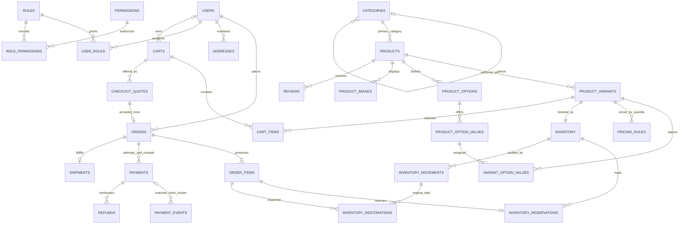

# FatihaAllOver Database Schema Plan

Version: 1.1 — finalized technical specification  
Date: 22 October 2026 (Asia/Dhaka)  
Milestone: 4 — database schema design and validation only  
Status: **DATABASE SCHEMA PLAN — COMPLETE** (technical specification; business gates remain in §16)  
Authority: [Architecture Blueprint v1.1](ARCHITECTURE_BLUEPRINT.md), reconciled with the owner's Milestone 4 business description.

This is a migration-design specification, not executable migrations or authorization to create tables. Only this document is changed. Existing application code, environment files, framework migrations, the architecture blueprint, and PostgreSQL are unchanged. The five finalization refinements are incorporated into the contracts below; unresolved business choices must not silently become implementation defaults. Technical completion permits a separately authorized migration milestone for agreed domains, not implementation of unapproved business policies.

## 1. Business Model Summary

FatihaAllOver is one organization selling its own goods. It is not a marketplace: no merchants, vendor stores, vendor commissions, or seller settlement tables are proposed. Laravel is the authoritative business system; customer Next.js, admin Next.js, and future mobile clients consume its API and never access the database directly.

There is one customer identity. All customers may buy any supported quantity. Retail/bulk pricing is an all-units quantity calculation per sellable SKU, never a customer classification or permission. There are no `wholesale_users`, `retail_users`, wholesale eligibility flags, or wholesale roles.

Products describe catalog items; variants describe sellable packages/combinations. Ghee can have 250 g, 500 g, and 1 kg variants; attar can vary by fragrance and bottle size; clothing by size and color. A simple product has one default variant and no artificial selectable options. Whole packages, one currency, one stock location, one primary category, and one shipment per order are the blueprint's proposed MVP boundaries, subject to the decisions in section 16.

Categories are editable records, including the supplied initial names: Food and beverage; Fashion and style; Dress and clothing; Home decor item; SUNNAH and islamic; Perfume and Khushboo / Attar; Everything wholesale. Names and slugs are data, not enums. No category records are inserted in this milestone.

### 1.1 Source reconciliation and explicit interpretation

| Topic | Blueprint and current business description | Plan treatment / decision |
|---|---|---|
| Merchant/customer model | Both require a shared backend and one customer identity; current description explicitly excludes marketplaces | Fully aligned; no vendor or wholesale-account schema |
| Quantity tiers | Blueprint resolves an earlier overlap to 1–5 / 6–49 / 50+; current request uses that example | Supported as initial example data, not schema constants; actual prices and intervals remain editable |
| Money type | Blueprint §3.1 requires `BIGINT` minor units; the business request requires exact monetary reconciliation | Architectural decision: retain exact integer minor units and all `_minor` formulas, with exact decimal intermediate calculations. No floating-point money or mixed storage representations; a future major-unit storage change would require an explicit blueprint/API revision |
| Payment versus attempt | Blueprint §§3.5, 4, 8 models each `payments` row as an attempt that can become a successful receipt; the business request lists payment and attempt concepts | Architectural decision: retain that single physical attempt table. Order → many `payments` → events/refunds. A distinct parent payment intent is not required for this contract; adding one would be a separate model change |
| Everything wholesale | Not in the blueprint's initial sample list; no identity-based wholesale rules are allowed | Normal editable category is possible, with no pricing privileges. A bulk-eligible collection/filter may be more useful; see §16. Neither alternative is implemented |
| Category assignment | Blueprint proposes one primary category; current request does not explicitly demand multiple assignments | Preserve `products.category_id`. Do not quietly add a many-to-many category model to support merchandising |
| Delivery | Blueprint proposes district zones, configured flat rates, one shipment, conditional COD | Treat these as proposed launch scope, not approved business policy. Multiple carriers/rates are data; weight rules/split shipments need a later explicit design |
| Reviews | Blueprint defines authenticated verified-purchase product reviews, optionally after launch | Plan product reviews only; no restaurant reviews |
| Framework inventory | Blueprint's logical list omits `job_batches` and differs from installed framework column types | Preserve actual Laravel/Sanctum migration shapes; document the differences in §4. No framework migration is rewritten |
| Receipt mismatch persistence | Blueprint requires amount/currency/late/excess exceptions but primarily describes their event evidence and summary; the finalization request explicitly retains separate captured fields | Additive clarification in §§4.25–4.27 and 9.2: immutable verified capture columns, a summary exception, and typed append-only exception evidence in existing audit_logs. This preserves the blueprint's intent without a new table or a separate accounting system |

### 1.2 Actual development database inspection

On 21 October 2026, a PDO connection using the existing local application credentials inspected PostgreSQL inside an explicit **read-only transaction**, then rolled it back. No credentials were printed and no Laravel cache/configuration command was needed.

- Server: PostgreSQL **18.6**; database `fatihaallover_dev`; connected role `fatihaallover_app`.
- Non-system schema: `public`.
- Non-system relations: **none**. No business tables, framework tables, sequences, or migration repository exist yet.
- Installed extension: `plpgsql` 1.0.
- `btree_gist` 1.8 is **available but not installed**. Provisioning it requires a later approved migration/deployment step and confirmation on managed PostgreSQL.
- Existing migration files define `cache`, `cache_locks`, `jobs`, `job_batches`, `failed_jobs`, and `personal_access_tokens`. Files existing does not mean migrations have run.
- No new migration files, models, factories, seeders, APIs, or database objects are created by this plan.

## 2. Domain Boundaries

| Domain | Ownership and boundaries |
|---|---|
| Identity | Accounts, reusable addresses, password-reset/token/session infrastructure |
| Administration | Staff role assignments, permissions, MFA enrollment, audit trail, approved settings |
| Categories | Editable hierarchy, activation, ordering and safe archival |
| Catalog | Product descriptions/publication, primary category and Cloudinary metadata |
| Variants | SKU, option combinations, package weight and sellable identity |
| Pricing | Base price and complete quantity schedule, revisioned atomic editing |
| Inventory | SKU counters, reservations, immutable movements and inspected restorations |
| Cart | Mutable selections, guest credential and optimistic revision; no trusted stored price |
| Checkout | Immutable, expiring commercial offer and consent validation; no stock hold until order |
| Orders | Historical sale facts, lifecycle and payment summary; not gateway transport logic |
| Payments | Durable attempt/receipt, provider event verification, dispatch ownership and reconciliation |
| Refunds | Independent monetary operations reserving captured balance; never automatic physical restocking |
| Delivery | Configured coverage/rates and shipment state; fee policy requires confirmation |
| CMS | Typed pages, banners/navigation/sections; no arbitrary executable page builder |
| Reviews | Optional verified-purchase product feedback and moderation |
| Operations | Outbox, notification deduplication, idempotency and framework job/cache persistence |

Modules share one transactional PostgreSQL database. Foreign keys and constraints enforce structural integrity; services own cross-table workflows and authorization. There are no per-client or mobile-specific commerce tables.

## 3. Entity Relationship Overview

Draft products may have zero variants; publication requires at least one valid active variant with its inventory row. Diagram cardinalities describe durable workflow boundaries, not a claim that SQL foreign keys alone enforce minimum child counts. Unmatched verified payment events intentionally have no payment FK until reconciled.

## 4. Complete Table Inventory

**Count: 47 inventoried physical tables** — **38 domain/operational tables**, **8 authentication/framework infrastructure tables**, and **1 Laravel-managed migration repository**. Of the 46 non-repository tables, six already have migration definitions; 40 do not. The count includes optional post-launch `reviews`; it is not a request to implement all tables in one milestone. No separate `payment_attempts` or `refund_attempts` tables are proposed under the blueprint's attempt model.

### Inventory conventions applying to every entry

- Domain tables (§4.1–4.38) include `id BIGINT GENERATED BY DEFAULT AS IDENTITY PRIMARY KEY`, `created_at TIMESTAMPTZ NOT NULL`, `updated_at TIMESTAMPTZ NOT NULL`, including join tables. Immutable rows keep both timestamps equal. These columns need not be repeated below. Never reassign IDs.
- `?` denotes nullable. Every other listed column is **NOT NULL**, unless an existing framework migration explicitly says otherwise. `FK` targets the named table's `id` unless a composite target is specified. All FK IDs are `BIGINT` except session/framework exceptions.
- **Default FK action: ON DELETE RESTRICT, ON UPDATE NO ACTION.** This applies to every FK below unless explicitly overridden. Soft deletion does not invoke FK actions; services must separately enforce archival and publication rules. Financial/audit records never cascade away.
- `UQ` creates a unique B-tree index. Do not add a duplicate ordinary index. Additional indexes below supplement PK/UQ indexes; index FK leading columns unless already covered. Composite referenced keys must be non-partial unique constraints.
- Domain status columns are `VARCHAR(32)` with CHECK membership in the exact listed states. CHECKs validate values, not legal old→new transitions; locked services enforce transitions.
- Amounts are `BIGINT` minor units, quantity/count/revision/order fields `INTEGER` unless specified. Money is nonnegative except movement deltas; purchase amounts specified positive are strictly positive. Non-null strings used as identities/references must be trimmed and nonempty. Defaults must be explicit in migrations: flags false unless required otherwise, counters zero, revisions one, draft/pending states appropriate to the operation; financial amounts are calculated rather than silently defaulted.
- Common currency policy: `CHAR(3)`, uppercase ISO representation, MVP CHECK `currency = 'BDT'` on catalog/cart/quote/order/rate amounts. Captured external payment/refund currency may record another valid uppercase code for exception evidence; it never silently converts into BDT revenue. Expansion beyond BDT requires an approved currency-exponent policy.
- JSONB snapshots require a versioned, validated object/array schema, finite lengths and payload sizes. Money inside JSON uses decimal **strings of minor units**, rates exact decimal strings. Relational amounts/references remain authoritative for operations; immutable JSON preserves contextual historical facts.
- All mutable domain configuration changes have a redacted `audit_logs` entry in the same transaction. Financial, stock, history and outbox entries have stable operation/event references. Framework tables are operational infrastructure rather than the financial audit ledger.

### 4.1 `users`

- **Purpose/columns:** unified identity: `name VARCHAR(150)`, `email VARCHAR(254)`, `phone VARCHAR(32)?`, `password VARCHAR(255)`, `status VARCHAR(32)`, `email_verified_at TIMESTAMPTZ?`, `last_login_at TIMESTAMPTZ?`, `remember_token VARCHAR(100)?`, `deleted_at TIMESTAMPTZ?`.
- **Keys/checks:** common PK; no outgoing FK. UQ normalized email; CHECK email equals trimmed lowercase representation. Partial UQ normalized phone when non-null. Status `active/suspended/closed`. Password is a framework hash, never plaintext.
- **Indexes:** `(status,id)` for support lists; email/phone unique indexes serve exact lookup.
- **Lifecycle/audit:** soft close/anonymize under retention policy; referenced accounts cannot be hard-deleted. Retain email uniqueness across soft deletion unless a reviewed identity-reuse policy changes it. No retail/wholesale field. Account suspension/password reset invalidates sessions and tokens.

### 4.2 `roles`

- **Purpose/columns:** named authorization bundles: `name VARCHAR(80)`, `description TEXT?`.
- **Keys/checks/indexes:** common PK; UQ nonempty canonical name; no outgoing FK or extra index required.
- **Lifecycle/audit:** blueprint examples `customer/admin/super_admin` are ordinary role data, not price eligibility. Staff assignment changes are audited; deletion only through controlled authorization administration, cascading links as below.

### 4.3 `permissions`

- **Purpose/columns:** explicit staff capabilities: `name VARCHAR(100)`, `description TEXT?`.
- **Keys/checks/indexes:** common PK; UQ canonical nonempty name; no outgoing FK/extra index. Examples `pricing.manage`, `orders.fulfill`, `payments.refund`.
- **Lifecycle/audit:** permission names form a versioned application contract. Do not rename/delete a permission without reviewing enforcement and assignments.

### 4.4 `user_roles`

- **Purpose/columns:** `user_id BIGINT`, `role_id BIGINT`.
- **Keys/checks/indexes:** common PK; FKs to users and roles; UQ `(user_id,role_id)`; index `(role_id,user_id)`; no additional row CHECK.
- **Lifecycle/audit:** both FKs DELETE CASCADE only when parent deletion is otherwise permissible. Every grant/revoke is audited and invalidates affected staff access proof; customer support cannot assign roles.

### 4.5 `role_permissions`

- **Purpose/columns:** `role_id BIGINT`, `permission_id BIGINT`.
- **Keys/checks/indexes:** common PK; FKs roles/permissions, both DELETE CASCADE; UQ pair; reverse index `(permission_id,role_id)`; no additional CHECK.
- **Lifecycle/audit:** audited authorization edits; cached capabilities invalidated after commit.

### 4.6 `admin_security`

- **Purpose/columns:** MFA enrollment: `user_id BIGINT`, `totp_secret_encrypted TEXT?`, `recovery_code_hashes JSONB`, `mfa_confirmed_at TIMESTAMPTZ?`, `last_totp_step BIGINT?`.
- **Keys/checks/indexes:** common PK; FK users; UQ user; JSON array CHECK; step null or nonnegative; confirmed enrollment requires an encrypted TOTP secret. No extra index needed.
- **Lifecycle/audit:** lock this row to advance TOTP step or remove a used recovery hash atomically. Enrollment/recovery is audited without secret values/hashes. A small bounded recovery-code array is deliberate; it is not a substitute for relational roles. Session MFA proof is stored in session payload, not this enrollment row.

### 4.7 `addresses`

- **Purpose/columns:** reusable address book: `user_id BIGINT`, `label VARCHAR(60)?`, `recipient_name VARCHAR(150)`, `phone VARCHAR(32)`, `line1 VARCHAR(255)`, `line2 VARCHAR(255)?`, `city VARCHAR(100)`, `district VARCHAR(100)`, `postal_code VARCHAR(20)?`, `country_code CHAR(2)`, `is_default_shipping BOOLEAN`, `is_default_billing BOOLEAN`.
- **Keys/checks/indexes:** common PK; FK users; uppercase two-letter country CHECK; partial UQ `(user_id)` for each true default flag; index `(user_id,id)`.
- **Lifecycle/audit:** lock user when switching defaults. Address edits/deletion never update quote/order snapshots. Hard deletion of an address is permissible because historical addresses do not depend on its continued existence; audit redacted changes and apply privacy retention.

### 4.8 `categories`

- **Purpose/columns:** editable adjacency-list hierarchy: `parent_id BIGINT?`, `name VARCHAR(150)`, `slug VARCHAR(180)`, `description TEXT?`, `is_active BOOLEAN`, `sort_order INTEGER`, `deleted_at TIMESTAMPTZ?`.
- **Keys/checks/indexes:** common PK; self FK; UQ slug including archived rows; CHECK parent differs from id and sort_order ≥ 0. Index `(parent_id,sort_order,id)`; partial active/undeleted navigation index if query plans justify it.
- **Lifecycle/audit:** ancestor cycles require serialized hierarchy validation, not a CHECK. Disable/archive preserves history. Reassign products and move/remove children before soft deletion; FK RESTRICT protects hard deletion. Log hierarchy and activation changes. Effective activity includes every ancestor.

### 4.9 `products`

- **Purpose/columns:** `category_id BIGINT`, `name VARCHAR(200)`, `slug VARCHAR(220)`, `short_description TEXT?`, `description TEXT`, `status VARCHAR(32)`, `seo_title VARCHAR(200)?`, `seo_description VARCHAR(320)?`, `published_at TIMESTAMPTZ?`, `deleted_at TIMESTAMPTZ?`.
- **Keys/checks/indexes:** common PK; FK categories; UQ slug; status `draft/active/archived`. Index `(category_id,status,id)` with undeleted filter for browsing; `(status,published_at,id)` for new arrivals if used.
- **Lifecycle/audit:** publication checks active category ancestry, valid positive-priced variants and options. Archive referenced products; do not cascade orders. No product-level stock or universal attribute columns.

### 4.10 `product_variants`

- **Purpose/columns:** sellable SKU: `product_id BIGINT`, `sku VARCHAR(100)`, `name VARCHAR(150)`, `option_signature VARCHAR(255)`, `base_price_minor BIGINT`, `currency CHAR(3)`, `weight_grams INTEGER?`, `is_active BOOLEAN`, `pricing_revision INTEGER`, `deleted_at TIMESTAMPTZ?`.
- **Keys/checks/indexes:** common PK; FK products; UQ SKU with a documented canonical case policy; UQ `(product_id,option_signature)`; UQ `(id,product_id)` for composite children. Price ≥ 0; active variant requires base price > 0; weight null or > 0; revision ≥ 1. Index `(product_id,is_active,id)`.
- **Lifecycle/audit:** zero price only in inactive draft configuration. Variant creation and its zero-stock inventory row are atomic. `default` signature for a product without options; otherwise deterministic sorted option/value IDs, bounded to 255 characters. Archive referenced SKUs; changing package meaning after sale requires a new SKU. Price edits require `pricing.manage` even during creation, copying or imports; record old/new revision and complete schedule.

### 4.11 `product_options`

- **Purpose/columns:** options local to one product: `product_id BIGINT`, `name VARCHAR(80)`, `sort_order INTEGER`.
- **Keys/checks/indexes:** common PK; FK products; UQ `(product_id,name)` after canonical normalization; UQ `(id,product_id)`; CHECK sort_order ≥ 0; index `(product_id,sort_order,id)`.
- **Lifecycle/audit:** remove only unused options; live combination changes lock product and variants. No global fixed clothing/food attribute schema.

### 4.12 `product_option_values`

- **Purpose/columns:** `product_id BIGINT`, `product_option_id BIGINT`, `value VARCHAR(100)`, `sort_order INTEGER`.
- **Keys/checks/indexes:** common PK; composite FK `(product_option_id,product_id)` → product_options `(id,product_id)`; UQ `(product_option_id,value)` after normalization; UQ `(id,product_option_id,product_id)`; sort_order ≥ 0; indexes `(product_option_id,sort_order,id)` and `product_id` if not otherwise covered.
- **Lifecycle/audit:** RESTRICT deletion while selected by a variant. Rename preserves ID and historical order option labels; audit mutation.

### 4.13 `variant_option_values`

- **Purpose/columns:** `product_id BIGINT`, `product_variant_id BIGINT`, `product_option_id BIGINT`, `product_option_value_id BIGINT`.
- **Keys/checks/indexes:** common PK; composite FK `(product_variant_id,product_id)` → variants `(id,product_id)`; composite FK `(product_option_value_id,product_option_id,product_id)` → option_values `(id,product_option_id,product_id)`; UQ `(product_variant_id,product_option_id)`; reverse index beginning `product_option_value_id` and index `product_id`.
- **Lifecycle/audit:** exactly one value per selected option; same-product membership enforced by FKs. Completeness against all required product options is transactional service validation. No rows for a default variant. Update assignments and signature in one parent-locked transaction; do not repurpose sold variant identity.

### 4.14 `product_images`

- **Purpose/columns:** `product_id BIGINT`, `product_variant_id BIGINT?`, `cloudinary_asset_id VARCHAR(255)`, `cloudinary_public_id VARCHAR(255)`, `resource_type VARCHAR(30)`, `version BIGINT`, `secure_url TEXT`, `alt_text VARCHAR(255)?`, `sort_order INTEGER`, `is_primary BOOLEAN`.
- **Keys/checks/indexes:** common PK; FK products; optional composite FK `(product_variant_id,product_id)` → variants `(id,product_id)` using normal nullable-FK semantics. UQ asset ID; partial UQ product where primary and variant null; partial UQ variant where primary and variant non-null. Version/sort nonnegative; image resource type allowlist and HTTPS URL validation. Index `(product_id,sort_order,id)` and `(product_variant_id,sort_order,id)`.
- **Lifecycle/audit:** one asset row belongs to a product and optionally one variant; shared-asset attachment is outside this model. No image binary. Detachment may delete the metadata row after audit; physical Cloudinary deletion is delayed until historical retention checks pass. Snapshot URLs do not guarantee asset retention by themselves.

### 4.15 `pricing_rules`

- **Purpose/columns:** `product_variant_id BIGINT`, `min_quantity INTEGER`, `max_quantity INTEGER?`, `unit_price_minor BIGINT`, `is_active BOOLEAN`.
- **Keys/checks/indexes:** common PK; FK variants; min ≥ 1; max null or ≥ min; price ≥ 0. Active interval overlap is prohibited per variant by GiST exclusion using `btree_gist` and the derived `int8range(min_quantity::bigint, CASE WHEN max_quantity IS NULL THEN NULL ELSE max_quantity::bigint + 1 END, '[)')`, predicate `is_active`. B-tree index `(product_variant_id,min_quantity)` supports schedule reads.
- **Lifecycle/audit:** null maximum means unbounded. Cast before adding one to avoid INTEGER upper-bound overflow. A variant may have no active rules; otherwise continuity, first-tier/base equality, descending/non-increasing prices and positive purchasable tiers are checked under variant lock. Full schedule replacement and revision increment are atomic. Historical item FK may become null on rule removal; immutable pricing snapshot remains.

### 4.16 `inventory`

- **Purpose/columns:** `product_variant_id BIGINT`, `on_hand INTEGER`, `reserved INTEGER`, `low_stock_threshold INTEGER`.
- **Keys/checks/indexes:** common PK; FK variants; UQ variant; on_hand ≥ 0, reserved ≥ 0, reserved ≤ on_hand, threshold ≥ 0. Unique variant index is the lookup/row-lock target; no separately stored available column.
- **Lifecycle/audit:** one location in this baseline. Every counter change and its movement commit together; no independent direct counter editing. Reconcile counters against ledger and active reservations. Archive variants instead of deleting their inventory history.

### 4.17 `inventory_reservations`

- **Purpose/columns:** `inventory_id BIGINT`, `order_item_id BIGINT`, `quantity INTEGER`, `status VARCHAR(32)`, `expires_at TIMESTAMPTZ`, `consumed_at TIMESTAMPTZ?`, `released_at TIMESTAMPTZ?`.
- **Keys/checks/indexes:** common PK; FKs inventory/order_items; UQ order item; quantity > 0; status `active/consumed/released/expired`. Active: both terminal timestamps null; consumed: consumed timestamp set and released null; released/expired: released timestamp set and consumed null. Index `inventory_id`; partial `(expires_at,id)` where active.
- **Lifecycle/audit:** item variant and quantity match the inventory and sold item under order/inventory locks; no cross-table CHECK. Online reservation deadline equals order deadline. Terminal rows never reactivate. Immediate COD reservation/consumption is recorded in one transaction under the proposed COD policy.

### 4.18 `inventory_movements`

- **Purpose/columns:** append-only ledger: `inventory_id BIGINT`, `order_item_id BIGINT?`, `actor_user_id BIGINT?`, `type VARCHAR(32)`, `on_hand_delta INTEGER`, `reserved_delta INTEGER`, `reason TEXT`, `operation_key VARCHAR(150)`.
- **Keys/checks/indexes:** common PK; FKs inventory/order_items/users; UQ operation key. Types `receipt/reserve/release/sale/cancellation_restore/return_restore/adjustment`. Receipt/restoration: on_hand_delta > 0 and reserved_delta = 0; reserve: on_hand_delta = 0 and reserved_delta > 0; release: on_hand_delta = 0 and reserved_delta < 0; sale: equal negative deltas; adjustment: nonzero on_hand_delta, reserved_delta = 0. Item required for all except receipt/adjustment. Proposed partial UQ `order_item_id` where type = sale, and where type = reserve, for the single-sale/single-reservation MVP. Index `(inventory_id,created_at,id)`, `order_item_id`, `actor_user_id`.
- **Lifecycle/audit:** no update/delete API. Actor null only for an attributable system operation. Stable keys derive from actual order/reservation/restoration identity; a new HTTP retry key cannot create a second physical effect. Quantity sums/counter bounds are checked with locks, with arithmetic widened before summation.

### 4.19 `inventory_restorations`

- **Purpose/columns:** `order_item_id BIGINT`, `sale_movement_id BIGINT`, `movement_id BIGINT?`, `source_reference VARCHAR(150)`, `kind VARCHAR(32)`, `quantity_received INTEGER`, `quantity_restocked INTEGER`, `quantity_discarded INTEGER`, `actor_user_id BIGINT?`, `reason TEXT`, `inspected_at TIMESTAMPTZ`.
- **Keys/checks/indexes:** common PK; FKs item, movements for sale/restoration, users. UQ `(order_item_id,source_reference)`; partial UQ movement_id when set. Kind `cancellation/return`; received > 0; restocked/discarded ≥ 0; their widened sum equals received; movement_id is present iff restocked > 0. Index sale_movement_id and actor_user_id; item/source unique index supports cumulative inspection queries.
- **Lifecycle/audit:** immutable. Sale type/item/variant, restoration movement type/delta and cumulative received ≤ original deducted quantity are validated under order then inventory locks. Cancellation uses a deterministic item source; returns use a stable original intake/parcel reference. Discarded-only returns still retain a row. Financial refund never creates this record implicitly.

### 4.20 `carts`

- **Purpose/columns:** `user_id BIGINT?`, `guest_token_hash CHAR(64)?`, `status VARCHAR(32)`, `currency CHAR(3)`, `revision INTEGER`, `expires_at TIMESTAMPTZ?`.
- **Keys/checks/indexes:** common PK; FK users; CHECK exactly one user/guest hash present; partial UQ guest hash when present; partial UQ user where status = active; status `active/converted/abandoned`; revision ≥ 1; index `(user_id,created_at,id)` and `(status,expires_at)`.
- **Lifecycle/audit:** hash unguessable guest credential; never log raw credential. Cart merge locks source/target carts in ID order and increments revision, invalidating quotes. Converted order-linked carts cannot be purged. Bounded cleanup of unconverted carts must first account for their unused quotes.

### 4.21 `cart_items`

- **Purpose/columns:** `cart_id BIGINT`, `product_variant_id BIGINT`, `quantity INTEGER`.
- **Keys/checks/indexes:** common PK; cart FK DELETE CASCADE; variant FK RESTRICT; UQ `(cart_id,product_variant_id)`; quantity > 0 with configured request cap; reverse index product_variant_id.
- **Lifecycle/audit:** mutable only while cart active, using expected cart revision under cart lock. No trusted price column. Repeated additions coalesce quantity, they do not split one SKU into differently priced lines. Expired cart purging is not a financial deletion.

### 4.22 `checkout_quotes`

- **Purpose/columns:** `user_id BIGINT`, `cart_id BIGINT`, `cart_revision INTEGER`, `payment_method VARCHAR(32)`, `currency CHAR(3)`, `snapshot JSONB`, `subtotal_minor BIGINT`, `discount_minor BIGINT`, `shipping_minor BIGINT`, `shipping_tax_minor BIGINT`, `tax_minor BIGINT`, `total_minor BIGINT`, `expires_at TIMESTAMPTZ`, `consumed_at TIMESTAMPTZ?`.
- **Keys/checks/indexes:** common PK; FKs users/carts; cart_revision ≥ 1; method `online/cod`; snapshot object CHECK; amounts ≥ 0, total > 0, discount = 0 in MVP, shipping_tax ≤ tax; header formula CHECK from §6 using widened arithmetic. Expiry after creation; consumed timestamp null or ≥ creation. Index `(cart_id,created_at,id)`, `(user_id,created_at,id)`, and unconsumed expiry.
- **Lifecycle/audit:** immutable offer except one-way consumed_at. No separate quote revision and no inventory hold. Snapshot includes version, line IDs/quantities/amounts/options, price revisions, addresses/contact, delivery and settings revisions, and tax policy. Financial items remain relational on order creation; frozen quote JSON is a deliberate bounded offer document, not a mutable shopping ledger. Owner/cart consistency is checked under cart lock. Consumption commits only with the complete order-placement unit in §8.1. Unaccepted expired quotes can be purged; order-linked quotes are retained.

### 4.23 `orders`

- **Purpose/columns:** `order_number VARCHAR(40)`, `user_id BIGINT`, `cart_id BIGINT`, `checkout_quote_id BIGINT`, `status VARCHAR(32)`, `payment_status VARCHAR(32)`, `payment_method VARCHAR(32)`, `currency CHAR(3)`, `subtotal_minor BIGINT`, `discount_minor BIGINT`, `shipping_minor BIGINT`, `shipping_tax_minor BIGINT`, `tax_minor BIGINT`, `total_minor BIGINT`, `shipping_address_snapshot JSONB`, `billing_address_snapshot JSONB`, `delivery_snapshot JSONB`, `contact_snapshot JSONB`, `notes TEXT?`, `expires_at TIMESTAMPTZ?`, `confirmed_at TIMESTAMPTZ?`, `cancelled_at TIMESTAMPTZ?`, `cancellation_reason TEXT?`.
- **Keys/checks/indexes:** common PK; FKs users/carts/quotes; UQ order_number, cart_id, checkout_quote_id. Method online/cod; exact status sets §9; amounts ≥ 0 and total > 0; discount = 0 in MVP; shipping_tax ≤ tax; header formula CHECK; snapshot object CHECKs. pending_payment requires online and a deadline; cancelled requires timestamp/reason. Index `(user_id,created_at,id)`, `(status,created_at,id)`, `(payment_status,created_at,id)` and pending-payment expiry.
- **Lifecycle/audit:** historical commercial columns immutable; only controlled operational transitions change state. Validate quote belongs to same user/cart and all item/header/currency totals within the complete atomic placement transaction in §8.1. UQ cart/quote prevents retries with different idempotency keys placing another order. No hard delete/cascade. No separate mutable fulfillment_status duplicates order/shipment lifecycle.

### 4.24 `order_items`

- **Purpose/columns:** `order_id BIGINT`, `product_id BIGINT`, `product_variant_id BIGINT`, `pricing_rule_id BIGINT?`, `product_name VARCHAR(200)`, `variant_name VARCHAR(150)`, `sku VARCHAR(100)`, `options_snapshot JSONB`, `quantity INTEGER`, `unit_price_minor BIGINT`, `price_includes_tax BOOLEAN`, `line_subtotal_minor BIGINT`, `discount_minor BIGINT`, `tax_minor BIGINT`, `line_total_minor BIGINT`, `pricing_snapshot JSONB`.
- **Keys/checks/indexes:** common PK; FKs order/product; composite FK `(product_variant_id,product_id)` → variants `(id,product_id)`; pricing rule FK DELETE SET NULL. UQ `(order_id,product_variant_id)`; quantity, unit price and line total > 0; other amounts ≥ 0; discount = 0 in MVP; row formula CHECKs §6. Index product_id, product_variant_id, pricing_rule_id; order/variant unique supports order reads.
- **Lifecycle/audit:** immutable sale facts; FK rule is optional provenance, never historical price authority. Validate rule belongs to variant at purchase. Currency inherited from order. Snapshot contains exact tier bounds, revision, tax policy/rate/basis and display metadata. Corrections are separate audited financial/stock operations, not rewritten sale rows.

### 4.25 `payments`

- **Purpose/columns:** one attempt/receipt: `order_id BIGINT`, `provider VARCHAR(60)`, `merchant_reference VARCHAR(100)`, `provider_payment_id VARCHAR(150)?`, `status VARCHAR(32)`, `amount_minor BIGINT`, `currency CHAR(3)`, `paid_at TIMESTAMPTZ?`, `failure_code VARCHAR(100)?`, `last_reconciled_at TIMESTAMPTZ?`, `dispatch_claim UUID?`, `dispatch_lease_until TIMESTAMPTZ?`.
- **Capture/exception columns:** `captured_amount_minor BIGINT?`, `captured_currency CHAR(3)?`, `exception_code VARCHAR(60)?`, `exception_resolved_at TIMESTAMPTZ?`. Requested amount/currency stay immutable. Verified capture fields are write-once settled facts, never replaced by later callback values (§9.2). Captured fields are both absent or both present; captured amount > 0, uppercase currency; succeeded requires captured fields and paid_at. Captured fields/paid_at are absent before settlement and present only for succeeded receipts. An exception resolution timestamp requires a code. `exception_code` is only the primary summary; all independent unresolved conditions and resolutions persist as typed append-only audit_logs records (§9.2.2). Code CHECK permits `amount_mismatch/currency_mismatch/late_receipt/excess_receipt/missing_reservation/provider_conflict`. Clearing financial review requires resolution of every applicable open condition, not editing a summary timestamp.
- **Keys/checks/indexes:** common PK; FK orders; UQ merchant_reference; partial UQ `(provider,provider_payment_id)` when set; partial UQ order_id where status in created/pending/unknown. Status `created/pending/unknown/succeeded/failed/cancelled`; amount > 0; claim and lease both null or both set. Index `(order_id,status,id)` and `(status,last_reconciled_at,id)` for unresolved reconciliation.
- **Lifecycle/audit:** no single-success-per-order constraint: unexpected duplicate real receipts must remain recordable. Provider identifies the configured merchant account namespace; references are immutable and never reused. Succeeded receipt cannot be downgraded or its captured amount/currency overwritten; approved refunds are separate rows. New initiation requires the successful-receipt guard in §9.1 under the order lock, not merely the active-attempt partial index. Capture discrepancies and all transitions/reconciliation attempts have retained audit/event evidence. Do not persist card data, secrets or temporary checkout URLs in canonical idempotency responses.

### 4.26 `payment_events`

- **Purpose/columns:** durable authenticated receipt: `payment_id BIGINT?`, `provider VARCHAR(60)`, `provider_event_id VARCHAR(150)`, `payload JSONB`, `verification_status VARCHAR(32)`, `processing_status VARCHAR(32)`, `processing_claim UUID?`, `processing_lease_until TIMESTAMPTZ?`, `received_at TIMESTAMPTZ`, `processed_at TIMESTAMPTZ?`, `last_error TEXT?`.
- **Keys/checks/indexes:** common PK; optional FK payments; UQ `(provider,provider_event_id)` for all stored rows because verification_status CHECK permits only `verified`. Processing states `unmatched/pending/processing/processed/retryable_failed/dead_letter`; processed requires processed_at and matched payment. Claim/lease pair null or both present. Index payment_id; `(processing_status,received_at,id)` and processing lease expiry.
- **Lifecycle/audit:** authenticate before inserting into the dedupe namespace. Payload is immutable, redacted, bounded and versioned; processing metadata may change with claim fencing. Processing requires a persisted claim/lease; ending the short claim transaction releases its database lock, not its durable ownership (§9.1). Null payment permits callback-before-response matching by stable merchant reference. Refund callbacks use the same event inbox and resolve the refund's merchant/provider reference; one provider event ID cannot independently trigger two effects. Invalid signatures go to restricted operational logs without raw secrets.

### 4.27 `refunds`

- **Purpose/columns:** `payment_id BIGINT`, `amount_minor BIGINT`, `reason TEXT`, `status VARCHAR(32)`, `merchant_refund_reference VARCHAR(100)`, `provider_refund_id VARCHAR(150)?`, `requested_by BIGINT?`, `operation_key VARCHAR(150)`, `completed_at TIMESTAMPTZ?`, `dispatch_claim UUID?`, `dispatch_lease_until TIMESTAMPTZ?`.
- **Keys/checks/indexes:** common PK; FKs payments/users; UQ operation_key and merchant_refund_reference; partial UQ `(payment_id,provider_refund_id)` when set, as in blueprint. Amount > 0; status `requested/processing/succeeded/failed/unknown`; succeeded requires completed_at; claim/lease both null or both present. Index `(payment_id,status,id)`, requested_by and `(status,updated_at,id)`.
- **Lifecycle/audit:** currency is inherited from the original payment's immutable captured_currency, never its requested currency or a newly supplied client value. No separate mutable refund currency column is needed; validate provider refund evidence in that currency. Lock order/payment then refunds before checking the immutable captured balance and all open exceptions (§9.4). Requested/processing/unknown/succeeded all reserve balance. A provider refund reference that is globally unique across a merchant account must additionally be reconciled against that namespace; finalize adapter uniqueness requirements when gateway selected. Dispatch retries reuse the refund row/reference; no new refund for a transport timeout. Audit approval, requester/system attribution, provider outcome and all changes; never cascade delete or restock automatically.

### 4.28 `order_status_history`

- **Purpose/columns:** `order_id BIGINT`, `from_status VARCHAR(32)?`, `to_status VARCHAR(32)`, `actor_user_id BIGINT?`, `reason TEXT?`, `operation_key VARCHAR(150)`.
- **Keys/checks/indexes:** common PK; FKs orders/users; UQ operation_key; statuses from §9; from null only for creation; changed status must differ from prior non-null state. Index `(order_id,created_at,id)` and actor_user_id.
- **Lifecycle/audit:** append-only in same transaction as order transition. Null actor is an identified system operation; required reasons for cancellations/exceptional transitions are service-validated. Financial-only changes have payment/refund audit evidence even if order status is unchanged.

### 4.29 `delivery_zones`

- **Purpose/columns:** proposed MVP coverage: `name VARCHAR(100)`, `country_code CHAR(2)`, `district VARCHAR(100)`, `is_active BOOLEAN`, `revision INTEGER`.
- **Keys/checks/indexes:** common PK; no outgoing FK; UQ `(country_code,district)` using canonical address normalization; uppercase country, revision ≥ 1. Unique index supports serviceability; no extra index until query need.
- **Lifecycle/audit:** disable rather than delete referenced zones; mutation locks/revisions invalidate affected quotes. District matching and geographic coverage are **BUSINESS DECISION REQUIRED**, not an implied nationwide promise.

### 4.30 `delivery_rates`

- **Purpose/columns:** named delivery method/rate: `delivery_zone_id BIGINT`, `name VARCHAR(100)`, `fee_minor BIGINT`, `currency CHAR(3)`, `estimated_min_days INTEGER`, `estimated_max_days INTEGER`, `cod_enabled BOOLEAN`, `is_active BOOLEAN`, `revision INTEGER`.
- **Keys/checks/indexes:** common PK; FK zones; fee ≥ 0, 0 ≤ min_days ≤ max_days, revision ≥ 1. Proposed UQ `(delivery_zone_id,name)` for unambiguous admin labels; index `(delivery_zone_id,is_active,id)`.
- **Lifecycle/audit:** many configurable rates per zone; no hard-coded delivery price/courier. Atomic revisioned changes; snapshots preserve past fee and tax basis. Flat pricing is provisional; weight/order-value formulas require reviewed rule inputs before schema extension. Allowed historical rate deletion sets shipment FK null; order delivery snapshot remains.

### 4.31 `shipments`

- **Purpose/columns:** `order_id BIGINT`, `delivery_rate_id BIGINT?`, `carrier VARCHAR(100)?`, `tracking_number VARCHAR(150)?`, `status VARCHAR(32)`, `shipped_at TIMESTAMPTZ?`, `delivered_at TIMESTAMPTZ?`, `failed_at TIMESTAMPTZ?`, `notes TEXT?`.
- **Keys/checks/indexes:** common PK; order FK RESTRICT; rate FK DELETE SET NULL; UQ order_id for provisional one-parcel MVP; partial UQ `(carrier,tracking_number)` when both set; tracking requires carrier. Status `pending/shipped/delivered/failed/returned`; delivered requires delivered_at, shipped/delivered require shipped_at. Index delivery_rate_id and `(status,created_at,id)`.
- **Lifecycle/audit:** transactionally align shipment and order transitions; history retained via order_status_history plus redacted audit of tracking changes/retries. Failed delivery is not restocking. Multiple carriers are supported as data; split parcels need explicit shipment-item allocation design before removing UQ order_id.

### 4.32 `reviews`

- **Purpose/columns:** optional post-launch product review: `user_id BIGINT`, `product_id BIGINT`, `order_item_id BIGINT`, `rating SMALLINT`, `title VARCHAR(150)?`, `body TEXT?`, `status VARCHAR(32)`, `moderated_by BIGINT?`, `moderated_at TIMESTAMPTZ?`.
- **Keys/checks/indexes:** common PK; FKs user/product/item/moderator; UQ `(user_id,product_id)`; rating 1–5; status `pending/approved/rejected`; moderator/time paired for manual moderation. Index order_item_id, moderated_by; partial `(product_id,created_at,id)` where approved; moderation queue `(status,created_at,id)`.
- **Lifecycle/audit:** service verifies delivered purchase belongs to that user/product. Edits return to pending; own deletion is an audited removal, not deletion of the order. Whether returns affect review eligibility is a decision before enabling reviews. No restaurant entities, media reviews or complex reputation system.

### 4.33 `cms_contents`

- **Purpose/columns:** `type VARCHAR(40)`, `slug VARCHAR(180)`, `title VARCHAR(200)`, `body JSONB`, `status VARCHAR(32)`, `published_at TIMESTAMPTZ?`, `created_by BIGINT`, `updated_by BIGINT`.
- **Keys/checks/indexes:** common PK; author/editor FKs users; UQ slug; status `draft/published/archived`; published requires published_at; body object CHECK; type whitelist initially page/banner/navigation/section pending CMS approval. Index `(type,status,published_at,id)`, created_by and updated_by.
- **Lifecycle/audit:** typed bounded blocks for policies, homepage banners, navigation and editorial sections; never executable HTML/JS/configuration. Body schema carries Cloudinary metadata and optional curated product/category IDs; validate references on save and re-filter visibility on render. Such display references do not control commercial rules and are not FK-backed; substantial product-collection querying would justify a later relational model. Drafts may be deleted; published content archived. Public business/contact information belongs here or in whitelisted settings, not duplicated in both.

### 4.34 `settings`

- **Purpose/columns:** `group_name VARCHAR(80)`, `key VARCHAR(100)`, `value JSONB`, `value_type VARCHAR(30)`, `is_public BOOLEAN`, `revision INTEGER`, `updated_by BIGINT?`.
- **Keys/checks/indexes:** common PK; optional FK users; UQ `(group_name,key)`; revision ≥ 1; value_type constrained to an approved typed whitelist. Index updated_by; unique index supports group and individual key lookup.
- **Lifecycle/audit:** validated operational configuration, not arbitrary executable rules. Atomic expected-revision updates and redacted audit. Critical settings rows must exist before quote workflows so absent-row locks are not assumed. Public flag plus independent allowlist. No gateway, Cloudinary, database or MFA secrets. Snapshot tax/delivery/security policy versions where relevant.

### 4.35 `notification_deliveries`

- **Purpose/columns:** `user_id BIGINT?`, `order_id BIGINT?`, `channel VARCHAR(30)`, `template VARCHAR(100)`, `destination_encrypted TEXT`, `status VARCHAR(32)`, `attempts INTEGER`, `provider_message_id VARCHAR(150)?`, `last_error TEXT?`, `sent_at TIMESTAMPTZ?`, `dedupe_key VARCHAR(150)`.
- **Keys/checks/indexes:** common PK; optional FKs users/orders; UQ dedupe_key; status `pending/sent/failed`; attempts ≥ 0; sent requires sent_at; initial channel email. Index user_id, order_id, `(status,updated_at,id)`.
- **Lifecycle/audit:** encrypted destination and redacted failure text; transactional outbox creates delivery intents. Claim/retry through durable queue locking, dedupe by original business event + template + recipient. Provider acknowledgments can be ambiguous: exactly-once email delivery is not promised; use provider idempotency when available. Retain operational metadata per approved privacy policy.

### 4.36 `audit_logs`

- **Purpose/columns:** `actor_user_id BIGINT?`, `action VARCHAR(100)`, `subject_type VARCHAR(100)`, `subject_id VARCHAR(100)?`, `changes JSONB`, `request_id UUID`, `ip_address INET?`.
- **Keys/checks/indexes:** common PK; actor FK users; no subject FK because subjects span tables and may be removed; action/type nonempty, changes object CHECK. Index `(subject_type,subject_id,created_at,id)`, `(actor_user_id,created_at,id)`, request_id.
- **Lifecycle/audit:** append-only, restricted access, no passwords/tokens/MFA material/raw payment payloads. System jobs generate a correlation UUID and explicit action. References are audit evidence rather than enforced live ownership. No unique request_id: one request can cause several audited effects. For payment subjects, the versioned actions and validated references in §9.2.2 preserve every exception opening/evidence/resolution, including capture discrepancies. These records are mandatory financial evidence retained with the payment, not disposable diagnostic logs. Parent payment locks serialize their creation and summary updates; the existing subject index supports reconstruction of all open conditions.

### 4.37 `outbox_events`

- **Purpose/columns:** `event_id UUID`, `event_type VARCHAR(100)`, `aggregate_type VARCHAR(100)`, `aggregate_id BIGINT`, `payload JSONB`, `available_at TIMESTAMPTZ`, `published_at TIMESTAMPTZ?`, `attempts INTEGER`, `last_error TEXT?`.
- **Keys/checks/indexes:** common PK; UQ event_id; no polymorphic FK; attempts ≥ 0, payload object CHECK. Partial `(available_at,id)` where published_at null; `(aggregate_type,aggregate_id,id)`.
- **Lifecycle/audit:** event identity/payload immutable, delivery metadata mutable. Insert in business transaction. Workers may use SKIP LOCKED for work selection, never to skip required stock locks. Crash between publishing and marking published causes repeat delivery; consumers dedupe durably. Do not claim atomicity with an external broker or notification provider.

### 4.38 `idempotency_keys`

- **Purpose/columns:** `user_id BIGINT`, `scope VARCHAR(100)`, `key VARCHAR(150)`, `request_hash CHAR(64)`, `status VARCHAR(32)`, `response_status SMALLINT?`, `response_body JSONB?`, `resource_id BIGINT?`, `expires_at TIMESTAMPTZ`.
- **Keys/checks/indexes:** common PK; FK users; UQ `(user_id,scope,key)`; status `processing/completed`; lowercase SHA-256 hex format; completed requires valid HTTP response status (100–599) and canonical response body; index `(status,expires_at,id)`. Resource reference is scope-dependent and service-validated, not a false universal FK.
- **Lifecycle/audit:** canonical request hash includes operation target and accepted fields; no secret response credentials. Resolve replay before quote consumption. For order placement, claim and completed response/resource commit with the entire local checkout unit (§8.1); never commit the order first and complete its key afterward. External payment/refund dispatch instead needs a committed durable intent before the network call (§9.1). Keep completed keys ≥ 48 hours and provider retry window; retain unresolved keys regardless of expiry. Scoped resource identity and permanent financial keys survive cleanup. Do not cascade deletion from users.

### 4.39 `personal_access_tokens` — existing Sanctum migration

- **Purpose/actual columns:** `id BIGSERIAL PK`, `tokenable_type VARCHAR(255)`, `tokenable_id BIGINT`, `name TEXT`, `token VARCHAR(64)`, `abilities TEXT?`, `last_used_at TIMESTAMP(0) WITHOUT TIME ZONE?`, `expires_at TIMESTAMP(0) WITHOUT TIME ZONE?`, nullable framework `created_at/updated_at TIMESTAMP(0) WITHOUT TIME ZONE`.
- **Keys/checks/indexes:** UQ token; index `(tokenable_type,tokenable_id)` and expires_at; no physical polymorphic FK and no additional CHECK in the existing migration. Restrict owner morph map to User in later authentication implementation; hash raw token before storage.
- **Lifecycle/audit:** preserve installed Sanctum 4.3.3 shape rather than blueprint's illustrative VARCHAR name/CHAR token/tz assumptions. Revoke on account closure/security changes; expiry cleanup. All framework timestamp values interpreted consistently as UTC. No raw token in audit logs.

### 4.40 `sessions` — planned framework infrastructure

- **Purpose/columns:** exception to common columns: `id VARCHAR(255) PK`, `user_id BIGINT?`, `ip_address VARCHAR(45)?`, `user_agent TEXT?`, `payload TEXT`, `last_activity INTEGER`; no common ID or created/updated timestamps.
- **Keys/checks/indexes:** planned user FK DELETE SET NULL, UPDATE NO ACTION; indexes user_id and last_activity; nonnegative epoch activity. Payload remains Laravel-managed session serialization; do not build relational commerce inside it.
- **Lifecycle/audit:** expires/revokes independently of financial retention. MFA challenge and session-bound proof are ephemeral payloads, never a permanent user boolean. Authentication service must remove invalid sessions before any permitted user deletion rather than treating null user_id as successful revocation by itself. Review encrypted session storage for production.

### 4.41 `password_reset_tokens` — planned framework infrastructure

- **Purpose/columns:** `email VARCHAR(254) PK`, `token VARCHAR(255)`, `created_at TIMESTAMPTZ?`; no common ID or updated timestamp.
- **Keys/checks/indexes:** normalized email key; no physical user FK because broker lookup is email-based; optional created_at cleanup index. Token is a framework hash. No extra domain CHECK required.
- **Lifecycle/audit:** follow configured Laravel password broker expiry and consume/invalidate on reset; invalidate on email change/account closure. Do not log reset secrets. Planned tz column is compatible with UTC application handling; confirm broker integration in authentication tests.

### 4.42 `cache` — existing infrastructure migration

- **Purpose/actual columns:** `key VARCHAR(255) PK`, `value TEXT`, `expiration BIGINT`; no common timestamps.
- **Keys/checks/indexes:** existing expiration index; no FKs/extra checks. BIGINT expiration is the actual installed migration, unlike blueprint's illustrative INTEGER.
- **Lifecycle/audit:** disposable framework cache, not price/payment authority. Protect sensitive cached content; cleanup is operational, not a financial audit event.

### 4.43 `cache_locks` — existing infrastructure migration

- **Purpose/actual columns:** `key VARCHAR(255) PK`, `owner VARCHAR(255)`, `expiration BIGINT`; no common timestamps.
- **Keys/checks/indexes:** expiration index; no FK/extra CHECK. Preserve framework lease semantics.
- **Lifecycle/audit:** operational coordination only. Inventory, payment and refund correctness cannot depend solely on a cache lock or its expiry.

### 4.44 `jobs` — existing infrastructure migration

- **Purpose/actual columns:** `id BIGSERIAL PK`, `queue VARCHAR(255)`, `payload TEXT`, `attempts SMALLINT`, `reserved_at INTEGER?`, `available_at INTEGER`, `created_at INTEGER`; no updated timestamp.
- **Keys/checks/indexes:** queue index; no FKs/additional CHECKs in existing file. Laravel unsigned integer declarations do not create PostgreSQL unsigned types.
- **Lifecycle/audit:** preserve framework queue representation; completed jobs may disappear, so outbox and business audit rows retain truth. Sanitize payloads and exception reporting; no credentials in queued jobs.

### 4.45 `job_batches` — existing infrastructure migration

- **Purpose/actual columns:** `id VARCHAR(255) PK`, `name VARCHAR(255)`, `total_jobs INTEGER`, `pending_jobs INTEGER`, `failed_jobs INTEGER`, `failed_job_ids TEXT`, `options TEXT?`, `cancelled_at INTEGER?`, `created_at INTEGER`, `finished_at INTEGER?`.
- **Keys/checks/indexes:** no FKs, extra uniqueness, checks or secondary indexes in existing migration.
- **Lifecycle/audit:** framework batch bookkeeping, omitted from blueprint's abbreviated list. Preserve it; not a business order/payment batch table. Prune completed infrastructure records through framework policy later.

### 4.46 `failed_jobs` — existing infrastructure migration

- **Purpose/actual columns:** `id BIGSERIAL PK`, `uuid VARCHAR(255)`, `connection TEXT`, `queue TEXT`, `payload TEXT`, `exception TEXT`, `failed_at TIMESTAMP(0) WITHOUT TIME ZONE DEFAULT CURRENT_TIMESTAMP`; no common timestamps.
- **Keys/checks/indexes:** UQ uuid; no FKs/additional CHECKs in existing migration.
- **Lifecycle/audit:** restricted operational failure evidence, sanitized because traces/payloads can contain personal information. Retry jobs through idempotent workflows; failed_jobs is not payment reconciliation state.

### 4.47 `migrations` — Laravel-managed repository

- **Purpose/expected framework columns:** auto-increment `id INTEGER PK`, `migration VARCHAR(255)`, `batch INTEGER`.
- **Keys/checks/indexes:** no domain FK, extra CHECK or business index. Laravel creates/manages its migration repository when migrations are eventually authorized.
- **Lifecycle/audit:** do not create a duplicate business migration for this table. Currently absent; do not manually edit rows to fabricate migration history. It is included for a complete physical inventory, not counted among the 46 application/infrastructure targets.

## 5. Detailed Relationship Map

| Parent → dependent | Cardinality and integrity contract |
|---|---|
| User → addresses | 1:N; at most one default shipping and one default billing address; orders copy values |
| User ↔ staff roles ↔ permissions | M:N through explicit pivots; staff capability never changes quantity prices |
| User → MFA enrollment | 1:0..1; ephemeral per-session proof is independent of enrollment |
| Category → children | 1:N, nullable parent for roots; acyclic tree with ancestor-based activity |
| Category → products | 1:N; each product has one primary category in provisional MVP |
| Product → variants | 1:N; zero during draft authoring, at least one valid active variant before publication |
| Product → options → values | 1:N:N; variant/value joins enforce same product and one value per option |
| Product → images | 1:N; optional variant FK narrows an image to a SKU of the same product |
| Variant → pricing rules | 1:N; zero active rules means base-only; otherwise a complete nonoverlapping schedule |
| Variant → inventory | 1:1 after atomic variant creation; stock never lives on products |
| User → carts | 1:N history, at most one active; guest cart has token hash instead of user |
| Cart → items | 1:N; each SKU appears once; quantities coalesce before pricing |
| Cart → quotes | 1:N immutable offers; an address/method/quantity change needs another quote |
| Cart/quote → order | Each 1:0..1 enforced by separate order UQs; quote/user/cart ownership also validated |
| User → orders | 1:N under login-required baseline; guest order identity remains a decision |
| Order → items/history | 1:N; items immutable, status history append-only |
| Order → inventory reservations | Through order_items; each item has at most one reservation in MVP |
| Inventory → movements | 1:N; movements and counters updated together; sales relate to order items |
| Order item → restorations | 1:N dispositions linked to its original sale; optional positive restoration movement |
| Order → payments | 1:N attempts/receipts; only one unresolved attempt, possibly multiple real successful receipts |
| Payment → payment attempts | **Same physical entity in blueprint:** a payments row is an attempt, not a parent containing another attempt table. Repeated HTTP dispatch/status queries are operations on that row |
| Payment → events | 1:N matched verified callbacks/reconciliation evidence; event FK can initially be null |
| Payment → refunds | 1:N distinct refund intents with durable references; transport retries stay on one refund |
| Payment → exception audit history | 1:N typed audit_logs subject records, with stable opening IDs and appended evidence/resolutions; service-validated references preserve all conditions while exception_code remains a summary |
| Zone → rates | 1:N configurable options; accepted rate facts copied to quote/order |
| Order → shipment | 1:0..1 in provisional MVP; no shipment-items join until split fulfillment is approved |
| User/product/order item → review | One review per user/product, tied to an owned delivered purchase |
| Business transaction → outbox | 1:N durable events; consumer/delivery dedupe handles repeated publication |

Aggregate references in outbox/audit/idempotency and product IDs inside CMS display blocks deliberately lack universal FKs. They must be validated by their owning services and cannot be used as a substitute for financial/stock relationships.

## 6. Pricing Architecture

### 6.1 Per-SKU all-units pricing

1. Laravel coalesces quantity for identical variant IDs and rejects zero, fractional, negative or out-of-policy quantities.
2. Check product, variant and category-ancestor availability. A 250 g jar and a 500 g jar are different units/SKUs and do not combine toward a tier.
3. Load the base price and active rules under a consistent variant pricing revision.
4. If no rules are active, use base price. Otherwise select the single inclusive interval containing the quantity.
5. Apply that unit price to **all** units on the line. Never progressively price successive bands unless the owner explicitly changes this contract.
6. Apply approved exact tax rules and shipping; return a server-authored quote. Client totals are consent/display data, never pricing authority.

Illustrative Honey SKU (not seed data or fixed configuration):

| Inclusive quantity | Stored min/max | Unit price BDT | Stored minor units |
|---|---|---:|---:|
| 1–5 | 1 / 5 | 800.00 | 80000 |
| 6–49 | 6 / 49 | 750.00 | 75000 |
| 50+ | 50 / NULL | 700.00 | 70000 |

At quantity 20, the configured line amount is 20 × 750 = BDT 15,000. The whole line uses 750; the first five units do not cost 800. Administrators can replace these data rows with 1–9 / 10–49 / 50–99 / 100+ without schema changes. All-units schedules can make total cost decrease at a threshold: 49 × 750 = 36,750 versus 50 × 700 = 35,000. Preview and disclose this consequence.

### 6.2 Atomic editing and revision rules

One price resource contains base price, currency and the entire tier schedule. Require `pricing.manage`, acquire the catalog coordination lock and variant lock, compare `expected_pricing_revision`, validate the complete resulting schedule, replace it, increment revision exactly once, and write audit/outbox entries in one transaction. Concurrent editors cannot both commit against the same revision. No generic product/variant update may bypass pricing authorization.

The active schedule must start at one, have no overlaps or gaps, end with an unbounded interval, have non-increasing unit prices, and start at the base price. The exclusion constraint protects against overlap even on concurrent writes; it does not prove coverage or descending prices. For replacement, remove/deactivate prior rules before installing the validated set inside the transaction, avoiding transient overlap; external readers never see a committed partial schedule. Inactive historical/draft rules may overlap because they never match purchases.

Positive purchasable base/tier prices and positive quote/order/item totals are mandatory. Zero may appear only in inactive draft configuration. MVP discount amounts are zero; zero-value orders have no implicit COD/free-payment bypass. Checkout returns the blueprint's `ZERO_VALUE_NOT_SUPPORTED` error until an explicit future free-order design is approved.

### 6.3 Money, quantity, precision and dates

**Storage contract retained from blueprint:** `BIGINT` minor units, exact scale 0; BDT has display scale 2, so BDT 800.00 is 80000. PostgreSQL signed BIGINT range provides up to 9,223,372,036,854,775,807 positive minor units. Do not use REAL, DOUBLE PRECISION, PHP floating-point arithmetic, or PostgreSQL's locale-dependent money type. Exact decimal intermediates do not change the integer storage/API contract; a future major-unit storage proposal would require an explicit architecture revision, not an implicit migration choice.

Use arbitrary-precision integer/decimal arithmetic in the pricing calculation and PostgreSQL `NUMERIC` intermediate casts for multiplication/sums in validation; reject results outside the target BIGINT range before persistence. This is exact decimal computation, not a change to `_minor` storage. Rate values are exact decimal strings with a proposed maximum of nine fractional digits (equivalent to `NUMERIC(12,9)` if later normalized into a rate column). Rate bounds and precision must match the approved tax policy; no tax rate is prescribed. Accept money API inputs as bounded digit strings and serialize BIGINT IDs and money as strings for JavaScript/mobile safety.

Sellable quantities and counters are INTEGER, bounded by the datatype and lower business-configured request limits. A SKU describes a whole package; weight_grams is package/shipping metadata, not fractional sale quantity. Before multiplication or increment, validate both numeric range and approved order/quantity caps. Rates, prices and counters must never be truncated to fit.

Domain instants use TIMESTAMPTZ, UTC connections and ISO-8601 UTC API timestamps; presentation uses Asia/Dhaka. Calendar-only dates use DATE if introduced, not midnight timestamps. Existing framework timestamps/epoch counters remain their installed types and are interpreted as UTC; do not silently rewrite historical framework migrations.

### 6.4 Exact monetary formulas

Let `q` be item quantity, `u` its selected `unit_price_minor`, `B = q × u`, and `r` the approved exact tax rate. All persisted result amounts are integral minor units.

| Field | Exact definition |
|---|---|
| Exclusive item tax | `tax_minor = round_half_up(B × r)` |
| Exclusive item net subtotal | `line_subtotal_minor = B` |
| Inclusive item tax | `tax_minor = round_half_up(B × r / (1 + r))` |
| Inclusive item net subtotal | `line_subtotal_minor = B − tax_minor` |
| Item total | `line_total_minor = line_subtotal_minor − discount_minor + tax_minor` |
| Shipping | Apply the same inclusive/exclusive extraction to the configured fee once; persist net as `shipping_minor`, tax as `shipping_tax_minor` |
| Quote/order subtotal | Sum of item net line subtotals |
| Quote/order discount | Sum of item discounts, zero in MVP; no shipping discount |
| Quote/order tax | Sum of item tax plus shipping_tax_minor |
| Quote/order total | `subtotal_minor − discount_minor + shipping_minor + tax_minor` |
| Equivalent total | Sum of item line_total_minor + shipping_minor + shipping_tax_minor |
| Refund capacity | Verified captured amount − sum of requested/processing/unknown/succeeded refund amounts in that capture currency |

Round half-up once per item-line tax and once per shipping tax; add rounded minor-unit amounts with no later rounding. Do not round a derived net unit price before multiplying. `r = 0` represents an explicitly approved untaxed line, not an assumption about local tax law. As a calculation example only, inclusive B = 300 minor units at r = 0.15 yields tax 39, net 261, total 300; exclusive B = 300 yields tax 45 and total 345.

Row CHECKs can enforce the item total formula and, with discounts zero, inclusive `net + tax = q × u` or exclusive `net = q × u`, using NUMERIC casts before multiplication. They cannot verify an external tax policy or sum other item rows. Header/item reconciliation occurs under the order transaction; a consistency job detects later operational corruption. Snapshot tax basis, exact rate, policy version, rounding mode, selected rule bounds/revision and configured shipping fee so historical calculation is reproducible. Do not add shipping tax twice.

## 7. Inventory Architecture

`available = on_hand − reserved`. `inventory` is a transactional counter projection, `inventory_movements` is its append-only explanation, and `inventory_reservations` identifies which order holds each quantity. A cart or quote does not reserve stock.

| Operation | on_hand delta | reserved delta | Durable records |
|---|---:|---:|---|
| Receive | +q | 0 | receipt movement and audited reason |
| Place pending online order | 0 | +q | active reservation + reserve movement |
| Confirm valid paid order | −q | −q | consumed reservation + sale movement |
| Cancel/expire pending order | 0 | −q | released/expired reservation + release movement |
| Cancel confirmed unshipped order | +q | 0 | cancellation disposition + cancellation_restore movement |
| Receive inspected return | +accepted | 0 | return disposition, including discarded units; optional return_restore movement |
| Manual correction | signed q | 0 | adjustment movement, staff reason and audit |

Reservation creation locks the inventory row and checks available ≥ requested. CHECKs prevent reserved > on_hand and negative counters. Stock adjustment cannot consume units already reserved. Each state/counter/movement/outbox mutation is one transaction; never “update stock now, log later.” All participating SKUs are locked in ascending variant ID order.

Expiry is a state transition, not deletion. Deadline `t >= expires_at` means expired even if the scheduler has not run. Sample current database wall-clock time **after acquiring decision locks**. PostgreSQL `now()` is transaction-start time; use `clock_timestamp()` sampled once for the decision to avoid accepting an already expired hold after waiting on locks. [PostgreSQL date/time semantics](https://www.postgresql.org/docs/18/functions-datetime.html)

Restoration requires proof of the original sale and physical disposition. Under the order and inventory locks, total received across cancellation/return dispositions must not exceed that sale's deducted quantity. Each received quantity partitions into restocked and discarded quantities. Stable source references stop re-entry of one intake; cumulative limits stop excess restocking even under different request/source keys. A discarded-only return has no positive stock movement but remains auditable. Dispatched goods are not automatically restocked by cancellation, payment refund, delivery failure, or a courier status message.

Batch/lot/expiry and multiple warehouses are intentionally not approximated with an unvalidated JSON field. **BUSINESS DECISION REQUIRED:** if food expiry/FEFO is required at launch, inventory must be revised before its migrations. The one-row-per-SKU baseline is conditional on a single physical stock pool.

## 8. Order Historical Snapshot Strategy

Financial order/items remain relational and immutable. Current product/address/rate records provide navigation and operational linkage, not the historical display source.

| Later mutation | Historical protection |
|---|---|
| Product renamed or archived | order_items.product_name and retained product FK |
| Variant renamed/package options edited | variant_name plus options_snapshot of option IDs and labels; sold package meaning cannot be repurposed |
| SKU code changed | immutable item sku; catalog SKU uniqueness prevents simultaneous reuse; recommend not recycling old SKU codes |
| Base/tier price changed or rule removed | unit price, monetary breakdown, pricing_snapshot; nullable rule provenance FK |
| Product moved to another category | pricing_snapshot has a versioned `catalog` display section with category ID/name/path at sale; current category does not rewrite it |
| Image replaced/detached | same display section includes optional Cloudinary asset/public ID, version, secure URL and alt text; retention prevents physical deletion while required |
| Customer edits/removes address | independent shipping_address_snapshot and billing_address_snapshot on order; no dependence on reusable address FK |
| Contact changes | immutable order contact snapshot; privacy/retention workflow controls disclosure |
| Delivery/tax configuration changes | delivery_snapshot and pricing_snapshot preserve fee/basis/rate/rounding/policy revisions |

The blueprint's existing JSON snapshot columns can carry versioned optional catalog display metadata without a new table. This is an explicit enrichment of their contract, not arbitrary business state. Financial fields stay typed relational columns. Missing old images must degrade to text/placeholder without altering sale facts; neither an FK nor a URL can stop remote asset deletion by itself.

Quote snapshot contract: `schema_version`, item list (variant/product IDs, names, SKU/options, quantities, rule/revision, unit price and all line amounts/tax policy), shipping and billing addresses, contact, delivery zone/rate IDs and revisions, fee/tax breakdown, relevant settings key/revision set. Quote relational totals must match its validated item list. Omitted billing address means copying shipping values, not a future live lookup. Editing a saved address after quote creation does not mutate that offer; choosing changed address data requires a new quote.

Retain order-linked carts/quotes, payment evidence, stock ledger/restorations and necessary audit history. No cascading customer/product deletion into commerce. Personal-data retention duration and anonymization of historical address/contact data are **BUSINESS DECISION REQUIRED** with qualified advice; do not invent permanent retention or legal time limits here.

### 8.1 Authoritative checkout atomic commit boundary

Order placement is **one local PostgreSQL transaction**. Resolve a completed `(user_id,scope,key)` replay and request-hash match before treating a consumed/expired quote as a new request. For a genuinely new placement, insert/claim that key with uniqueness-conflict handling inside the placement transaction, then lock cart/quote and authoritative catalog, pricing, delivery/settings and inventory in §12.2 order. Recheck ownership, cart revision, quote expiry/consumption, offer consent, positive total, SKU availability and pricing/configuration revisions under those locks. A quote is neither a stock reservation nor an order.

The following durable changes **commit together or all roll back**:

1. `orders` and every `order_items` row, including validated historical snapshots and exact header/line totals.
2. Every `inventory_reservations` row, corresponding inventory counter change, and immutable `inventory_movements` reserve entry. Online reservations share the order's database-clock deadline; no partial reservation set is committed.
3. One-way `checkout_quotes.consumed_at` and `carts.status = converted` for the same quote/cart referenced by the order. Unique order cart/quote keys prevent another placement even under a different idempotency key.
4. Initial `order_status_history`, required audit records, and all corresponding `outbox_events` records with stable event identities.
5. The placement `idempotency_keys` row in completed state with the original canonical HTTP result and `resource_id` pointing to that order. There is no committed order awaiting a later write of its idempotency result.

For the provisional COD path, confirmation, immediate reservation consumption, sale movement and stock deduction also belong to this same unit; payment remains unpaid. The transient reserve and its consumption are recorded together for audit, without leaving an active online hold. Online placement instead commits pending_payment with active reservations; gateway initiation/settlement occurs later under §9. No provider call, email delivery or broker publication occurs inside placement. Outbox publication after commit is retryable and consumers deduplicate; atomic database persistence does not promise atomic external delivery.

A validation failure or database error rolls back the whole placement, including the new key claim, so no orphan reservation/order, consumed quote without an order, or missing completed result/outbox can survive. If commit succeeds but the response is lost, the same request/key returns the original result without reserving again. A uniqueness conflict or deadlock causes bounded retry/reload of authoritative state, never a second independent placement. This differs deliberately from external payment/refund operations, whose durable intent must commit before their potentially irreversible network request.

## 9. Payment Architecture

### 9.1 Attempt, receipt, event and refund are distinct concepts

The blueprint uses `payments` for the durable attempt and subsequent receipt. A new attempt is allowed only after the previous one is definitively failed/cancelled and the original order hold remains valid. A network retry is not automatically a new attempt. `payment_events` is the authenticated durable inbox; a `refunds` row is an independent refund intent, not a negative payment or stock movement.

The order is created **before** gateway interaction. Payment initiation locks the order and its payment rows and requires pending_payment + online + unexpired hold + exact consent amount/currency **and no already accepted successful receipt for that order/payment state**. Check durable receipt rows under the order lock, not only a cached order summary or the active-attempt index. An accepted success refuses a fresh attempt/charge; any recorded succeeded receipt with unresolved mismatch/late/excess/provider issues also requires reconciliation rather than another initiation. Replay may return an existing canonical result, but may not dispatch a new charge. This same guard applies when deciding whether an existing created attempt is eligible for dispatch, and serializes with settlement callbacks using the same order lock.

Only after those checks may initiation persist the unique merchant reference and idempotency association before calling a provider. Partial uniqueness prevents simultaneous created/pending/unknown attempts even under different request keys; reuse an existing active attempt rather than insert another. Lease ownership coordinates dispatch; expiration permits reconciliation, not proof that a request was never sent. Use the same reference for provider idempotency/status queries. No database locks are held during network calls. An unexpected late external receipt is still durably recorded and reconciled; this local guard cannot retract a request already sent to a provider.

Gateway-agnostic means stable internal references and provider adapters, not ignoring provider requirements. Final adapter design must specify merchant-account namespace, signatures, event IDs or derived keys, amount units, authoritative status queries, delayed settlement, cancellation guarantees and refund/reference uniqueness. Multiple merchant accounts under one provider need an explicit account namespace before expansion.

Authenticated events are inserted before acknowledgment. An event arriving before provider response can match by merchant_reference, even without provider_payment_id. Invalid signatures never reserve an event ID. A short claim transaction persists `processing_status = processing`, a fresh `processing_claim` UUID and `processing_lease_until`, then commits. **Only the database row/transaction lock is released; the durable claim remains valid ownership.** Ending that transaction does not make the event unowned or available to a second worker.

The owner next takes the financial locks in §12.2 order, then locks the event row and checks its claim UUID, processing state and unexpired lease against database wall-clock time. Recheck applicable order/reservation deadlines using that same instant after all decision locks are held, immediately before effects. Hold the event lock through the short effects transaction. Only this fenced owner may apply financial effects and mark the event processed atomically; a stale owner must roll back all effects. Another worker may reclaim only an eligible expired/retryable event in a short row-locked transaction, assigning a different UUID; it must not hold that event lock while waiting for an order lock. Once the financial transaction holds the event lock and validates ownership, a reclaimer cannot interleave before commit. On rollback, no financial effects persist and lease/retry recovery remains possible. Duplicates hit the same event identity and permanent business movement/refund keys. Callback ordering cannot downgrade a succeeded receipt or rewrite its captured facts. Browser return URLs never settle an order.

### 9.2 Captured facts, exceptions and corrections

#### 9.2.1 Immutable settlement evidence

`amount_minor/currency` are the immutable requested charge; `captured_amount_minor/captured_currency` are separately verified funds. First authoritative settlement acceptance sets the captured pair, paid_at and succeeded state in the same fenced transaction as event processing and applicable order/inventory/audit/outbox effects. An anomalous receipt is still recorded as received money even when it cannot fund/confirm the order. Receipt success and order funding eligibility are distinct facts.

**Once accepted, the captured amount/currency are immutable.** A later callback, status query, administrator edit or reconciliation worker cannot overwrite or clear them, even when the provider reports a correction. Repeated identical evidence is idempotent. Conflicting evidence is retained in a new verified payment_event and a `provider_conflict` exception with the original and newly reported facts referenced in the append-only audit contract below. Preserve the original receipt and event; never hide disagreement by replacing the captured pair with the requested pair or latest callback values.

Correction is an attributable reconciliation process: investigate verified provider evidence, append findings, and record an explicit resolution and any linked corrective refund. A distinct independently verified additional receipt may be represented by its own payment/reference; never fabricate a second receipt merely to offset or rewrite the first. Same-currency confirmed excess can be corrected through an approved refund within the captured balance. A provider correction to the same receipt that cannot be expressed by the existing receipt/refund contract remains review_required with automatic funding/refund dispatch blocked until provider/operator resolution is evidenced. Do not invent a balancing entry, currency conversion or accounting subsystem. If a future provider requires reversals/chargebacks beyond this contract, review that extension before supporting those operations.

Audit corrections explain the discrepancy and its disposition; they do not silently replace relational captured money or increase the refund ceiling. Every refund inherits the original immutable `captured_currency`, not requested currency. This prevents later provider disagreements from changing historical refund denominations or permitting refunds against money never verified as received.

#### 9.2.2 Multiple conditions with one summary field

`payments.exception_code` is the **primary current summary**, not the complete issue list. Retain independent conditions in existing `audit_logs` using `subject_type = payment`, `subject_id = payments.id` serialized as text, and a versioned, validated `changes` object. This is a small payment-specific audit contract, not a new generic issue framework; money balances remain relational payment/refund columns.

| Append-only action | Required typed evidence in changes |
|---|---|
| `payment.exception_opened` | schema_version, controlled exception code, reason, source payment_event ID when applicable, and precise evidence references. The opening audit row's PK is the stable exception identity |
| `payment.exception_evidence` | schema_version, opening audit ID, reason and new verified evidence references; for capture disagreement, original and reported amount/currency values as exact evidence, never a replacement balance |
| `payment.exception_resolved` | schema_version, opening audit ID, disposition/reason, verified evidence references and corrective refund ID where applicable. Actor or identified system policy is attributable through the audit record |

All referenced rows must exist and belong to the same payment; these typed audit references are service-validated, not physical FKs. Retain these records for the financial record's lifetime. Never purge them as ordinary runtime logs. Under the order/payment locks, reconstruct open conditions as openings without a resolution; repeated evidence for an existing open condition appends evidence rather than replacing it. Opening identity distinguishes recurrence after an earlier resolution. Serialize creation/resolution and update the payment/order summaries in the same transaction, with event fencing and permanent financial operation keys preventing duplicate effects. A second resolution of the same opening is an idempotent no-op. The existing subject-history index supports this bounded per-payment review; no new table/index is required.

Choose the primary summary deterministically from the open set using technical triage order: provider_conflict, currency_mismatch, amount_mismatch, missing_reservation, late_receipt, excess_receipt. This order affects display only, never whether other conditions require action. `exception_resolved_at` remains null while any condition is open. When the last condition closes, retain the last summary code and set the resolution timestamp; a new condition resets that timestamp and recomputes the primary code. A payment with no exception history has both fields null. All workers and operators must inspect the full open set before funding, refund or reconciliation decisions.

For example, a late receipt with an incorrect amount opens both late_receipt and amount_mismatch. Resolving the amount discrepancy cannot erase the late-receipt issue. A later conflicting capture report adds provider_conflict without destroying either earlier condition. No summary switch, timestamp edit or corrective refund may silently resolve an unrelated issue.

### 9.3 Status vocabulary and transitions

| Entity | Vocabulary and transition contract |
|---|---|
| Order | pending_payment → confirmed → processing → shipped → delivered; pending_payment → expired; pre-shipment pending_payment/confirmed/processing → cancelled; shipped → delivery_failed; delivery_failed → shipped or returned; delivered → returned only through authorized return workflow. Proposed COD starts confirmed |
| Order payment summary | unpaid, pending, paid, refund_pending, partially_refunded, refunded, review_required; derived under order lock, not a fulfillment command |
| Payment attempt | created → pending/unknown/succeeded/failed/cancelled; pending → unknown/succeeded/failed/cancelled; unknown → authoritative pending/succeeded/failed/cancelled. Verified late settlement may correct failed/cancelled to succeeded without reviving the order; succeeded never downgrades |
| Refund | requested → processing → succeeded/failed/unknown; unknown → processing/succeeded/failed only through reconciliation or proven-safe same-reference retry |
| Reservation | active → consumed/released/expired; no reactivation |
| Shipment | pending → shipped → delivered/failed; failed → shipped/returned; delivered → returned through approved handling |
| Event verification | verified only in accepted payment_events |
| Event processing | unmatched → pending after matching; pending → processing → processed/retryable_failed; retryable_failed → pending; exhausted work → dead_letter; abandoned processing can be recovered to pending under a new claim; controlled requeue after correction |

Allowed-state CHECKs do not enforce these transition paths. Every writer, including workers/admin commands, must use the corresponding locked workflow.

### 9.4 Refund balance and summary reconciliation

Lock order, payment, then refund rows. Require verified succeeded capture, inspect all open conditions, and calculate committed/reserved refunds using requested + processing + unknown + succeeded. Insert the new refund and immutable merchant_refund_reference in that transaction before dispatch; reject any aggregate above immutable captured_amount_minor. Parent payment locking prevents two requests both passing the same stale remaining-balance check. A definitive failed/no-refund outcome frees reserved balance; unknown does not. Dispatch retries/status queries reuse the same refund reference even if the lease expires. Provider evidence must match the inherited captured_currency and intended refund amount; a conflict stays unknown/reconciliation with its balance reserved, not falsely succeeded or definitively failed. Conflicting capture evidence blocks new refund dispatch until an attributable resolution establishes the operation is safe within the original capture contract.

Refunds use capture currency and never automatically restock. Normal MVP staff refund requests cover the full outstanding refundable receipt for approved cancellation/return, or excess duplicate receipts. Partial monetary amounts remain representable for provider reconciliation, but arbitrary item-level partial refunds/allocations and self-service return rules are future scope. Refunds against anomalous captures require an approved exception workflow. Do not automatically refund/convert mismatched currencies.

Under the order lock, calculate actual succeeded receipts by captured currency, succeeded refunds, unresolved refund reservations, and the complete unresolved exception set. Never sum different currencies. Unresolved exceptions mean review_required. Approved corrective refunds in progress mean refund_pending only when each remaining condition is covered by that documented resolution path and none independently blocks it; an unrelated open provider/currency conflict retains review_required. A valid accepted receipt covering intended total with no unresolved exception means paid. If excess funds were refunded and the intended amount remains covered, the active order returns to paid. Once exception handling permits a settled summary, all received funds returned means refunded; other nonzero reimbursements mean partially_refunded. No accepted receipt plus an unresolved attempt means pending; otherwise unpaid. Fulfillment does not change solely because this summary changes.

### 9.5 COD and fulfillment

The blueprint's **proposed** COD baseline confirms and deducts stock during placement, while payment_status remains unpaid. Later staff records verified collection/remittance using an attributable payment reference and audit. Delivery can precede verified remittance. Do not simulate a cash receipt merely on shipment/delivery. COD coverage, order limits, rejection risk, collection ownership and refund route require business approval before this path is implemented.

## 10. Security / Authorization Data Model

- One `users` table covers customers and staff identities; staff permissions are orthogonal to purchasing behavior. **Wholesale is not a customer role.** All eligible customers receive the same SKU quantity schedule.
- Use Sanctum browser sessions for first-party websites and hashed device tokens for future mobile applications. Token abilities complement ownership/policies; they do not grant staff privileges to customer mobile tokens.
- Staff access requires active account + staff role/permission + session-bound MFA proof. Initial restricted MFA challenge contains identity, creation/expiry and failure count. Successful challenge/reverification rotates session and replaces proof bound to the new session/user.
- Keep enrollment in admin_security; ephemeral challenge/proof in sessions. Lock enrollment row when accepting TOTP step or consuming recovery hash. The same factor cannot be replayed in a different session. Enrollment confirmation is not proof that this session passed MFA.
- Blueprint proposed security timings: challenge 5 minutes/5 failures, account throttle 10 failures per 15 minutes plus IP limit, ordinary MFA proof 8 hours, sensitive-action freshness 10 minutes. They are explicit configurable policy awaiting operational sign-off, not Sanctum defaults.
- Reverification requires active staff identity, CSRF and throttles even with expired MFA proof. Logout is available before MFA completion. Reset/suspension/role removal/MFA reset clears sessions/tokens/proof as appropriate; current permissions are checked on requests.
- Encrypt TOTP secrets and notification destinations, hash passwords/reset tokens/guest tokens/recovery codes appropriately, and redact security values from audit. Store deployment/gateway/Cloudinary credentials outside database settings and tracked files.
- Development role ownership is appropriate for eventual local migrations. Production should separate a migration/owner role from a least-privilege runtime role; append-only financial/audit protection requires grants or narrowly reviewed triggers as well as application conventions. This milestone changes no roles/grants.

## 11. Indexing Strategy

| Access pattern | Index / reason |
|---|---|
| SKU exact lookup | Unique canonical sku; avoids duplicate sellable identities |
| Category tree/navigation | categories `(parent_id,sort_order,id)`; self-FK access and ordered siblings |
| Category products | products `(category_id,status,id)` with suitable undeleted filter; status/category equality then pagination |
| Variant selection | `(product_id,option_signature)` unique and product/active index |
| Quantity schedule | pricing_rules `(product_variant_id,min_quantity)` plus active GiST exclusion; correctness and ordered tier lookup serve different purposes |
| Inventory locking | inventory unique product_variant_id; point lookup then row lock, not a table scan |
| Reservation expiry | active-only `(expires_at,id)`; worker finds candidates efficiently but rechecks under order locks |
| Stock audit | movements `(inventory_id,created_at,id)`, item index and unique business operation keys |
| Cart coalescing | unique `(cart_id,product_variant_id)`; active-user cart partial uniqueness |
| Customer order history | orders `(user_id,created_at,id)`; stable cursor pagination |
| Operational order queues | `(status,created_at,id)` and pending-payment expiry |
| Order retry dedupe | independent unique cart_id and checkout_quote_id |
| Payment references | merchant_reference unique; provider/provider_payment_id partial unique |
| One active attempt | partial unique order_id for created/pending/unknown; not “one successful payment” |
| Callback replay | unique provider/provider_event_id plus pending-processing queue index |
| Complete payment exception history | existing audit_logs `(subject_type,subject_id,created_at,id)` selects one payment's ordered openings/evidence/resolutions; no broad JSON index or new exception table |
| Refund reconciliation | payment/status/id index, unique operation/merchant reference, provider refund uniqueness |
| Checkout/request retries | unique `(user_id,scope,key)`; never unique key globally across all customers |
| Notifications/outbox | unique dedupe/event IDs, pending publication/retry indexes |
| Public reviews | approved-only product/created/id index; avoid exposing pending reviews |

Every FK's child-side access path should be covered without redundant indexes. Composite FK maintenance can often use the leading unique ID column; explicitly inspect generated indexes and actual query plans. Avoid blanket GIN indexes on snapshots/payloads, low-selectivity boolean-only indexes, speculative full-text infrastructure, or eager partitioning. Add search/analytics structures after measured workloads. Indexes speed locks; they do not replace transactions or ownership checks.

## 12. PostgreSQL Constraints

### 12.1 Declarative guarantees versus workflow guarantees

| Invariant | Enforcement |
|---|---|
| Required values and physical relationships | NOT NULL and FK constraints; explicit optionality instead of magic zero IDs |
| Unique identity/references/conversion | PK, UQ, partial unique indexes |
| Same-product option/image/variant ownership | Composite FKs with matching parent unique keys |
| Nonnegative counters, positive quantities/amounts, valid row totals | Row CHECKs with overflow-safe intermediate arithmetic |
| No overlapping active price tiers | GiST exclusion on variant equality and range overlap; btree_gist prerequisite |
| Category cycles, schedule completeness, minimum active variant count | Parent/coordinating locks and transactional validation |
| Header totals versus sum of items | Transactional calculation/validation and later reconciliation; not a cross-table CHECK |
| Refund cumulative amount | Order/payment parent lock plus refund aggregation and stable reference |
| Complete checkout persistence | One transaction for order/items, reservations/counters/movements, quote/cart conversion, history/audit/outbox and completed idempotency result (§8.1); no asynchronous completion of local placement records |
| Settled capture immutability and complete exception history | Write-once captured fields, parent-locked append-only audit contract and fenced verified events (§9.2); a row CHECK cannot compare OLD/NEW or prove all exceptions resolved |
| No new charge after accepted success | Order/payment locks and durable receipt/exception inspection before initiation/dispatch; active-attempt uniqueness alone does not enforce this guard |
| Reservation quantity/variant versus item; stock ledger totals | Locked workflow and reconciliation |
| Cumulative restored/received quantity | Order/inventory lock and original-sale-linked aggregation |
| Append-only history and immutable order commercial facts | Narrow mutation services plus reviewed runtime privileges/optional guard triggers; CHECK cannot compare old/new rows |
| Deadlines and transition ordering | Current-time decisions under locks, not time-dependent CHECKs |

PostgreSQL CHECK expressions cannot safely enforce arbitrary other-row/table facts; NULL may satisfy a CHECK, so required fields also need NOT NULL. FK, unique and exclusion constraints address structural cross-row rules. [PostgreSQL constraint documentation](https://www.postgresql.org/docs/18/ddl-constraints.html)

For price intervals, use range exclusion rather than unique minimum/maximum alone. The scalar variant key uses btree_gist and the range uses overlap; null upper bound represents infinity. A derived `int8range` avoids the inclusive INTEGER maximum overflow trap while quantities remain INTEGER. Do not put current time in the partial predicate; activity is a stored flag. [PostgreSQL range constraints](https://www.postgresql.org/docs/18/rangetypes.html)

Future migrations must name constraints consistently and map expected conflicts into API errors rather than expose SQL. Test FK nullable composite behavior, partial uniqueness, time-zone round trips and restore compatibility on real PostgreSQL. No trigger-based business engine is proposed; if direct SQL writers are later introduced, reassess which cross-row safeguards also need database-side enforcement.

### 12.2 Lock order and isolation contract

Retain blueprint order: **idempotency claim → carts by ID then quote → existing order → payments by ID then refunds by ID → catalog/pricing/delivery/settings → inventory by variant ID → reservations by ID**. Skip unused groups without reversing them. Order-item/restoration mutation serializes through the owning order. New orders do not require a pre-existing row lock; cart/quote ownership and unique constraints establish their creation boundary. Insert/claim missing idempotency rows with conflict handling; selecting a nonexistent row FOR UPDATE does not lock a future insertion.

Technical refinement for category/configuration phantoms: use one documented transaction-scoped catalog advisory lock namespace, shared for quote/checkout readers and exclusive for hierarchy, activation, pricing, delivery or relevant settings writers. Acquire it at the catalog group before reading affected records, then lock rows in stable table order: categories → products → variants → delivery_zones → delivery_rates → settings, ascending IDs within each. Critical parent rows protect child price/option schedules. This conservative MVP coordination avoids a deactivation/move between ancestry discovery and validation, including inserts that row locks alone cannot cover. It can later be narrowed only with concurrency proof and tests; avoid holding it across HTTP calls.

READ COMMITTED with these explicit locks, constraints and revalidation is the proposed baseline. PostgreSQL row locks serialize conflicting writers; consistent acquisition order reduces deadlocks but does not eliminate the need for bounded retries. Retry only idempotent database transactions, never a potentially sent untracked payment/refund call. [PostgreSQL explicit locking](https://www.postgresql.org/docs/18/explicit-locking.html)

Workers first find candidate IDs without keeping reservation/event locks while acquiring an earlier order lock. Payment-event claim transactions are separate and short: committing them releases database locks, while the persisted UUID/lease continues to own the event. After financial locks, acquire the event row lock last and validate that ownership/lease before effects; finish effects, exception evidence and fenced processing status together (§9.1). Reclaim requires an eligible lease/state and a new UUID, not merely an unlocked row. Event claim leases do not supersede financial state. MFA enrollment verification is its own short locked transaction; do not hold MFA/session locks through provider work.

## 13. Migration Dependency Order

**Planning order only. No migration command is authorized by this document.** Resolve the relevant gates in §16 before each domain. Domain tables use explicit timezone-aware timestamps and identity keys; existing framework migrations retain their actual types.

| Sequence | Tables / prerequisite | Dependency reason |
|---:|---|---|
| 0 | Confirm applicable business decisions, authorize the migration milestone, confirm managed/local btree_gist availability and installation privileges | Technical refinements are incorporated; do not silently substitute a weaker overlap check |
| 1 | Laravel-managed migrations repository | Framework creates it, not a new application migration |
| 2 | Existing cache + cache_locks migration | No business FKs; preserve current filename and definition |
| 3 | Existing jobs + job_batches + failed_jobs migration | No business FKs; preserve current filename and definition |
| 4 | Existing personal_access_tokens migration | Polymorphic owner has no physical users FK, so its current timestamp can remain before users |
| 5 | users | Parent of identity/ownership/actor references |
| 6 | roles, then permissions | Parents for authorization pivots |
| 7 | user_roles, then role_permissions | Both parent sets now exist |
| 8 | admin_security, then addresses | Depend on users |
| 9 | sessions, then password_reset_tokens | Users FK for sessions; broker-compatible reset storage |
| 10 | settings, then audit_logs, then idempotency_keys, then outbox_events | User FKs where needed; no financial polymorphic FK dependency |
| 11 | categories | Self-reference can be declared with the table |
| 12 | products | Requires categories |
| 13 | product_variants | Requires products and its composite parent key |
| 14 | product_options, then product_option_values, then variant_option_values | Composite referenced unique constraints precede child FKs |
| 15 | product_images | Product and optional same-product variant available |
| 16 | Approved btree_gist enabling step, then pricing_rules | Enable extension only in an authorized migration/operator step; exclusion created with rules |
| 17 | inventory | Unique per variant; no order dependency yet |
| 18 | delivery_zones, then delivery_rates | Requires approved delivery boundary; rates depend on zone |
| 19 | carts, then cart_items | Users/variants available |
| 20 | checkout_quotes | Users/carts available; snapshot contract and money policy approved |
| 21 | orders, then order_items, then order_status_history | Quote/cart/user parents, then variant/rule/item dependencies |
| 22 | inventory_reservations, then inventory_movements, then inventory_restorations | Item parents first; restorations require both original and restoration movement references |
| 23 | payments, then payment_events, then refunds | Immutable capture/summary fields belong to payments; audit_logs already exists at sequence 10 for exception history. Finalize provider reference semantics before provider-specific constraints |
| 24 | shipments | Orders/rates available; confirm single-parcel launch assumption |
| 25 | cms_contents, then notification_deliveries | Authors/recipients/orders available; typed CMS policy approved |
| 26 | reviews, if enabled | Users/products/order_items available; can be a later post-launch migration |
| 27 | Validate constraints/indexes/UTC semantics and test rollback on disposable PostgreSQL; no production destructive rollback assumption | Verify schema generated by migrations against this inventory |

The three existing migration files remain before new timestamped domain migrations; there is no need to rename them merely to put User before a polymorphic token table. Sessions/reset migrations must not duplicate a stock users migration, which is not present. Do not generate Laravel's default users schema over the proposed identity design. The five finalization refinements introduce no new tables, foreign-key cycle or ordering change: exception evidence uses existing audit_logs with validated subject references, and claim/capture fields are already part of their owning table definitions. Workflows must not be enabled until all their dependent tables and contracts are available.

Migration ordering is not a seed plan. Default roles, permission names, category records, tax policy, settings and stock initialization require a separate reviewed data/bootstrap milestone. Financial/audit retention does not permit down migrations to erase production commerce; use forward repair/backward-compatible rollout and tested backups.

## 14. Example Data Relationships

The following labels and numbers are explanatory only; no rows or seeders are created.

| Product | Product-local options | Variant / SKU examples | Pricing and stock |
|---|---|---|---|
| Ghee | Package: 250g, 500g, 1kg | GHEE-250, GHEE-500, GHEE-1000 | Three variants, each with independent base/tier schedule and inventory row |
| Premium Attar | Fragrance: Oud/Rose; Bottle: 6ml/12ml | ATTAR-OUD-6, ATTAR-OUD-12, ATTAR-ROSE-6 | Only sellable combinations are created; no need to stock every Cartesian combination |
| PanJabi | Size: M/L; Color: White/Black | PANJABI-M-WHITE, PANJABI-L-BLACK | Size/color value links, unique canonical signature per product, SKU-specific price and stock |
| Topi, simple style | No selectable options | TOPI-CLASSIC, signature default | One variant; no dummy size/color values |

An illustrative GHEE-500 inventory row with on_hand 100 and reserved 10 has available 90. A checkout of 20 reserves another 20: counters become 100/30. Its successful eligible payment changes them to 80/10, with one reserve and one sale movement for its order item. A cancelled unpaid order would instead return them to 100/10 by releasing its hold. Twenty GHEE-250 units do not combine with GHEE-500 toward a tier.

For one GHEE-500 sale of 20 units, a return intake of 3 units can record 2 restocked and 1 discarded; stock increases by 2, while received total increases by 3. Repeating the same intake reference fails uniqueness. Another intake cannot bring total received above 20, even if it uses a different API idempotency key. A monetary refund is recorded separately against the original payment.

## 15. Concurrency Scenarios

### A. Two customers buy the last unit

Both create independent quotes without holds. Placement transactions claim their own scoped idempotency keys, lock their carts/quotes and relevant catalog parents, then compete for the same inventory row. First checks available = 1 and commits the entire §8.1 unit: order/items, reservation, reserve movement/counter, quote consumption, cart conversion, history/audit/outbox and completed idempotency result. Second acquires the row afterward, reads available = 0 and rolls back its whole unit with insufficient stock. No second reservation can pass `reserved <= on_hand`. If the first transaction rolls back, the second may succeed. Unique order cart/quote IDs and reservation/order-item and movement operation keys protect retries; a lost successful response replays the stored result, not another hold.

### B. Payment success races reservation expiry

Expiry worker and settlement handler both acquire order → payments → inventory → reservations; the settlement worker then takes the event row lock. Sample wall-clock time after all decision locks and validate deadline plus fenced event ownership as in §9.1 immediately before effects. If success wins while still eligible, immutable captured facts, consumed reservations, sale movements, order confirmation/history, event completion and outbox commit together; expiry later sees a non-pending order/terminal reservations. If the deadline has passed, the success handler performs any still-needed expiry/release, records actual received money and every applicable exception atomically, and never reacquires stock. Terminal reservation checks plus unique movement operation keys prevent duplicate release/sale after retries. Late plus wrong-amount receipt opens both conditions (§9.2.2). A delayed scheduler/provider timestamp cannot extend a hold. Corrections/refunds follow the exception path, not revival of the old order.

### C. Duplicate payment callback

Verify signature before durable receipt. Unique `(provider,provider_event_id)` accepts one event; a duplicate receives an acknowledgment based on durable state. The short claim transaction releases its database lock but retains the durable UUID/lease, so an unlocked event is not free work. Financial locks followed by event-row ownership/lease validation fence effects; a reclaimed claim has a new UUID and a stale owner rolls back. Different event IDs announcing the same settlement still match the unique provider/merchant payment reference. Order/payment locks and terminal reservation state prevent a second sale; permanent movement keys/partial sale uniqueness provide further protection. Event completion, effects, exception evidence and required outbox records commit together. Crash/lease recovery retries the same operation. An old callback cannot downgrade succeeded or overwrite captured facts; conflicting verified evidence opens an auditable condition instead.

### D. Concurrent refund requests

Both lock the same order/payment and existing refunds, inspect all open exceptions, and use the original immutable captured amount/currency. First aggregates succeeded plus reserved refund amounts and commits requested refund, stable reference, audit/outbox and applicable idempotency intent before dispatch. Second reads that committed balance reservation and rejects any excess. Unique operation_key/merchant_refund_reference protect same-operation retries; unknown outcomes keep their balance reserved. Only authoritative no-refund failure frees it. Capture/provider disagreements cannot increase the ceiling or change currency; they require reconciliation. A partial unique “one refund” rule would be wrong because legitimate separate refunds and excess-receipt corrections may exist.

### E. Cancellation races restoration

Both workflows serialize on the order, then inventory. Pending unpaid cancellation releases reservations only. Confirmed unshipped cancellation creates deterministic per-item cancellation disposition and restoration movement once. A simultaneous return/second cancellation must recheck lifecycle and cumulative received quantities; source/movement keys reject the same physical event and original-sale limits reject over-restoration under different keys. Shipped/delivery_failed goods require inspection; refund completion does not satisfy this condition. Dispositions and counters cannot be committed separately.

### F. Retry with an old quote

Authenticate and hash the canonical request before claiming idempotency. Same key + different hash returns key-reuse conflict. A matching completed key returns original order response even if quote is consumed/expired. An unresolved concurrent claim returns in-progress with Retry-After; uniqueness conflict handling may first wait/reload the winner's committed result. A new key for converted cart/quote returns existing-order conflict through permanent uniqueness. Otherwise lock cart/quote, verify expected revision, deadline, ownership, prices/configuration revisions, consent total/currency and current stock. Reject stale/expired offers without creating orders or holds; changing address/method/quantities requires a new immutable quote. Successful placement commits every §8.1 record together, including completed idempotency and outbox; rollback leaves the quote/cart unconsumed and no order/reservation. Replay never initiates payment; any later explicit initiation separately rechecks §9.1's successful-receipt guard.

### Additional required races

- **Two payment initiations, different keys:** order lock plus active-attempt partial uniqueness reuses one intent. Inspect durable successful receipts and all open exceptions first; a settled receipt refuses another charge, including when a callback wins the race. Persist dispatch claim before external work. Lease expiry means reconcile before resend.
- **Concurrent price edit versus checkout:** shared catalog coordination/parent locks ensure quote validation sees a complete schedule/revision, never half a base-price/tier edit. Optimistic revision protects staff editors.
- **Category move/deactivate versus checkout:** shared/exclusive catalog coordination prevents ancestry/availability phantoms; validate after acquisition.
- **Stock adjustment while reserved:** inventory row lock and nonnegative/reserved CHECK reject an adjustment below committed holds.
- **Callback before initiation response:** merchant reference resolves unmatched event; conditional state writes cannot downgrade a callback-settled payment.
- **Outbox publish crash:** duplicate messages are expected; notification/business consumer dedupe keys preserve one business effect.

## 16. Unresolved Business Decisions

“Proposed” business scope is not “approved.” The owner and relevant reviewer must close each business choice before its indicated migrations/workflows. Technical contracts are finalized without silently resolving launch policies or changing the blueprint.

The former technical questions D01–D03 are closed for this specification: **D01** retains the blueprint's BIGINT minor-unit storage with exact decimal intermediates; **D02** retains one payments row per attempt/receipt; **D03** retains the expressly requested captured amount/currency and exception fields, with immutable capture and durable multiple-exception history (§9.2). These are architectural decisions, not unresolved business approvals. A later change needs explicit design review; it is not an excuse to choose a different model during migration implementation.

| ID | Decision | Current baseline / alternatives | Gate |
|---|---|---|---|
| D04 | **BUSINESS DECISION REQUIRED — payment gateway** | One launch provider; confirm signature/status/idempotency/refund support, account namespace and reference uniqueness | Provider integration and final payment constraints |
| D05 | **BUSINESS DECISION REQUIRED — tax/invoices** | Confirm taxable classes, inclusive/exclusive basis, exact rates, shipping tax, rounding and invoice fields; blueprint half-up line policy is provisional pending qualified advice | Pricing/quote/order monetary contract |
| D06 | **BUSINESS DECISION REQUIRED — delivery pricing/coverage** | District-based flat rates are proposed; confirm address normalization, multiple methods, weights/value/free-shipping requirements | Zone/rate/address schema freeze |
| D07 | **BUSINESS DECISION REQUIRED — COD** | Eligibility, value/risk limits, immediate confirmation versus another approval process, cash collection/remittance and cash refund procedure | Order/COD/payment behavior |
| D08 | **BUSINESS DECISION REQUIRED — expiry** | Proposed quote 5 minutes and online stock hold 15 minutes; align provider checkout lifetime and queue latency | Checkout/payment acceptance tests; durations remain revisioned configuration |
| D09 | **BUSINESS DECISION REQUIRED — cancellation/returns/refunds** | Cutoffs, eligible goods, inspection authority, discarded stock treatment, approval roles and refund scope | Restoration/refund workflow freeze |
| D10 | **BUSINESS DECISION REQUIRED — checkout identity** | Blueprint proposes login + email verification; guest browsing/cart allowed. Guest checkout or phone-first identity would change NOT NULL/user/email contracts | Users/quotes/orders/idempotency schema freeze |
| D11 | **BUSINESS DECISION REQUIRED — inventory operations** | Single location and whole packages; determine food lot/expiry/FEFO requirements before inventory implementation | Inventory/reservation/movement schema freeze |
| D12 | **BUSINESS DECISION REQUIRED — Everything wholesale** | Normal editable category with no special behavior, or dynamic bulk-eligible collection/filter across primary categories | Catalog navigation/merchandising design |
| D13 | **BUSINESS DECISION REQUIRED — category assignment** | One primary category baseline. Secondary merchandising categories would need a junction table | Catalog migration approval if multi-category required |
| D14 | **BUSINESS DECISION REQUIRED — delivery parcels** | One shipment/order baseline; split dispatch needs shipment-item quantity allocation and additional fulfillment transitions | Shipment migration approval |
| D15 | **BUSINESS DECISION REQUIRED — CMS launch scope** | Essential pages, banners, navigation and modest curated sections. Approve block types, placements/order, scheduled publication and featured-product needs | CMS schema/contract approval |
| D16 | **BUSINESS DECISION REQUIRED — reviews launch timing** | One verified-purchase review per user/product; enable after launch if desired. Define edits/deletion/moderation and returned-purchase eligibility | Optional reviews implementation |
| D17 | **BUSINESS DECISION REQUIRED — prices and purchase caps** | Example 1–5/6–49/50+ supports current intent but actual SKU schedules, cart line caps, quantity/order limits need approval | Pricing/configuration data; arithmetic safety always enforced |
| D18 | **BUSINESS DECISION REQUIRED — retention and privacy** | Financial records, addresses, events, audit, media and account anonymization; no fabricated retention duration | Production operations and cleanup |
| D19 | **BUSINESS DECISION REQUIRED — operations/security** | Domain family, MFA timeouts, staff enrollment/recovery ownership, capacity, backup/RPO/RTO budget | Authentication/deployment and launch |

**Everything wholesale tradeoff:** as a normal category it supports manual editorial selection, but under one-primary-category MVP a Ghee product assigned there leaves its Food category. A dynamic collection could show eligible discounted SKUs across Food/Attar/Clothing without changing product category. Its eligibility must be defined (for example an active higher-quantity tier cheaper than base), computed server-side, and never grant exclusive customer access. Do not use the category name to select prices, and do not create collection tables/rules until that meaning is approved.

## 17. Schema Risks / Recommendations

| Risk | Recommendation / consequence |
|---|---|
| Treating every table as migration-ready despite provisional policies | Approve domain-specific gates; implement in dependency-ordered slices rather than 47 tables blindly |
| Mixed monetary representations | Preserve finalized integer minor units and exact intermediates; do not mix a major-unit API with minor-unit columns |
| Duplicating payment/attempt state | Preserve one authoritative attempt/receipt state per external operation, no redundant unsynchronized tables |
| Actual capture differing from intended amount | Preserve write-once captured facts and every discrepancy; requested money is not evidence of received money |
| Summary exception hides another unresolved condition | Reconstruct all open conditions from retained typed audit history under payment locks; summary code is not authoritative issue inventory |
| Event row unlocked is mistaken for unowned work | Persist UUID/lease across transactions and fence financial completion after financial locks; never reclaim merely because a row lock ended |
| Direct SQL bypasses service cross-row checks | Least-privilege runtime access, reviewed mutations, concurrency tests and reconciliation; consider targeted guard triggers only if direct writers become necessary |
| Global catalog coordination limits throughput | Safe coarse MVP design; measure contention, shorten transactions, later partition lock scope with verified ancestry/phantom handling |
| Food expiry or multiple warehouses becomes a launch requirement | Stop inventory migration implementation and revise stock allocation model first |
| Single-shipment/single-category assumptions become product requirements | Resolve before those constraints freeze; later extensions must preserve order snapshots and quantities |
| Checkout/order/payment aggregates drift | Calculate/commit together; immutable item facts, exact formulas, separate receipt/refund/fulfillment states and reconciliation jobs |
| Multiple captures/late callbacks hidden by uniqueness | Unique external receipt identity, not unique succeeded payment per order; retain real money and route exceptions |
| Refund provider ID scoped too narrowly | Finalize gateway account/reference namespace; stronger provider-account uniqueness may require additive columns/keys |
| Partial restore repeated under different keys | Original-sale FK + stable physical source + cumulative received bound under order/inventory locks |
| Remote image deletion breaks historical presentation | Versioned metadata plus retention policy; snapshots alone cannot preserve a deleted Cloudinary asset |
| Broad JSON content becomes unvalidated business data | Typed schemas and bounds; relational money/stock/ownership; snapshot JSON immutable and versioned |
| Recovery hashes/TOTP/session metadata leak into audit | Redacted allowlisted changes, encrypted secrets, hashed credentials, separate session proof |
| PostgreSQL extension unavailable in managed service | Confirm btree_gist before migrations; never quietly remove overlap protection |
| Framework type assumptions differ from actual Laravel files | Preserve existing files; new domain timestamp/identity conventions are explicit; test actual generated SQL later |
| Helper files under ignored storage are not deployment automation | Milestone 3A helpers remain local; do not treat them as production schema provisioning or commit secrets |

The technical specification is complete. Business choices still gate affected migration slices, especially identity, food stock, delivery and provider-specific contracts; this is not blanket approval to implement all 47 tables. The architecture blueprint is deliberately unchanged. Additive clarifications are identified in §1.1 and preserve its intent; no conflicting architecture change is required for these five refinements.

## 18. Migration Readiness Checklist

### 18.1 Domain readiness

| Domain | Design status | What must happen before migrations/implementation |
|---|---|---|
| Existing queue/cache/Sanctum migrations | Inspected; retain as-is | Separate authorization to run migrations; no need to redesign stock framework tables |
| Users/addresses/session/reset | Detailed conditional design | Confirm email/login/guest and address/retention requirements D10/D06/D18 |
| Staff roles/permissions/MFA | Detailed design ready for technical review | Approve permission catalog and security policy/enrollment workflow; no wholesale role |
| Categories/catalog/options/media | Detailed design ready for review | Confirm one primary category, Everything wholesale, image retention; category names stay data |
| Pricing | Finalized technical design with exact formulas | Confirm tax policy D05, extension availability and business caps; tiers remain data |
| Inventory/reservations/ledger/restorations | Detailed conditional design | Resolve food lots/locations and return policy D11/D09; approve lock/ledger constraints |
| Cart/checkout | Detailed conditional design | Confirm identity, delivery, tax and quote/hold durations D05–D10 |
| Orders | Detailed conditional design | Approve immutable snapshot contract, lifecycle, totals, cancellation/COD rules |
| Payments/refunds/events | Finalized technical design; provider/business gates remain | D04 and D09, reference namespace and refund policy; verify implementation of immutable capture, complete exceptions and concurrency |
| Delivery/shipments | Requires business decisions | D06/D07/D14, coverage/fees/COD/single-parcel approval |
| CMS/settings | Bounded design ready for scope review | Approve block types/featured content and whitelisted operational settings |
| Reviews | Designed, deferred candidate | D16; does not block purchase flow launch |
| Audit/outbox/idempotency/notifications | Detailed design ready for technical review | Approve retention, claim/fencing/dedupe contracts and runtime access policy |

### 18.2 Completion and implementation gates

- [x] Entire architecture blueprint reviewed, including schema, API contracts, MFA, monetary formulas, failure recovery and unresolved decisions.
- [x] PostgreSQL database inspected in read-only mode during planning on 21 October 2026 (§1.2); empty database confirmed then. This finalization performs no database operation.
- [x] Existing framework migration files and installed PostgreSQL grammar inspected; preserved without modification.
- [x] Single merchant, unified customer identity, dynamic categories and per-SKU all-units pricing explicitly enforced in the plan.
- [x] Every inventoried table has typed columns/nullability, PK/FK behavior, uniqueness/check/index expectations and lifecycle/audit treatment.
- [x] Quote/cart/order separation, immutable historical values, original-sale-linked restoration and gateway-agnostic reconciliation documented.
- [x] All six requested concurrency scenarios, lock ordering and deadline semantics documented.
- [x] Migration dependencies and extension prerequisite recorded; no migration created or executed.
- [x] Five finalization refinements integrated: complete atomic checkout, immutable captured facts/correction evidence, multiple durable exceptions, event lock-versus-claim distinction and successful-receipt guard.
- [x] All 18 sections and 47 unique table definitions reviewed together; relationships, constraints/indexes, statuses, concurrency and migration ordering reconciled.
- [x] Technical choices D01–D03 resolved consistently with the blueprint and the explicit finalization request; no new table needed.
- [ ] Owner resolves applicable business decisions, particularly food inventory operations, identity, delivery/COD, tax and return policy.
- [ ] Before future schema rollout, prove constraints/transactions against PostgreSQL with negative, boundary, concurrent race, retry, replay and restore tests; current foundation tests do not prove this unimplemented commerce design.
- [ ] Final API schemas and mutation contracts align with the approved table/state definitions.
- [ ] A separate milestone explicitly authorizes migration creation and execution.

**Conclusion: DATABASE SCHEMA PLAN — COMPLETE.** The technical planning/refinement milestone is complete and can guide a separately authorized, phased Laravel migration implementation. Resolve §16's applicable business gates before freezing each affected domain; this is not approval to create every table immediately. No application functionality or database schema has been implemented by this milestone.

