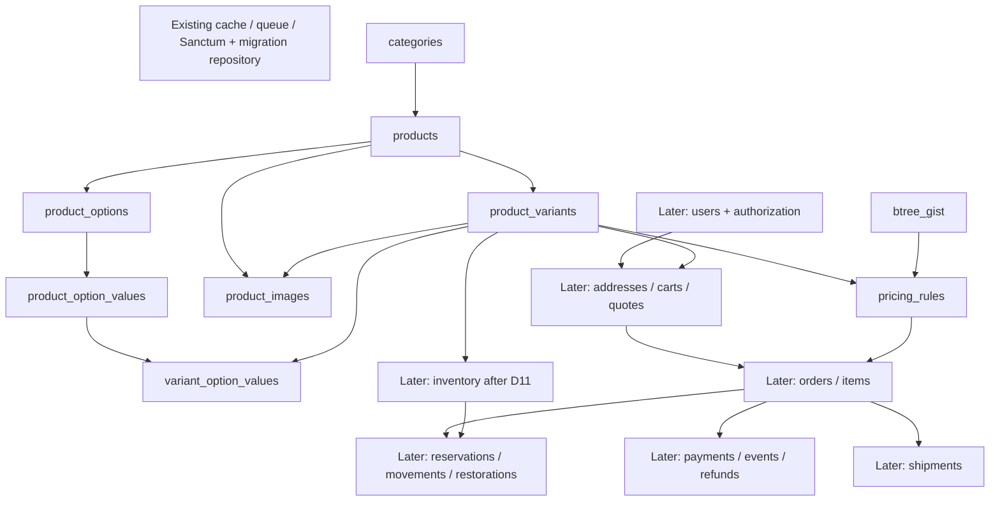

# Milestone 5A migration dependency graph and execution scope

Date: 1 November 2026 (Asia/Dhaka)

Authority: [Database Schema Plan v1.1](DATABASE_SCHEMA_PLAN.md), especially sections 4, 13, 16 and 18, and [Architecture Blueprint v1.1](ARCHITECTURE_BLUEPRINT.md). Neither design document is modified by this implementation.

## Inspection and selected batch

Initial branch: `main`, clean, HEAD `dd76fbeb7fdc096cbab85df9edfef672cbdd5563` (Finalize database schema plan). Laravel 13.37.0 connects with PHP 8.4.23 to PostgreSQL 18.6, `127.0.0.1:5432`, database `fatihaallover_dev`, application role `fatihaallover_app`. Initial database inspection found no application tables, sequences or migration history. `btree_gist` 1.8 is available but initially not installed.

Three existing migrations define six framework tables: cache/cache_locks, jobs/job_batches/failed_jobs and personal_access_tokens. Preserve these files. There is an existing User model, but **no users migration or users table**. No duplicate identity table or speculative user extension is appropriate.

This first batch applies existing framework migrations and creates eight catalog/pricing tables: categories, products, product_variants, product_options, product_option_values, variant_option_values, product_images and pricing_rules. Laravel creates its migration repository. This produces 15 tables through nine migration files (three existing, six new).

The owner's instruction to implement the documented catalog authorizes its existing one-primary-category structure. No category data or wholesale-specific logic is introduced. Tax policy is unnecessary for storing exact base/tier amounts; no quote/tax calculation is implemented. Media metadata does not require Cloudinary credentials or a retention job.

Inventory is deliberately deferred: D11 explicitly gates the single-pool stock schema on food lot/expiry/FEFO and location decisions. Reservations/movements/restorations additionally require order items and, where applicable, users. Do not implement a reduced inventory counter without its planned ledger. Users/addresses/cart/checkout remain gated by identity/address and checkout decisions. No publication or purchasing workflow is enabled: eventual publication still requires valid variants, inventory and audited services.

## Classification and complete dependency inventory

- **A — IMPLEMENTATION READY:** included in this core batch.
- **B — BUSINESS DECISION DEPENDENT:** direct policy gate or an unresolved prerequisite; deferred.
- **C — FRAMEWORK/EXISTING:** preserve installed migration definitions or Laravel-managed repository.
- **D — FUTURE / NOT REQUIRED FOR THIS MILESTONE:** technically definable but outside this batch; dependencies must exist before implementation.

Order numbers below refer to schema-plan section 13, not new arbitrary migration timestamps. All FK targets are `id` unless explicitly stated. Default FK behavior is DELETE RESTRICT / UPDATE NO ACTION; exceptions are stated. Nullable FKs remain real dependencies. Snapshot/audit/polymorphic references are distinguished from physical FKs.

| Plan order | Table | Physical parent/FK dependencies | Class | Gate / disposition |
|---:|---|---|:---:|---|
| 1 | migrations | None; Laravel owns creation | C | Created by migrator, no duplicate migration |
| 2 | cache | None | C | Existing cache migration |
| 2 | cache_locks | None | C | Existing cache migration |
| 3 | jobs | None | C | Existing jobs migration |
| 3 | job_batches | None | C | Existing jobs migration |
| 3 | failed_jobs | None | C | Existing jobs migration |
| 4 | personal_access_tokens | No physical FK; polymorphic tokenable reference | C | Existing Sanctum migration can precede users |
| 5 | users | None | B | D10 email/login identity; no stock users table exists |
| 6 | roles | None | D | Staff authorization batch; never wholesale eligibility |
| 6 | permissions | None | D | Staff capability catalog, no seeded grants now |
| 7 | user_roles | user_id → users; role_id → roles; both DELETE CASCADE | B | Await users / authorization batch |
| 7 | role_permissions | role_id → roles; permission_id → permissions; both DELETE CASCADE | D | After both authorization parents |
| 8 | admin_security | user_id → users | B | Users prerequisite, D19 operational MFA policy |
| 8 | addresses | user_id → users | B | D06 address/coverage, D10 identity, D18 privacy |
| 9 | sessions | user_id → users, DELETE SET NULL | B | Planned infrastructure, not an existing migration; await users |
| 9 | password_reset_tokens | No physical FK; normalized email identifies account | B | D10 email identity and password broker contract |
| 10 | settings | updated_by → users | B | Users dependency, approved value-type/key whitelist |
| 10 | audit_logs | actor_user_id → users; subject references have no universal FK | B | Users prerequisite; D18 retention, no audit erasure |
| 10 | idempotency_keys | user_id → users; resource reference scoped, not physical FK | B | D10 ownership; required before checkout/provider workflows |
| 10 | outbox_events | No physical FK; aggregate reference service-validated | D | Introduce with transactional workflow prerequisites |
| 11 | categories | parent_id → categories (self FK) | A | Hierarchy, editable records; no fixed category enum |
| 12 | products | category_id → categories | A | Preserve documented primary category; D12 merchandising remains deferred |
| 13 | product_variants | product_id → products | A | SKU, base price/revision and composite parent key |
| 14 | product_options | product_id → products | A | Optional product-local options |
| 14 | product_option_values | (product_option_id,product_id) → product_options(id,product_id) | A | Composite parent UQ must exist first |
| 14 | variant_option_values | (product_variant_id,product_id) → product_variants(id,product_id); (product_option_value_id,product_option_id,product_id) → product_option_values(id,product_option_id,product_id) | A | Same-product selections; one value per variant/option |
| 15 | product_images | product_id → products; nullable (product_variant_id,product_id) → product_variants(id,product_id) | A | Cloudinary references only; retention execution deferred |
| 16 | pricing_rules | product_variant_id → product_variants; btree_gist extension | A | Exact minor units; configurable nonoverlapping ranges |
| 17 | inventory | product_variant_id → product_variants | B | D11 lots/expiry/locations before freezing inventory |
| 18 | delivery_zones | None | B | D06 coverage/address normalization |
| 18 | delivery_rates | delivery_zone_id → delivery_zones | B | D06 pricing, D07 COD; no invented fee |
| 19 | carts | user_id → users (nullable) | B | Users prerequisite; proposed guest-cart contract retained |
| 19 | cart_items | cart_id → carts DELETE CASCADE; product_variant_id → product_variants | B | Carts prerequisite; no independent cart table subset |
| 20 | checkout_quotes | user_id → users; cart_id → carts | B | D05–D10 tax/delivery/COD/identity; immutable snapshot contracts |
| 21 | orders | user_id → users; cart_id → carts; checkout_quote_id → checkout_quotes | B | Checkout policy/dependencies; no bypass placeholders |
| 21 | order_items | order_id → orders; product_id → products; (product_variant_id,product_id) → product_variants(id,product_id); pricing_rule_id → pricing_rules DELETE SET NULL | B | Orders and monetary/tax contract |
| 21 | order_status_history | order_id → orders; actor_user_id → users | B | Order/user dependencies, lifecycle policy |
| 22 | inventory_reservations | inventory_id → inventory; order_item_id → order_items | B | D11 plus order items; D08 duration stays configuration |
| 22 | inventory_movements | inventory_id → inventory; order_item_id → order_items; actor_user_id → users | B | Inventory/order/user dependencies; immutable ledger |
| 22 | inventory_restorations | order_item_id → order_items; sale_movement_id and movement_id → inventory_movements; actor_user_id → users | B | D09/D11 returns/inspection; original-sale audit links |
| 23 | payments | order_id → orders | B | Orders, D04 provider reference semantics; gateway-agnostic model retained |
| 23 | payment_events | payment_id → payments (nullable) | B | Payments; provider event identity/verification contract |
| 23 | refunds | payment_id → payments; requested_by → users | B | D09 refund policy, payments/users; no gateway assumption |
| 24 | shipments | order_id → orders; delivery_rate_id → delivery_rates DELETE SET NULL | B | D06/D07/D14 coverage/COD/split parcels |
| 25 | cms_contents | created_by and updated_by → users | B | D15 approved content types; authors prerequisite |
| 25 | notification_deliveries | user_id → users; order_id → orders (both nullable) | D | Later notifications; both parents must exist |
| 26 | reviews | user_id and moderated_by → users; product_id → products; order_item_id → order_items | D | Optional D16 launch/moderation policy; parent dependencies |

All 47 tables appear exactly once. A table classified D may still have later business/workflow prerequisites; it is not implicitly approved now.



## Phasing rationale and implementation details

1. **5A: existing framework + catalog/media + pricing.** Catalog tables have no users/order FKs, so they can precede the conditional identity phase without violating the dependency graph. No application mutation workflow is enabled without its audit/inventory dependencies.
2. **Identity/authorization and shared operational storage**, after D10 and applicable policy decisions. Reuse/extend a users table only if one actually exists at that future inspection.
3. **Inventory counters and delivery configuration**, after D11 and D06/D07. Do not lose the eventual ledger/reservation requirements.
4. **Addresses/cart/quotes**, then **orders/items/history**, once their policy/parent dependencies are settled.
5. **Inventory reservations/movements/restorations**, only after order items. This is why the entire inventory domain cannot precede orders.
6. **Payments/events/refunds and shipments**, after orders and provider/delivery/refund decisions.
7. **CMS/notifications/reviews and remaining operations**, respecting users/orders and optional launch scope.

New domain IDs use PostgreSQL BIGINT GENERATED BY DEFAULT AS IDENTITY through Laravel's generatedAs modifier; timestamps are explicitly non-null TIMESTAMPTZ(6). Declare primary keys explicitly before foreign-key commands so the category self-reference has its parent key when Laravel emits statements. Laravel's timestampsTz convenience method is not used because it creates nullable columns. Existing framework types remain untouched.

Migration-local normalization: SKU is trimmed uppercase; slugs are trimmed lowercase; option names/values are trimmed, case-sensitive display labels with the documented composite uniqueness. No case-insensitive collation or speculative extension is added. Identity/reference strings are nonempty and trimmed. These conventions implement the plan's canonicalization requirement and do not select business category names or prices.

Schema Builder handles columns, keys and normal indexes. Named SQL CHECK constraints, filtered indexes and range exclusion use fixed SQL where required by the PostgreSQL design. `pricing_rules` enables btree_gist if absent and uses an active-only GiST exclusion over SKU equality and the inclusive-to-half-open int8range expression, casting before max + 1. Its down method drops the pricing table but deliberately retains the shared extension: a rollback must not remove an extension already used by another schema or installed before this project. No CASCADE teardown is used.

Only necessary indexes are created. The optional new-arrivals and additional active-category indexes await demonstrated query use. The product category/status/id index has the required undeleted predicate; a separate full category_id index covers the FK for archived rows. No live database-dependent branching or table-exists skip hides migration drift.

This batch does not enforce cross-row publication, category-cycle, complete-tier coverage, decreasing-tier prices, atomic revision edits or audit workflows in triggers. The plan assigns these to later locked application workflows. Database checks still enforce the specified row invariants and overlapping-tier exclusion now. No business seeds or actual stock/order/payment data are installed.

## Verification contract

Use PHP `C:\php\8.4\php.exe` for all commands. Explicitly target the local pgsql development connection. Apply migrations through Laravel and inspect PostgreSQL catalogs afterward, not just command exit status.

The opt-in `tests/Database/CoreSchemaTest.php` suite uses a separate PostgreSQL schema created inside a transaction on the existing database. It runs the actual migration up/down methods against that isolated schema, uses rollback-only verification fixtures, and rolls the entire transaction back. It neither drops public tables nor recreates the database. It is outside the default foundation suite and must be invoked explicitly with `RUN_SCHEMA_TESTS=1`. These checks prove structural integrity/rollback, not unimplemented checkout concurrency or pricing services.

Official implementation references: [Laravel 13 migrations](https://laravel.com/docs/13.x/migrations), [PostgreSQL btree_gist](https://www.postgresql.org/docs/18/btree-gist.html), [PostgreSQL CREATE EXTENSION](https://www.postgresql.org/docs/18/sql-createextension.html). The non-superuser application role can enable the trusted extension when it has database CREATE permission; no administrator password or superuser application account is used.

## Verified result — 1 November 2026

- Applied all nine migration files successfully in Laravel batch 1: three unchanged existing migrations plus six new files. `migrate:status` reports all nine as Ran.
- Public schema contains exactly the expected 15 tables. The eight new domain tables have 77 columns, eight primary keys, ten foreign keys, eleven UNIQUE constraints, 27 CHECK constraints, one GiST exclusion constraint and 34 indexes (including two additional partial unique media indexes). Across all 15 tables there are 48 indexes and 15 primary keys. PostgreSQL's NOT NULL constraints are additional to these CHECK counts.
- All ten new FKs use DELETE RESTRICT / UPDATE NO ACTION. Composite keys and media/tier predicates were inspected in PostgreSQL, not inferred from PHP source.
- `btree_gist` 1.8 is installed. Application role remains LOGIN, non-superuser, without CREATEDB or CREATEROLE.
- New schema checks: **8 tests, 347 assertions passed**. Includes actual deployed-versus-isolated comparison of all column definitions (types, lengths, precision, nullability, defaults, identity), constraints, indexes and migration filenames.
- Rollback verification: the six new migrations were reversed in dependency order and reapplied in an isolated transactional schema. Outer rollback removed that schema and all test fixtures. Public tables and migration history were not rolled back; the database was never dropped/recreated. No verification schemas remain.
- Existing foundation: **9 tests, 32 assertions passed**, including `/up`, `/api/v1/health`, Sanctum CSRF, stateful middleware and CORS checks. Pint passes for the backend.
- All 14 non-history public tables are empty. Only `migrations` has rows (nine). No categories, products, tiers, users, seeds or test fixtures were retained.
- No existing tracked source/configuration/design file changed. Additions are the six migrations, the opt-in schema test and this dependency/execution record. No staging, commit or push.

Re-run verification from `backend/` using PowerShell (no migration/reset command is included):

```powershell
$env:RUN_SCHEMA_TESTS = '1'
& C:\php\8.4\php.exe vendor/bin/phpunit --do-not-cache-result tests/Database/CoreSchemaTest.php
Remove-Item Env:RUN_SCHEMA_TESTS
& C:\php\8.4\php.exe vendor/bin/phpunit --do-not-cache-result
& C:\php\8.4\php.exe vendor/bin/pint --test
& C:\php\8.4\php.exe artisan migrate:status --database=pgsql --no-interaction
```

**MILESTONE 5A — COMPLETE** for the first catalog/pricing batch. Identity, inventory and checkout implementation remain separate, policy-gated milestones; this result does not claim a functioning commerce workflow.
